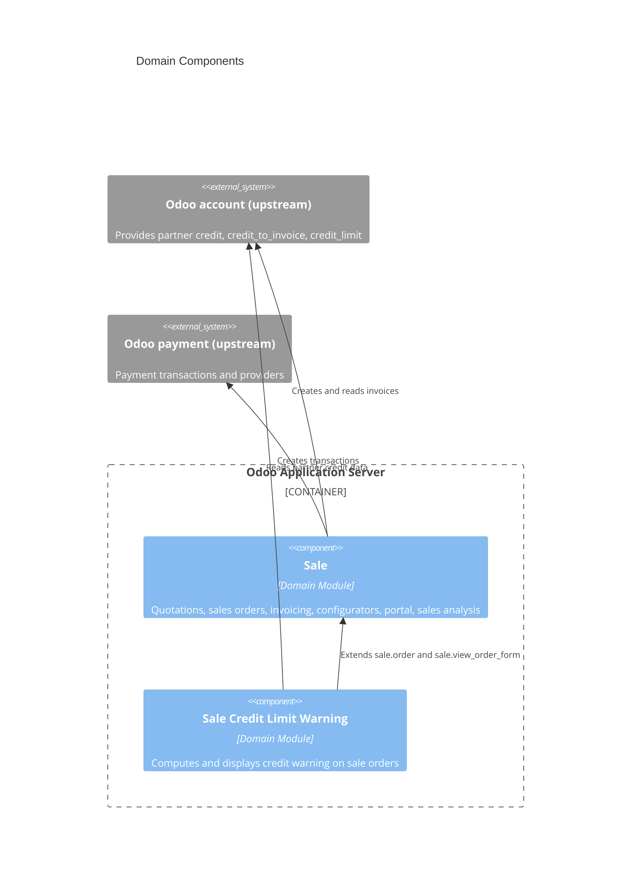

# C4 Component Relationships

<!--
  Auto-generated by the c4-component agent (master-index mode). Holds the
  cross-component Mermaid diagram(s).

  Lives in its own file to keep c4-component.md (the master index) lean. When
  there are >15 components, the diagram is split into:
    1. Domain components (business-bearing components, libraries excluded)
    2. Supporting components (libraries, pure-utility, cross-cutting concerns)

  Do not hand-edit between AUTO-MANAGED markers — edits will be overwritten.
-->

## Generated By

- **Agent**: c4-component (Sonnet, master-index mode)
- **Run ID**: c4-20261101-s4l3
- **Generated**: 2026-11-01T11:22:58Z

## Domain Components Diagram

<!--
  Two components in scope: the upstream Sale addon and the custom Sale Credit
  Limit Warning addon. Other upstream Odoo addons (account, payment) are shown
  as external platform, not components.
-->

## Cross-Component Edges (Excluding Library Imports)

<!--
  Tabular form of the diagram edges between custom/in-scope components. Edges to
  upstream Odoo platform addons are external-system dependencies and are
  documented in the per-component doc.
-->

| From | To | Pattern | Notes |
|------|----|---------|----|
| Sale Credit Limit Warning | Sale | In-process (ORM `_inherit`, view inheritance) | Adds `credit_warning_level` / `credit_warning_message` to `sale.order`; replaces core `partner_credit_warning` banner in `sale.view_order_form`. Sale has no reverse dependency. |

## Cross-Component Lifecycle Conflicts

<!--
  System-wide view of entities where MULTIPLE components write state. Generated
  by the c4-component master-index pass from each per-component doc's
  Entity Lifecycles section.

  Severity vocabulary:
    OK        — one writer (or read-only access pattern only); no conflict
    SHARED    — multiple writers, but at least one claims OWNS — typical and acceptable
    CONFLICT  — two+ components claim OWNS, OR writers exist but no OWNS claim

  CONSUMES-only access is NOT listed here.
-->

| Entity | Owner(s) (OWNS) | Contributors (CONTRIBUTES) | Severity | Notes |
|---|---|---|---|---|

(Empty when no cross-component conflicts detected.)

## Cross-References

- **Master Index**: [`c4-component.md`](./c4-component.md)
- **Per-component detail**: [`components/`](./components/)
- **Container topology**: [`c4-container-relationships.md`](./c4-container-relationships.md)
- **Entity ERD + classification inventory**: [`c4-entities.md`](./c4-entities.md)
