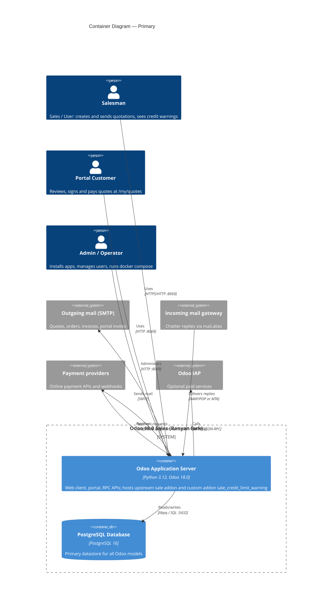

# C4 Container Relationships

<!--
  Auto-generated by the c4-container agent (master mode). Holds the system-wide
  Mermaid C4Container diagram plus the cross-container communication matrix.

  HAND-AUTHORED CONTENT: this file has TWO USER-MANAGED blocks for hand-curated
  external integrations and edges the agents may have missed. Content between
  USER-MANAGED markers is preserved verbatim.
-->

## Generated By

- **Agent**: c4-container (Sonnet, master mode)
- **Run ID**: c4-20261101-s4l3
- **Generated**: 2026-11-01T11:22:58Z

## Primary Container Diagram

## Cross-Container Communication Matrix

| From | To | Protocol | Pattern | Notes |
|------|----|---------|---------|----|
| Odoo Application Server | PostgreSQL Database | TCP / libpq (SQL), port 5432 | Sync; ORM connection pool | Host `db`, user `odoo` per `docker/odoo.conf`. The custom addon declares no tables; access is indirect via the ORM. `sale` models (`sale.order`, `sale.order.line`) persist here. |

## External-System Edges (System Boundary Crossings)

| Container | External System | Direction | Protocol | Critical Path? |
|-----------|----------------|-----------|---------|----------------|
| Odoo Application Server | Outgoing mail (SMTP) | Outbound | SMTP (`ir.mail_server`) | No (not configured locally) |
| Odoo Application Server | Incoming mail gateway | Inbound | IMAP/POP or MTA | No |
| Odoo Application Server | Payment providers | Bidirectional | Provider REST APIs + webhooks | No (portal pay flow only) |
| Odoo Application Server | Odoo IAP | Outbound | HTTPS JSON-RPC | No (optional) |

Sources: all four from `productBrief.md` § Integration Points (payment providers and outgoing mail are also evidenced by the `sale` component doc: payment transactions via the `payment` addon, mail templates via `mail`; the portal's public routes `/my/orders/<id>/transaction` and the payment webhooks are inbound boundaries on the same container, not separate containers). None detected in IaC (no cross-account messaging, webhook routes or federated IdPs in compose). The Chromium browser used by the E2E tour is a test-time dependency inside the application server image, not an external integration. No inferred-only integrations.

<!-- USER-MANAGED-START: additional-external-integrations -->

### Additional External Integrations (User-Managed)

<!--
  Hand-add external integrations the agents missed (message buses, webhooks,
  event sources, file-transfer integrations, etc.). Content between USER-MANAGED
  markers is preserved verbatim.

  | Container | External System | Direction | Protocol | Critical Path? | Notes |
-->

(empty by default)

<!-- USER-MANAGED-END: additional-external-integrations -->

<!-- USER-MANAGED-START: additional-edges -->

### Additional Cross-Container Edges (User-Managed)

<!--
  Hand-add cross-container edges the agents missed. Same schema as the matrix
  above. Preserved verbatim across regenerations.
-->

(empty by default)

<!-- USER-MANAGED-END: additional-edges -->

## Boundary Infrastructure

| Resource Type | Count | IaC Sources | Note |
|---------------|-------|-------------|------|
| Compose config mount (`docker/odoo.conf`) | 1 | `docker-compose.yml`, `docker/odoo.conf` | Read-only config at `/etc/odoo/odoo.conf`; contains dev secrets (master password, db credentials) |
| Compose named volume | 2 | `docker-compose.yml` | `pg-data` (database files), `odoo-filestore` (attachments at `/var/lib/odoo`) |
| Compose published port | 1 | `docker-compose.yml` | `8069:8069` on the Odoo service (plain HTTP, no TLS) |

## Cross-References

- **Master Index**: [`c4-container.md`](./c4-container.md)
- **Per-container detail**: [`containers/`](./containers/)
- **System Context**: [`c4-context.md`](./c4-context.md) (non-technical view)
- **IaC adapter rules**: `${CLAUDE_PLUGIN_ROOT}/context/c4-iac-adapters.md` (recognition rules used to produce the boundary list)
