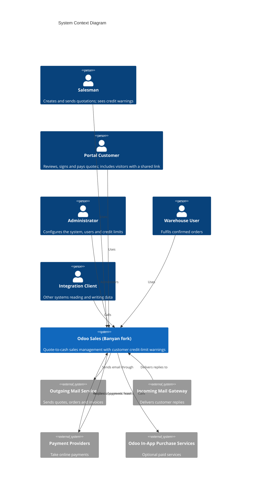

# C4 Context Level: System Context

<!--
  Auto-generated by the c4-context agent. Highest-level view of the system.
  Refreshed on /bmb:c4 reruns when containers or productBrief.md change.

  Per the C4 model, this level focuses on PEOPLE and SOFTWARE SYSTEMS, not
  technology. Tech-stack details belong in c4-container.md.

  HAND-AUTHORED CONTENT PRESERVATION: content between
  <!-- USER-MANAGED-START: <id> --> and <!-- USER-MANAGED-END: <id> --> markers
  is preserved verbatim across regenerations. Content outside the markers is
  compared on each run; removals or material alterations require approval
  (see ${CLAUDE_PLUGIN_ROOT}/context/c4-external-integrations.md).
-->

## Generated By

- **Agent**: c4-context (Sonnet)
- **Run ID**: c4-20261101-s4l3
- **Generated**: 2026-11-01T11:22:58Z
- **Synthesized From**: c4-container.md (lean index), c4-container-relationships.md (cross-container matrix + external-system edges), c4-component.md (lean index), containers/c4-container-*.md, productBrief.md, techContext.md (light), systemPatterns.md
- **Scope note**: this C4 run documents `custom_addons/` plus the upstream Sales addon (`addons/sale`), which is now a documented component (quotation-to-order-to-invoice flows, customer portal, payment hand-off, outgoing mail). The remaining upstream platform functionality is the base the system is built on; features below describe the system as a whole, with the custom addition called out.

## System Overview

### Short Description

A self-hosted business management system whose Sales application takes an organisation from customer quotation through confirmed sales order to invoicing and online payment, extended with a live customer credit-limit warning on quotations.

### Long Description

The system helps a sales organisation manage the full quote-to-cash handoff in one place. Sales staff prepare and send quotations, apply customer-specific pricing and discounts, and confirm orders. Customers receive quotations by email and can review, sign, decline or pay them through a self-service portal. Confirmed orders hand off to invoicing, and Sales Analysis and a sales digest give managers visibility of performance.

The system serves internal sales staff and administrators, and external customers through the portal. A small number of internal roles (for example warehouse staff and general internal users) interact with it in a more limited way. Other business systems can also read and write its data through its programmatic interfaces.

The one capability added by this fork is a **customer credit-limit warning**. While a salesperson builds a quotation, a colour-coded banner shows whether the customer is approaching (yellow, 80% or more) or over (red, above 100%) their credit limit, with concrete figures. It is gated by an administrator-controlled setting and never blocks the user.

Out of scope: the vendor's Enterprise-only modules, production hosting and operations, and any changes to the vendor's core code (customisations live in separate additional modules). Delivery/warehouse hand-off depends on the Inventory application, which is not confirmed as installed. The system currently runs as a local development and evaluation instance.

## Personas

<!--
  Personas are sourced from memory-bank/productBrief.md § Key Personas. UAT persona
  role names (admin, user, portal, salesman, warehouse) are used verbatim.
-->

### Salesman

- **Type**: Human User
- **Description**: Sales team member (Sales / User: Own Documents Only). Sees only their own and unassigned orders.
- **Goals**: Create and send quotations, confirm orders, follow up own customers, trigger invoicing; know before sending whether an order pushes a customer near or over their credit limit.
- **Key Features Used**: Quotation Management, Sales Order Lifecycle, Customer Credit Limit Warning, Pricing and Pricelists, Customer Management, Invoicing Hand-off, Sales Analysis and Digest
- **Source**: productBrief.md § Key Personas

### Portal Customer

- **Type**: Human User
- **Description**: External customer with self-service access to their own quotes, orders and invoices.
- **Goals**: Review, sign and pay quotes; view orders and invoices; decline with a reason.
- **Key Features Used**: Customer Portal, Online Payment, Email Notifications and Chatter
- **Source**: productBrief.md § Key Personas

### Internal User (no Sales rights)

- **Type**: Human User
- **Description**: Staff member with back-office access but no Sales rights.
- **Goals**: General system use; confirms that Sales menus and records are hidden from them.
- **Key Features Used**: Access Control and Administration (as a restricted user)
- **Source**: productBrief.md § Key Personas (persona `user`)

### Warehouse User

- **Type**: Human User
- **Description**: Inventory / User role who validates deliveries from confirmed orders.
- **Goals**: Fulfil confirmed sales orders. Requires the Inventory application, which is not yet confirmed as installed.
- **Key Features Used**: Sales Order Lifecycle (delivery hand-off, when available)
- **Source**: productBrief.md § Key Personas

### Public Visitor

- **Type**: Human User
- **Description**: Anonymous visitor who opens a quotation through a secure shared link.
- **Goals**: View a quotation without needing an account.
- **Key Features Used**: Customer Portal
- **Source**: productBrief.md § Key Personas

### Administrator

- **Type**: Human User
- **Description**: Settings and Sales Administrator. Also covers the Sales Manager role for acceptance testing.
- **Goals**: Install applications, manage users and groups, configure company, currency, payment providers and mail, enable the credit-limit setting, and set customer credit limits.
- **Key Features Used**: Access Control and Administration, Customer Credit Limit Warning, Pricing and Pricelists, Online Payment, Sales Analysis and Digest
- **Source**: productBrief.md § Key Personas

### Developer / Operator

- **Type**: Human User
- **Description**: Runs the local deployment, manages the database and upgrades modules.
- **Goals**: Keep the stack running reliably and extend it without altering vendor code.
- **Key Features Used**: Access Control and Administration (operational)
- **Source**: productBrief.md § Key Personas

### Integration Client

- **Type**: Programmatic User
- **Description**: Other business systems or scripts that read and write system data through its programmatic interfaces, subject to the same access rules as people.
- **Goals**: Automate record access and updates.
- **Key Features Used**: Quotation Management, Customer Management, Sales Order Lifecycle
- **Source**: inferred from container interfaces and productBrief.md § Integration Points ("APIs Provided: consumers = web client, integrations") — verify in productBrief.md Key Personas

<!-- USER-MANAGED-START: additional-personas -->

### Additional Personas (User-Managed)

<!--
  Hand-add personas the agents missed. Content between the USER-MANAGED markers
  is preserved verbatim across regenerations. Use the same structure as the
  agent-generated personas above (Type / Description / Goals / Key Features Used /
  Source).
-->

(empty by default — add hand-curated personas here, then they're permanently preserved)

<!-- USER-MANAGED-END: additional-personas -->

## System Features

### Quotation Management

- **Description**: Create, edit and send quotations to customers, with templates, validity dates, optional products and line discounts.
- **Users**: Salesman, Integration Client
- **Implementing Containers**: Odoo Application Server — see [c4-container.md](./c4-container.md)
- **User Journey**: no journey doc — gap

### Sales Order Lifecycle

- **Description**: Confirm, cancel or reset orders back to quotation; lock confirmed orders; hand off to delivery when Inventory is installed.
- **Users**: Salesman, Warehouse User, Integration Client
- **Implementing Containers**: Odoo Application Server
- **User Journey**: no journey doc — gap (the credit banner journey touches confirm/cancel only)

### Customer Credit Limit Warning (custom addition)

- **Description**: A live, colour-coded banner on a quotation: yellow when the customer is approaching their limit (80% or more), red when over it (above 100%). It shows the customer's outstanding balance, this order and the total after this order. It appears only on unconfirmed quotations, only when an administrator has enabled the setting, and never blocks saving or sending.
- **Users**: Salesman, Administrator
- **Implementing Containers**: Odoo Application Server (custom addition `Sale Credit Limit Warning`) — see [c4-component.md](./c4-component.md)
- **User Journey**: [`creative/sale-credit-limit-warning-credit-banner-user-journey.md`](../creative/sale-credit-limit-warning-credit-banner-user-journey.md)

### Pricing and Pricelists

- **Description**: Customer-specific price lists, multiple currencies, product variants with price extras and discounts applied on quotations.
- **Users**: Administrator (setup), Salesman (applies)
- **Implementing Containers**: Odoo Application Server
- **User Journey**: no journey doc — gap

### Customer Management

- **Description**: Maintain customer companies and contacts, including their credit limit and portal access.
- **Users**: Salesman, Administrator, Integration Client
- **Implementing Containers**: Odoo Application Server; PostgreSQL Database (data storage)
- **User Journey**: no journey doc — gap

### Invoicing Hand-off

- **Description**: Create invoices and down-payment invoices from confirmed sales orders, then post and register payment.
- **Users**: Salesman, Administrator
- **Implementing Containers**: Odoo Application Server
- **User Journey**: no journey doc — gap

### Customer Portal

- **Description**: Customers and visitors with a secure link review quotes and orders, accept and sign, decline with a reason, and download documents.
- **Users**: Portal Customer, Public Visitor
- **Implementing Containers**: Odoo Application Server
- **User Journey**: no journey doc — gap

### Online Payment

- **Description**: Customers pay quotes or orders online through third-party payment providers; confirmations flow back automatically.
- **Users**: Portal Customer, Administrator (provider setup)
- **Implementing Containers**: Odoo Application Server
- **User Journey**: no journey doc — gap

### Email Notifications and Chatter

- **Description**: Quotes, orders, invoices, portal invitations and digests are emailed out; customer replies are attached to the related record's discussion thread.
- **Users**: Salesman, Portal Customer, Administrator
- **Implementing Containers**: Odoo Application Server
- **User Journey**: no journey doc — gap

### Sales Analysis and Digest

- **Description**: Sales reporting and a periodic digest of total sales; salespeople see only their own data.
- **Users**: Salesman, Administrator
- **Implementing Containers**: Odoo Application Server; PostgreSQL Database
- **User Journey**: no journey doc — gap

### Sales Teams and Campaign Tracking

- **Description**: Group salespeople into sales teams with targets, and record which campaign, medium and source each order came from.
- **Users**: Administrator, Salesman
- **Implementing Containers**: Odoo Application Server (Sales component) — see [c4-component.md](./c4-component.md)
- **User Journey**: no journey doc — gap

### Access Control and Administration

- **Description**: Install applications, manage users and role-based permissions, configure company and currency, and run the deployment.
- **Users**: Administrator, Developer / Operator, Internal User
- **Implementing Containers**: Odoo Application Server; PostgreSQL Database
- **User Journey**: no journey doc — gap

## User Journeys

<!-- Existing journey docs only. No journeys are invented here. -->

### Customer Credit Limit Warning — Administrator and Salesman Journey

- **Source**: [`creative/sale-credit-limit-warning-credit-banner-user-journey.md`](../creative/sale-credit-limit-warning-credit-banner-user-journey.md) (no `e2e-journeys/` directory exists)
- **Summary**: An administrator enables the credit-limit setting and sets a customer limit. A user building a quotation then sees no banner, a yellow banner or a red banner depending on the order total, updating live. The journey also covers mobile layout, a salesman without accounting rights, confirmed orders (no banner), a missing customer, and a customer with no limit.

**Gap features (no journey doc)**: Quotation Management, Sales Order Lifecycle, Pricing and Pricelists, Customer Management, Invoicing Hand-off, Customer Portal, Online Payment, Email Notifications and Chatter, Sales Analysis and Digest, Sales Teams and Campaign Tracking, Access Control and Administration (11 gaps). Recommended next step: `/bmb:creative` or hand-author a journey, starting with the portal sign-and-pay flow.

## External Systems and Dependencies

### Outgoing Mail Service

- **Type**: Service
- **Description**: Delivers quotes, orders, invoices, portal invitations and digests to recipients.
- **Integration Type**: Outbound email
- **Critical Path?**: No — degraded mode possible (not configured locally; send flows are untestable without it)
- **Owned By**: Mail provider chosen by the organisation (not yet decided)
- **Source**: productBrief.md § Integration Points; c4-container-relationships.md

### Incoming Mail Gateway

- **Type**: Service
- **Description**: Delivers customer email replies so they attach to the related record's discussion thread.
- **Integration Type**: Inbound email
- **Critical Path?**: No — degraded mode possible
- **Owned By**: Mail provider chosen by the organisation (not yet decided)
- **Source**: productBrief.md § Integration Points; c4-container-relationships.md

### Payment Providers

- **Type**: API
- **Description**: Third-party providers that take online payments for quotes and orders and notify the system of the outcome.
- **Integration Type**: REST API (outbound requests) and Webhook (inbound notifications), bidirectional
- **Critical Path?**: No — degraded mode possible (affects the portal payment flow only)
- **Owned By**: Each provider (which providers are in scope is undecided)
- **Source**: productBrief.md § Integration Points; c4-container-relationships.md

### Odoo In-App Purchase Services

- **Type**: API
- **Description**: Optional paid services from the platform vendor (for example text messaging and contact autocomplete), only if enabled.
- **Integration Type**: REST API (outbound)
- **Critical Path?**: No — optional
- **Owned By**: Odoo S.A.
- **Source**: productBrief.md § Integration Points; c4-container-relationships.md

**Not shown as external**: the primary datastore is part of the system (a container, see c4-container.md), even though productBrief.md lists it under Integration Points. The browser used by the end-to-end test is a test-time tool, not an integration. No inferred-only external systems were found.

<!-- USER-MANAGED-START: additional-external-integrations -->

### Additional External Integrations (User-Managed)

<!--
  Hand-add external systems / integrations the agents missed. Content between
  USER-MANAGED markers is preserved verbatim across regenerations. Use the
  same structure as the agent-generated entries above (Type / Description /
  Integration Type / Critical Path? / Owned By).

  Tip: instead of hand-adding here, consider adding to memory-bank/productBrief.md
  § Integration Points — that section is canonical and the agents will
  auto-include those entries on every run.
-->

(empty by default)

<!-- USER-MANAGED-END: additional-external-integrations -->

## System Context Diagram

Internal User and Public Visitor personas are omitted from the diagram for readability. They use the system in the same way as the Salesman and Portal Customer respectively, with fewer rights.

## System Boundaries

- **Inside the system**: the application server (web client, customer portal, programmatic interfaces, the standard Sales functionality and the custom credit-limit warning addition) and its primary datastore, including the file storage for attachments. Owned and operated by the team.
- **Outside the system**: outgoing and incoming mail services, payment providers, the platform vendor's paid services, and the people and systems that use it.
- **Boundary points**: the web address that staff and portal customers use; the programmatic interface used by Integration Clients; the payment-notification receiver that payment providers call back; the mail-reply intake used by the incoming mail gateway; the outbound mail connection.

## Cross-References

- **Containers (index)**: [`c4-container.md`](./c4-container.md) — one-line-per-container; tech-stack matrix
- **Container relationships**: [`c4-container-relationships.md`](./c4-container-relationships.md) — system-wide diagram + cross-container communication matrix + external-system edges
- **Per-container detail**: [`containers/`](./containers/) — full deployment + interface details per container
- **Components (index)**: [`c4-component.md`](./c4-component.md) — components grouped by container
- **Component relationships**: [`c4-component-relationships.md`](./c4-component-relationships.md) — cross-component dependency graph
- **Personas (canonical)**: `memory-bank/productBrief.md` § Key Personas
- **NFRs**: `memory-bank/productBrief.md` § Non-Functional Requirements
