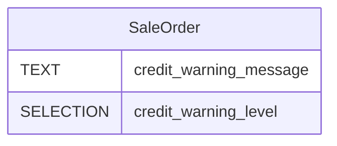

# C4 — Domain Entities

<!--
  Auto-generated by the c4-entity-aggregator agent. Single source of truth for
  the system-wide domain entity model and ERD.

  This file is fully regenerated each /bmb:c4 run when any constituent
  c4-code Entities section changes OR the container inventory changes.
  Do NOT hand-edit — all hand-edits live in:
    1. Per-attribute classifications: USER-MANAGED block in each c4-code-*.md
    2. Per-entity descriptions: docstrings in source code

  This file aggregates content; it does not own any USER-MANAGED markers.
-->

## Generated By

- **Agent**: c4-entity-aggregator (Haiku)
- **Run ID**: c4-20261031-k7m2
- **Generated**: 2026-10-31T12:00:00Z
- **Input docs**: 5 c4-code-*.md docs scanned, 1 containing entities

## Summary

| Metric | Value |
|--------|------:|
| Total entities | 1 |
| Persisted (table/collection/view/document) | 1 |
| In-memory / DTO (no persistence) | 0 |
| Aggregate roots | 0 |
| Containers with entities | 0 |
| Cross-container references | 0 |
| Attributes classified `pii:*` | 0 |
| Attributes classified `sensitive:*` | 0 |
| USER-MANAGED overrides applied | 0 |

## Compliance Scope (System-Wide)

Compliance scopes derived from the union of entity classifications. See
§Data Classification Inventory for the per-attribute drivers.

- **Detected scopes**: none
- **Driver entities**:
  - GDPR / CCPA: none
  - HIPAA: none
  - PCI-DSS: none
  - GLBA: none
  - SOC2: none

## Entities by Container

No entity resolved to a canonical container this run. The only entity (`SaleOrder`) has a blank `container_hint` in its c4-code doc and is listed under Orphans below.

### Orphans (no persistence container)

Entities with no resolved container — typically DTOs, in-memory models, or API request/response objects.

| Entity | Kind | Source |
|--------|------|--------|
| `SaleOrder` | table `sale_order` (persisted; no container_hint emitted) | [`c4-code-custom_addons-sale_credit_limit_warning-models.md`](code/c4-code-custom_addons-sale_credit_limit_warning-models.md) |

## System-Wide ERD

<!--
  SaleOrder declares no stored columns of its own (inherited via _inherit from
  sale.order). Both attributes below are non-stored computed fields with no
  database column; they are rendered because they are the only entity
  attributes the c4-code agent emitted.
-->

## Per-Container ERDs

Omitted: 1 persisted entity (≤12 threshold); the system-wide ERD covers it.

## Cross-Container References

| Source Entity (Container) | FK Attribute | Target Entity (Container) | Note |
|---|---|---|---|

None detected this run. No entity declares an FK, and `SaleOrder` declares no relationships.

## Data Classification Inventory

No classified attributes this run. No c4-code Entities section emitted any `pii:*` or `sensitive:*` classification, and no USER-MANAGED override supplied one.

## USER-MANAGED Overrides Applied

None applied this run. The `data-classification-overrides` blocks in the c4-code docs are either empty `(none)` (models and tests docs) or absent (root, views, and tours docs).

| Entity.Attribute | Heuristic | Override | c4-code Doc |
|---|---|---|---|

## Coverage Notes

- Entity `SaleOrder` (`c4-code-custom_addons-sale_credit_limit_warning-models.md`) is persisted (table `sale_order`) but its `container_hint` is blank, so it could not be resolved to a canonical container and is listed as an orphan. The orchestrator's inventory maps Odoo ORM persistence to `postgresql-database` (`docker-compose.services.db`), but the c4-code agent emitted no hint and the aggregator does not infer one. Orchestrator or c4-code action may be needed to place it.
- `SaleOrder.credit_warning_message` and `SaleOrder.credit_warning_level` are non-stored computed fields with no database column. They are rendered in the ERD as emitted by the c4-code agent.
- Four c4-code docs have no Entities content (sale_credit_limit_warning root, views, tests, static/tests/tours). They were scanned and contribute no entities.
- Upstream `sale.order` columns are out of scope: this addon's c4-code doc emitted only the two computed fields, so no upstream attributes are aggregated.
- No overrides were applied, so there are no overrides referencing unknown entities or attributes.
- Input hash is computed over the canonical serialization of the Entities content, the container inventory, and the override block bodies.
