# C4 — Domain Entities

<!--
  Auto-generated by the c4-entity-aggregator agent. Single source of truth for
  the system-wide domain entity model and ERD.

  This file is fully regenerated each /bmb:c4 run when any constituent
  c4-code Entities section changes OR the container inventory changes.
  Do NOT hand-edit — all hand-edits live in:
    1. Per-attribute classifications: USER-MANAGED block in each c4-code-*.md
    2. Per-entity descriptions: docstrings in source code

  This file aggregates content; it does not own any USER-MANAGED markers.
-->

## Generated By

- **Agent**: c4-entity-aggregator (Haiku)
- **Run ID**: c4-20261101-s4l3
- **Generated**: 2026-11-01T11:22:58Z
- **Input docs**: 33 c4-code-*.md docs scanned, 3 containing entities (21 carry an Entities section; 4 entities declared)

## Summary

| Metric | Value |
|--------|------:|
| Total entities | 4 |
| Persisted (table/collection/view/document) | 4 |
| In-memory / DTO (no persistence) | 0 |
| Aggregate roots | 1 |
| Containers with entities | 1 |
| Cross-container references | 0 |
| Attributes classified `pii:*` | 2 |
| Attributes classified `sensitive:*` | 0 |
| USER-MANAGED overrides applied | 0 |

## Compliance Scope (System-Wide)

Compliance scopes derived from the union of entity classifications. See
§Data Classification Inventory for the per-attribute drivers.

- **Detected scopes**: GDPR, CCPA
- **Driver entities**:
  - GDPR / CCPA: `sale.report`
  - HIPAA: none
  - PCI-DSS: none
  - GLBA: none
  - SOC2: none (no `sensitive:*` attributes detected)

## Entities by Container

### Container: `docker-compose.services.db`

Canonical container: `postgresql-database` (Stateful, IaC source `docker-compose.yml:2`).

| Entity | Persistence | Attributes | Relationships | Aggregate Root | Compliance Scope | Source |
|--------|-------------|-----------:|--------------:|:--------------:|------------------|--------|
| `sale.order` | table `sale_order` | 26 | 6 | yes | none | [c4-code-addons-sale-models.md](code/c4-code-addons-sale-models.md) |
| `sale.order.line` | table `sale_order_line` | 20 | 4 | no | none | [c4-code-addons-sale-models.md](code/c4-code-addons-sale-models.md) |
| `sale.report` | view `sale_report` | 39 | 17 | no | GDPR, CCPA | [c4-code-addons-sale-report.md](code/c4-code-addons-sale-report.md) |
| `SaleOrder` (sale_credit_limit_warning extension) | table `sale_order` (inherited; no stored columns) | 2 | 0 | no | none | [c4-code-custom_addons-sale_credit_limit_warning-models.md](code/c4-code-custom_addons-sale_credit_limit_warning-models.md) |

### Orphans (no persistence container)

None. All persisted entities resolved to `docker-compose.services.db` (see Coverage Notes for how two of the container hints were resolved).

## System-Wide ERD

```mermaid
erDiagram
    %% truncated: 11 more attributes — see c4-code-addons-sale-models.md
    "sale.order" {
        Char name
        Many2one company_id FK
        Many2one partner_id FK
        Selection state
        Boolean locked
        Datetime date_order
        Datetime commitment_date
        Date validity_date
        Float prepayment_percent
        Boolean require_signature
        Boolean require_payment
        Image signature
        Char signed_by
        Datetime signed_on
        Many2one partner_invoice_id FK
    }
    %% truncated: 5 more attributes — see c4-code-addons-sale-models.md
    "sale.order.line" {
        Many2one order_id FK
        Integer sequence
        Many2one company_id FK
        Many2one currency_id FK
        Many2one order_partner_id FK
        Many2one salesman_id FK
        Selection state
        Selection display_type
        Many2one product_id FK
        Float product_uom_qty
        Many2one product_uom FK
        Many2many tax_id FK
        Float price_unit
        Float discount
        Monetary price_subtotal
    }
    %% truncated: 24 more attributes (incl. partner_zip and state_id, classified pii:address; see Data Classification Inventory) — see c4-code-addons-sale-report.md
    "sale.report" {
        Char name
        Datetime date
        Many2one partner_id FK
        Many2one company_id FK
        Many2one pricelist_id FK
        Many2one team_id FK
        Many2one user_id FK
        Selection state
        Selection invoice_status
        Many2one campaign_id FK
        Many2one medium_id FK
        Many2one source_id FK
        Many2one commercial_partner_id FK
        Many2one country_id FK
        Many2one industry_id FK
    }
    "SaleOrder" {
        Text credit_warning_message
        Selection credit_warning_level
    }
    "sale.order" ||--o{ "sale.order.line" : "order_line"
    "sale.order.line" }o--|| "res.currency" : "currency_id"
    "sale.order.line" }o--|| "res.company" : "company_id"
    "sale.order.line" }o--|| "res.partner" : "order_partner_id"
    "sale.order.line" }o--|| "res.users" : "salesman_id"
    "sale.order.line" }o--|| "product.product" : "product_id"
    "sale.order.line" }o--|| "uom.uom" : "product_uom"
    "sale.order.line" }o--o{ "account.tax" : "tax_id"
    "sale.order" }o--|| "res.company" : "company_id"
    "sale.order" }o--|| "res.partner" : "partner_id"
    "sale.order" }o--|| "res.partner" : "partner_invoice_id"
    "sale.order" }o--|| "res.partner" : "partner_shipping_id"
    "sale.order" }o--|| "product.pricelist" : "pricelist_id"
    "sale.order" }o--|| "res.currency" : "currency_id"
    "sale.order" }o--|| "res.users" : "user_id"
    "sale.order" }o--|| "crm.team" : "team_id"
    "sale.report" }o--|| "res.partner" : "partner_id"
    "sale.report" }o--|| "res.company" : "company_id"
    "sale.report" }o--|| "product.pricelist" : "pricelist_id"
    "sale.report" }o--|| "crm.team" : "team_id"
    "sale.report" }o--|| "res.users" : "user_id"
    "sale.report" }o--|| "utm.campaign" : "campaign_id"
    "sale.report" }o--|| "utm.medium" : "medium_id"
    "sale.report" }o--|| "utm.source" : "source_id"
    "sale.report" }o--|| "res.partner" : "commercial_partner_id"
    "sale.report" }o--|| "res.country" : "country_id"
    "sale.report" }o--|| "res.partner.industry" : "industry_id"
    "sale.report" }o--|| "res.country.state" : "state_id"
    "sale.report" }o--|| "product.category" : "categ_id"
    "sale.report" }o--|| "product.product" : "product_id"
    "sale.report" }o--|| "product.template" : "product_tmpl_id"
    "sale.report" }o--|| "uom.uom" : "product_uom"
```

Note: target nodes with no attributes (for example `"res.partner"`, `"product.product"`) are FK targets that are not declared as entities in any c4-code Entities section. They are drawn as dangling edges per the aggregator rules.

## Per-Container ERDs

Omitted: 4 persisted entities (at or below the 12-entity threshold). The system-wide ERD above covers all of them.

## Cross-Container References

No cross-container references. Every FK whose target is a c4-code entity (`sale.order.line.order_id` → `sale.order`) shares the same container. FK targets outside the entity set are listed in Coverage Notes.

## Data Classification Inventory

| Entity | Attribute | Classifications | Compliance Drivers | Source |
|---|---|---|---|---|
| `sale.report` | `partner_zip` | `pii:address` | GDPR, CCPA | [c4-code-addons-sale-report.md](code/c4-code-addons-sale-report.md) |
| `sale.report` | `state_id` | `pii:address` | GDPR, CCPA | [c4-code-addons-sale-report.md](code/c4-code-addons-sale-report.md) |

## USER-MANAGED Overrides Applied

No overrides applied. The 7 `data-classification-overrides` blocks scanned across the c4-code docs each contain `(none)`; no override lines were present.

| Entity.Attribute | Heuristic | Override | c4-code Doc |
|---|---|---|---|
| (none) | | | |

## Coverage Notes

- **Warning (container hint alias)**: `sale.order` and `sale.order.line` emitted the container hint `odoo-primary-database`, which is not an exact resource_id. Resolved by the `database` alias to `docker-compose.services.db` (`postgresql-database`).
- **Warning (blank container hint, orchestrator rule)**: `sale.report` (hint emitted as "(filled by aggregator)") and the custom `SaleOrder` (hint emitted as "(none — resolved by aggregator)") had no c4-code-emitted container. Both were assigned to `docker-compose.services.db` under the orchestrator's instruction that Odoo ORM models persist to PostgreSQL via the Odoo server. This is an orchestrator-supplied mapping, not a c4-code hint. Confirm if a different placement is wanted.
- **Warning (shared table)**: custom `SaleOrder` (`_inherit = 'sale.order'`) declares no stored columns and shares table `sale_order` with core `sale.order`. It is kept as a separate entity per its c4-code record and counted as persisted under its declared table persistence. Its two attributes are non-stored computed fields.
- **Warning (unresolved FK targets)**: 17 distinct FK targets are not declared as entities in any c4-code Entities section: `res.company`, `res.partner`, `res.currency`, `res.users`, `res.country`, `res.country.state`, `res.partner.industry`, `product.pricelist`, `product.product`, `product.category`, `product.template`, `uom.uom`, `account.tax`, `crm.team`, `utm.campaign`, `utm.medium`, `utm.source`. They appear in the ERD as dangling edges, and no cross-container reference is recorded for them.
- **Truncated ERD attributes**: `sale.order` (11 not rendered), `sale.order.line` (5 not rendered), `sale.report` (24 not rendered, including `partner_zip` and `state_id`, which are in the Data Classification Inventory). Full lists are in the source c4-code docs.
- **Not drawn in ERD**: many-to-many and non-attribute relationships in the c4-code Relationships sections (`sale.order` to `account.move`, `payment.transaction`, `crm.tag`; `sale.order.line` to `account.move.line`, `account.analytic.line`). They are recorded in the source docs only.
- **Candidate override, not applied**: `sale.order.signed_by` (Char) holds a signer name. The c4-code doc notes a `pii:name` override may be appropriate. No override was applied. A human may add one to the USER-MANAGED block in `c4-code-addons-sale-models.md`.
- **Per-container ERDs omitted**: 4 persisted entities, at or below the 12-entity threshold.
