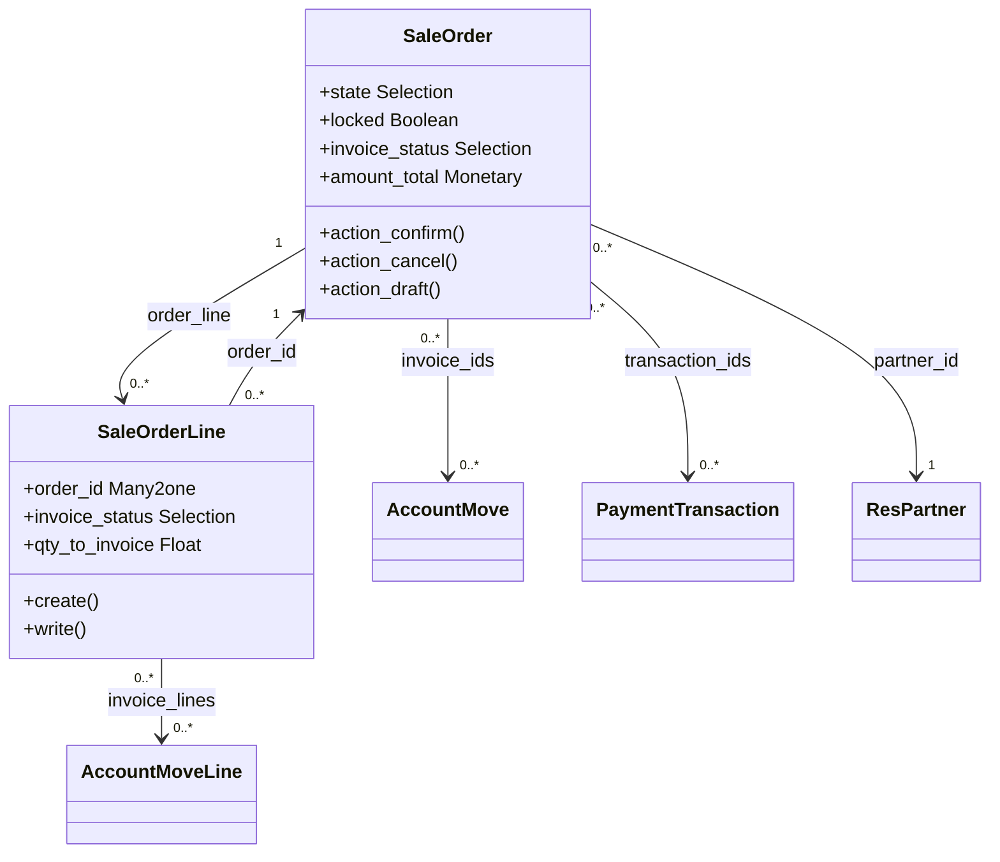

# C4 Code Level: addons/sale/models

<!--
  Auto-generated by the c4-code agent. One file per source directory.
  Refreshed on /bmb:c4 reruns whenever the directory's content hash changes.
  Do NOT hand-edit; edits will be overwritten on next refresh.

  Linking conventions (MAINTAIN ON EVERY REWRITE):
  - This doc lives at memory-bank/c4/code/c4-code-<sanitized>.md (3 dirs below
    repo root). Use `../../../` to reach repo root for source-file links.
  - File:line references MUST be rendered as clickable markdown links of the
    form: [`<file>:<line>`](../../../<dir>/<file>#L<line>).
  - Directory paths under Overview → Location MUST be rendered as a markdown
    link to the directory itself: [`path/to/dir/`](../../../path/to/dir).
  - Internal-dependency directory names SHOULD be linked to their c4-code
    sibling doc when one exists in `memory-bank/c4/code/`, otherwise to the
    directory in the source tree.
  - The "Parent Component" up-link section near the bottom is filled by the
    c4-backlink agent; the AUTO-MANAGED markers below MUST be preserved
    verbatim so the back-link pass can find and populate them.
-->

## Generated By

- **Agent**: c4-code (Haiku)
- **Run ID**: c4-20261101-s4l3
- **Generated**: 2026-11-01T11:22:58Z
- **Source Directory**: [`addons/sale/models`](../../../addons/sale/models)
- **Content Hash**: git-tree 99548521fdbd136b
- **Plugin**: bmb 2.2.1

## Overview

- **Name**: Odoo Sale - core ORM models (sale.order, sale.order.line, and inherited models)
- **Description**: Defines the sales order and sales order line models with their fields, computed amounts, invoice-status logic, state transitions and action methods, and extends related Odoo core models (account, payment, CRM, product, partner, company, UTM) with sale-specific fields and behavior.
- **Location**: [`addons/sale/models`](../../../addons/sale/models) — 19 files, 5639 lines (flat directory, `__init__.py` imports all 19 modules except itself)
- **Language**: Python (Odoo 18.0 ORM; `version_info = (18, 0, 0, FINAL, 0, '')` at [`odoo/odoo/release.py:15`](../../../odoo/odoo/release.py#L15))
- **Purpose**: Core sales domain of the Odoo Sale application. Two models are new persistable entities (`sale.order`, `sale.order.line`); the remaining 19 classes are `_inherit` extensions of models owned by other addons (account, payment, crm, product, base, utm, mail). Presentation (views, wizards, controllers, reports) lives outside this directory.

## Code Elements

### Functions / Methods

Scope note: this directory defines roughly 380 methods. The list below covers the public `action_*` surface, the state-transition and invoicing logic, and the main compute, constraint and override methods for `sale.order` and `sale.order.line`, plus the notable methods of the inherited models. Remaining `_compute_*` / `_get_*` / `_prepare_*` helpers are private and are not enumerated; they are reachable from the line numbers in the same files.

**SaleOrder** ([`sale_order.py`](../../../addons/sale/models/sale_order.py))

- `init(self)` — creates composite index `sale_order_date_order_id_idx` on (`date_order desc`, `id desc`)
  - **Location**: [`sale_order.py:322`](../../../addons/sale/models/sale_order.py#L322) (index created at L323)
  - **Visibility**: public (ORM hook)
- `_compute_amounts(self)` — recomputes `amount_untaxed`, `amount_tax`, `amount_total` from the tax-totals summary of priced lines
  - **Location**: [`sale_order.py:498`](../../../addons/sale/models/sale_order.py#L498)
  - **Visibility**: internal (compute)
  - **Dependencies**: `account.tax` tax-detail helpers; `_add_base_lines_for_early_payment_discount`
- `_add_base_lines_for_early_payment_discount(self)` — adds early-payment-discount base lines when the payment term uses `mixed` computation
  - **Location**: [`sale_order.py:515`](../../../addons/sale/models/sale_order.py#L515)
  - **Visibility**: internal
- `_compute_invoice_status(self)` — derives `invoice_status` (`no`, `to invoice`, `invoiced`, `upselling`) from line-level statuses; only `sale` orders can be non-`no`
  - **Location**: [`sale_order.py:602`](../../../addons/sale/models/sale_order.py#L602) (decorator L601)
  - **Visibility**: internal (compute)
- `_compute_partner_credit_warning(self)` — builds `partner_credit_warning` text for `draft`/`sent` orders when the company uses credit limits
  - **Location**: [`sale_order.py:771`](../../../addons/sale/models/sale_order.py#L771)
  - **Visibility**: internal (compute, non-stored)
  - **Dependencies**: `account.move._build_credit_warning_message`
- `_compute_tax_totals(self)` — builds `tax_totals` binary for the form widget
  - **Location**: [`sale_order.py:785`](../../../addons/sale/models/sale_order.py#L785)
- `_compute_type_name(self)` — "Quotation" vs "Sales Order" label by state
  - **Location**: [`sale_order.py:801`](../../../addons/sale/models/sale_order.py#L801)
- `_check_order_line_company_id(self)` — constraint that order lines belong to the order's company
  - **Location**: [`sale_order.py:817`](../../../addons/sale/models/sale_order.py#L817)
- `_check_prepayment_percent(self)` — constraint on `prepayment_percent`
  - **Location**: [`sale_order.py:834`](../../../addons/sale/models/sale_order.py#L834)
- `_onchange_order_line(self)` — recomputes derived onchange state for lines
  - **Location**: [`sale_order.py:931`](../../../addons/sale/models/sale_order.py#L931)
- `create(self, vals_list)` — ORM create override
  - **Location**: [`sale_order.py:980`](../../../addons/sale/models/sale_order.py#L980)
  - **Visibility**: public (override)
- `_unlink_except_draft_or_cancel(self)` — blocks deletion unless state is `draft` or `cancel`
  - **Location**: [`sale_order.py:1009`](../../../addons/sale/models/sale_order.py#L1009)
  - **Visibility**: internal (ondelete guard)
- `write(self, vals)` — blocks `pricelist_id` changes on `sale` orders (L1017-1018); subscribes new partner to `sent`/`sale` orders (L1020-1023)
  - **Location**: [`sale_order.py:1016`](../../../addons/sale/models/sale_order.py#L1016)
  - **Visibility**: public (override)
- `action_open_discount_wizard(self)` — opens the `sale.order.discount` wizard
  - **Location**: [`sale_order.py:1028`](../../../addons/sale/models/sale_order.py#L1028)
  - **Visibility**: public
- `action_draft(self)` — reset `cancel`/`sent` orders to `draft` and clear signature fields
  - **Location**: [`sale_order.py:1038`](../../../addons/sale/models/sale_order.py#L1038)
  - **Visibility**: public (state transition T4)
- `action_quotation_send(self)` — opens the mail composer for quotation/confirmation email
  - **Location**: [`sale_order.py:1047`](../../../addons/sale/models/sale_order.py#L1047)
  - **Visibility**: public
- `_find_mail_template(self)` — picks confirmation vs quotation template from state
  - **Location**: [`sale_order.py:1101`](../../../addons/sale/models/sale_order.py#L1101)
- `_get_confirmation_template(self)` — reads `sale.default_confirmation_template` config parameter, falls back to `sale.mail_template_sale_confirmation`
  - **Location**: [`sale_order.py:1116`](../../../addons/sale/models/sale_order.py#L1116)
- `action_quotation_sent(self)` — marks `draft` quotations as `sent` (guard L1137-1138)
  - **Location**: [`sale_order.py:1132`](../../../addons/sale/models/sale_order.py#L1132)
  - **Visibility**: public (state transition T1)
- `action_confirm(self)` — confirms `draft`/`sent` orders: error guard, write `state='sale'`, `_action_confirm` hook, optional lock, optional email
  - **Location**: [`sale_order.py:1145`](../../../addons/sale/models/sale_order.py#L1145)
  - **Visibility**: public (state transition T2)
- `_should_be_locked(self)` — true when the order creator has `sale.group_auto_done_setting`
  - **Location**: [`sale_order.py:1183`](../../../addons/sale/models/sale_order.py#L1183)
- `_confirmation_error_message(self)` — returns error text when state is not `draft`/`sent` or a non-downpayment, non-section line lacks a product
  - **Location**: [`sale_order.py:1189`](../../../addons/sale/models/sale_order.py#L1189)
- `_prepare_confirmation_values(self)` — returns `{'state': 'sale', 'date_order': now}`
  - **Location**: [`sale_order.py:1204`](../../../addons/sale/models/sale_order.py#L1204)
- `_action_confirm(self)` — extension hook, no-op in this module
  - **Location**: [`sale_order.py:1217`](../../../addons/sale/models/sale_order.py#L1217)
  - **Visibility**: internal (hook)
- `_send_order_confirmation_mail(self)` / `_send_order_notification_mail(self, mail_template)` — send confirmation mail via `message_post_with_source`
  - **Location**: [`sale_order.py:1224`](../../../addons/sale/models/sale_order.py#L1224), [`sale_order.py:1244`](../../../addons/sale/models/sale_order.py#L1244)
- `action_lock(self)` / `action_unlock(self)` — set `locked` boolean (not `state`)
  - **Location**: [`sale_order.py:1267`](../../../addons/sale/models/sale_order.py#L1267), [`sale_order.py:1270`](../../../addons/sale/models/sale_order.py#L1270)
  - **Visibility**: public
- `action_cancel(self)` — refuses locked orders (L1280-1281); opens `sale.order.cancel` wizard when any order is not `draft`, otherwise calls `_action_cancel`
  - **Location**: [`sale_order.py:1273`](../../../addons/sale/models/sale_order.py#L1273)
  - **Visibility**: public (state transition T3)
- `_action_cancel(self)` — cancels draft invoices, then writes `state='cancel'`
  - **Location**: [`sale_order.py:1311`](../../../addons/sale/models/sale_order.py#L1311)
  - **Visibility**: internal (state transition T3 write)
- `_show_cancel_wizard(self)` — true when context does not disable it and any order is non-draft
  - **Location**: [`sale_order.py:1316`](../../../addons/sale/models/sale_order.py#L1316)
- `action_preview_sale_order(self)` / `action_update_taxes(self)` / `action_update_prices(self)` — portal preview URL; recompute taxes / prices
  - **Location**: [`sale_order.py:1326`](../../../addons/sale/models/sale_order.py#L1326), [`sale_order.py:1334`](../../../addons/sale/models/sale_order.py#L1334), [`sale_order.py:1349`](../../../addons/sale/models/sale_order.py#L1349)
- `_prepare_invoice(self)` — invoice header values from the order
  - **Location**: [`sale_order.py:1399`](../../../addons/sale/models/sale_order.py#L1399)
- `action_view_invoice(self, invoices=False)` — returns invoice list/form action
  - **Location**: [`sale_order.py:1439`](../../../addons/sale/models/sale_order.py#L1439)
  - **Visibility**: public
- `_get_invoiceable_lines(self, final=False)` — lines eligible for invoicing
  - **Location**: [`sale_order.py:1485`](../../../addons/sale/models/sale_order.py#L1485)
- `_create_invoices(self, grouped=False, final=False, date=None)` — creates `account.move` records from invoiceable lines
  - **Location**: [`sale_order.py:1518`](../../../addons/sale/models/sale_order.py#L1518)
  - **Visibility**: internal (invoice creation entry point)
- `_discard_tracking(self)` / `_track_finalize(self)` — suppress chatter tracking for `draft` orders in catalog context
  - **Location**: [`sale_order.py:1707`](../../../addons/sale/models/sale_order.py#L1707), [`sale_order.py:1714`](../../../addons/sale/models/sale_order.py#L1714)
- `message_post(self, **kwargs)` — when context `mark_so_as_sent` is set, writes `state='sent'` on `draft` orders (transition T1 variant)
  - **Location**: [`sale_order.py:1726`](../../../addons/sale/models/sale_order.py#L1726)
  - **Visibility**: public (override)
- `_is_readonly(self)` — true when state is `cancel` or `locked`
  - **Location**: [`sale_order.py:2245`](../../../addons/sale/models/sale_order.py#L2245) (condition at L2255)
- `_is_paid(self)` — payment-state helper
  - **Location**: [`sale_order.py:2257`](../../../addons/sale/models/sale_order.py#L2257)
- `_generate_downpayment_invoices(self)`, `_get_prepayment_required_amount(self)`, `_is_confirmation_amount_reached(self)` — prepayment and down-payment helpers
  - **Location**: [`sale_order.py:2141`](../../../addons/sale/models/sale_order.py#L2141), [`sale_order.py:2113`](../../../addons/sale/models/sale_order.py#L2113), [`sale_order.py:2127`](../../../addons/sale/models/sale_order.py#L2127)
- `_validate_order(self)` — confirms with `send_email=True` context (used by the payment flow)
  - **Location**: [`sale_order.py:2277`](../../../addons/sale/models/sale_order.py#L2277)
  - **Visibility**: internal

**SaleOrderLine** ([`sale_order_line.py`](../../../addons/sale/models/sale_order_line.py))

- `create(self, vals_list)` — zeroes qty on display lines, links `linked_line_id`, posts a chatter message for extra lines on confirmed orders
  - **Location**: [`sale_order_line.py:1252`](../../../addons/sale/models/sale_order_line.py#L1252)
- `_add_precomputed_values(self, vals_list)` — mirrors `price_unit` into `technical_price_unit`
  - **Location**: [`sale_order_line.py:1278`](../../../addons/sale/models/sale_order_line.py#L1278)
- `write(self, values)` — blocks type changes and product changes (non-updatable); logs quantity updates on `sale` lines; enforces the protected-field list on locked orders
  - **Location**: [`sale_order_line.py:1284`](../../../addons/sale/models/sale_order_line.py#L1284)
  - **Visibility**: public (override)
- `_get_protected_fields(self)` — `product_id`, `name`, `price_unit`, `product_uom`, `product_uom_qty`, `tax_id`, `analytic_distribution`
  - **Location**: [`sale_order_line.py:1335`](../../../addons/sale/models/sale_order_line.py#L1335)
- `_update_line_quantity(self, values)` — posts "Ordered quantity has been updated" message
  - **Location**: [`sale_order_line.py:1346`](../../../addons/sale/models/sale_order_line.py#L1346)
- `_check_line_unlink(self)` — lines that cannot be deleted (confirmed, and not an uninvoiced down payment, and not a section or note)
  - **Location**: [`sale_order_line.py:1367`](../../../addons/sale/models/sale_order_line.py#L1367)
- `_unlink_except_confirmed(self)` — `@api.ondelete` guard
  - **Location**: [`sale_order_line.py:1385`](../../../addons/sale/models/sale_order_line.py#L1385) (decorator L1384)
- `action_add_from_catalog(self)` — delegates to the order's catalog action
  - **Location**: [`sale_order_line.py:1392`](../../../addons/sale/models/sale_order_line.py#L1392)
  - **Visibility**: public
- `_expected_date(self)` — expected delivery date for a line on a `sale` order
  - **Location**: [`sale_order_line.py:1398`](../../../addons/sale/models/sale_order_line.py#L1398)
- `_prepare_invoice_line(self, **optional_values)` — `account.move.line` values for invoicing
  - **Location**: [`sale_order_line.py:1421`](../../../addons/sale/models/sale_order_line.py#L1421)
- `_compute_product_uom_qty(self)` / `_compute_product_uom(self)` / `_compute_tax_id(self)` / `_compute_price_unit(self)` / `_compute_discount(self)` — pricing and quantity computes
  - **Location**: [`sale_order_line.py:494`](../../../addons/sale/models/sale_order_line.py#L494), [`sale_order_line.py:510`](../../../addons/sale/models/sale_order_line.py#L510), [`sale_order_line.py:516`](../../../addons/sale/models/sale_order_line.py#L516), [`sale_order_line.py:562`](../../../addons/sale/models/sale_order_line.py#L562), [`sale_order_line.py:758`](../../../addons/sale/models/sale_order_line.py#L758)
  - **Visibility**: internal (compute)
- `_compute_amount(self)` — line tax-included and tax-excluded subtotals
  - **Location**: [`sale_order_line.py:810`](../../../addons/sale/models/sale_order_line.py#L810)
- `_compute_qty_delivered_method(self)` / `_compute_qty_delivered(self)` — delivered-quantity method (`analytic`, `manual`, ...) and analytic-based delivered quantity
  - **Location**: [`sale_order_line.py:856`](../../../addons/sale/models/sale_order_line.py#L856), [`sale_order_line.py:876`](../../../addons/sale/models/sale_order_line.py#L876)
- `_compute_qty_invoiced(self)` / `_compute_qty_invoiced_posted(self)` / `_compute_qty_to_invoice(self)` — invoiced and to-invoice quantities
  - **Location**: [`sale_order_line.py:938`](../../../addons/sale/models/sale_order_line.py#L938), [`sale_order_line.py:956`](../../../addons/sale/models/sale_order_line.py#L956), [`sale_order_line.py:983`](../../../addons/sale/models/sale_order_line.py#L983)
- `_compute_invoice_status(self)` — line `invoice_status`: `no`, `to invoice` (qty_to_invoice non-zero), `upselling` (delivered > ordered, invoice_policy `order`), `invoiced`
  - **Location**: [`sale_order_line.py:1013`](../../../addons/sale/models/sale_order_line.py#L1013) (decorator L1012)
  - **Visibility**: internal (compute)
- `_compute_untaxed_amount_to_invoice(self)` / `_compute_amount_to_invoice(self)` — un-invoiced amounts
  - **Location**: [`sale_order_line.py:1090`](../../../addons/sale/models/sale_order_line.py#L1090), [`sale_order_line.py:1138`](../../../addons/sale/models/sale_order_line.py#L1138)
- `_compute_product_updatable(self)` / `_compute_product_uom_readonly(self)` — UI-readonly flags
  - **Location**: [`sale_order_line.py:1162`](../../../addons/sale/models/sale_order_line.py#L1162), [`sale_order_line.py:1177`](../../../addons/sale/models/sale_order_line.py#L1177)
- `_check_combo_item_id(self)` — constraint on combo item consistency
  - **Location**: [`sale_order_line.py:1185`](../../../addons/sale/models/sale_order_line.py#L1185)
- `_onchange_product_id(self)` / `_onchange_product_packaging_id(self)` — onchange handlers
  - **Location**: [`sale_order_line.py:1222`](../../../addons/sale/models/sale_order_line.py#L1222), [`sale_order_line.py:1228`](../../../addons/sale/models/sale_order_line.py#L1228)
- `_get_linked_line(self)` / `_get_linked_lines(self)` — resolves combo/linked line relationships
  - **Location**: [`sale_order_line.py:1613`](../../../addons/sale/models/sale_order_line.py#L1613), [`sale_order_line.py:1626`](../../../addons/sale/models/sale_order_line.py#L1626)

**Inherited / extended models** (method sets only; full list in the files)

- **AccountMove** ([`account_move.py`](../../../addons/sale/models/account_move.py)): `unlink` [L25](../../../addons/sale/models/account_move.py#L25), `_reverse_moves` [L50](../../../addons/sale/models/account_move.py#L50), `action_post` [L62](../../../addons/sale/models/account_move.py#L62), `button_draft` [L78](../../../addons/sale/models/account_move.py#L78), `button_cancel` [L86](../../../addons/sale/models/account_move.py#L86), `_post` [L94](../../../addons/sale/models/account_move.py#L94), `_invoice_paid_hook` [L107](../../../addons/sale/models/account_move.py#L107), `action_view_source_sale_orders` [L130](../../../addons/sale/models/account_move.py#L130), `_get_sale_order_invoiced_amount` [L148](../../../addons/sale/models/account_move.py#L148), `_compute_partner_credit` [L189](../../../addons/sale/models/account_move.py#L189)
- **AccountMoveLine** ([`account_move_line.py`](../../../addons/sale/models/account_move_line.py)): `_sale_can_be_reinvoice` [L55](../../../addons/sale/models/account_move_line.py#L55), `_sale_create_reinvoice_sale_line` [L65](../../../addons/sale/models/account_move_line.py#L65), `_sale_get_invoice_price` [L181](../../../addons/sale/models/account_move_line.py#L181)
- **PaymentTransaction** ([`payment_transaction.py`](../../../addons/sale/models/payment_transaction.py)): `_post_process` [L39](../../../addons/sale/models/payment_transaction.py#L39), `_check_amount_and_confirm_order` [L107](../../../addons/sale/models/payment_transaction.py#L107), `_send_invoice` [L144](../../../addons/sale/models/payment_transaction.py#L144), `_cron_send_invoice` [L173](../../../addons/sale/models/payment_transaction.py#L173), `_invoice_sale_orders` [L194](../../../addons/sale/models/payment_transaction.py#L194), `action_view_sales_orders` [L245](../../../addons/sale/models/payment_transaction.py#L245)
- **CrmTeam** ([`crm_team.py`](../../../addons/sale/models/crm_team.py)): `_compute_sales_to_invoice` [L61](../../../addons/sale/models/crm_team.py#L61), `_compute_invoiced` [L70](../../../addons/sale/models/crm_team.py#L70), `action_primary_channel_button` [L146](../../../addons/sale/models/crm_team.py#L146), `update_invoiced_target` [L151](../../../addons/sale/models/crm_team.py#L151), `_unlink_except_used_for_sales` [L155](../../../addons/sale/models/crm_team.py#L155)
- **ResPartner** ([`res_partner.py`](../../../addons/sale/models/res_partner.py)): `_compute_sale_order_count` [L24](../../../addons/sale/models/res_partner.py#L24), `_has_order` [L46](../../../addons/sale/models/res_partner.py#L46), `action_view_sale_order` [L74](../../../addons/sale/models/res_partner.py#L74), `_compute_credit_to_invoice` [L80](../../../addons/sale/models/res_partner.py#L80)
- **ProductTemplate** ([`product_template.py`](../../../addons/sale/models/product_template.py)): `action_view_sales` [L142](../../../addons/sale/models/product_template.py#L142), `_get_configurator_price` [L279](../../../addons/sale/models/product_template.py#L279), `get_single_product_variant` [L211](../../../addons/sale/models/product_template.py#L211)
- **ProductProduct** ([`product_product.py`](../../../addons/sale/models/product_product.py)): `_compute_sales_count` [L21](../../../addons/sale/models/product_product.py#L21), `action_view_sales` [L77](../../../addons/sale/models/product_product.py#L77), `_filter_to_unlink` [L95](../../../addons/sale/models/product_product.py#L95)
- **UtmCampaign** ([`utm_campaign.py`](../../../addons/sale/models/utm_campaign.py)): `_compute_sale_invoiced_amount` [L25](../../../addons/sale/models/utm_campaign.py#L25), `action_redirect_to_quotations` [L50](../../../addons/sale/models/utm_campaign.py#L50), `action_redirect_to_invoiced` [L56](../../../addons/sale/models/utm_campaign.py#L56)
- **ResCompany** ([`res_company.py`](../../../addons/sale/models/res_company.py)): `_check_prepayment_percent` [L53](../../../addons/sale/models/res_company.py#L53)
- **IrConfigParameter** ([`ir_config_parameter.py`](../../../addons/sale/models/ir_config_parameter.py)): `_sale_sync_cron` [L10](../../../addons/sale/models/ir_config_parameter.py#L10), `create` [L19](../../../addons/sale/models/ir_config_parameter.py#L19), `write` [L24](../../../addons/sale/models/ir_config_parameter.py#L24), `unlink` [L29](../../../addons/sale/models/ir_config_parameter.py#L29)
- **ScheduledMessage** ([`mail_scheduled_message.py`](../../../addons/sale/models/mail_scheduled_message.py)): `_post_message` [L11](../../../addons/sale/models/mail_scheduled_message.py#L11)

### Classes / Modules

- **`SaleOrder`** (`sale.order`) — Sales order / quotation header; the aggregate root of the sales domain
  - **Location**: [`sale_order.py:49`](../../../addons/sale/models/sale_order.py#L49) (`_name` L50, `_inherit` L51)
  - **Methods**: `init()`, `_compute_amounts()`, `_compute_invoice_status()`, `write()`, `create()`, `action_draft()`, `action_quotation_sent()`, `action_confirm()`, `action_cancel()`, `action_lock()`, `action_unlock()`, `action_quotation_send()`, `_create_invoices()`, `_validate_order()`, `message_post()` (plus `_compute_*` helpers)
  - **Implements / Extends**: `_inherit` = `portal.mixin`, `product.catalog.mixin`, `mail.thread`, `mail.activity.mixin`, `utm.mixin`; `_order` = `date_order desc, id desc` (L53); `_check_company_auto` (L54)
  - **Dependencies**: `odoo.exceptions`, `odoo.fields.Command`, `odoo.http.request`, `odoo.osv.expression`, `odoo.tools` (`create_index`, `float_is_zero`, `format_amount`, `format_date`, `is_html_empty`, `SQL`), `odoo.tools.mail.html_keep_url`, `odoo.addons.payment.utils`
- **`SaleOrderLine`** (`sale.order.line`) — Order line (product, quantity, price, tax, invoicing and delivery quantities)
  - **Location**: [`sale_order_line.py:16`](../../../addons/sale/models/sale_order_line.py#L16) (`_name` L17, `_inherit` L18)
  - **Methods**: `create()`, `write()`, `_check_line_unlink()`, `_unlink_except_confirmed()`, `action_add_from_catalog()`, `_compute_invoice_status()`, `_compute_qty_delivered()`, `_compute_qty_invoiced()`, `_compute_qty_to_invoice()`, `_prepare_invoice_line()`
  - **Implements / Extends**: `_inherit` = `analytic.mixin`; `_order` = `order_id, sequence, id` (L21); `_rec_names_search` = `name`, `order_id.name` (L20)
  - **Dependencies**: `markupsafe.Markup`, `odoo.exceptions`, `odoo.fields.Command`, `odoo.osv.expression`, `odoo.tools`
- **`AccountMove`** (`account.move`, extension) — adds sale team, UTM, sale-order count; extends invoice posting and cancellation
  - **Location**: [`account_move.py:8`](../../../addons/sale/models/account_move.py#L8) (`_name` L9; `_inherit` L10 `account.move`, `utm.mixin`)
  - **Methods**: as listed above
  - **Implements / Extends**: `account.move`, `utm.mixin`
- **`AccountMoveLine`** (`account.move.line`, extension) — invoice-line link to sale lines (`sale_line_ids`), reinvoicing from expense lines, down-payment flag
  - **Location**: [`account_move_line.py:8`](../../../addons/sale/models/account_move_line.py#L8)
  - **Implements / Extends**: `account.move.line`
- **`AccountAnalyticLine`** (`account.analytic.line`, extension) — `so_line` link (domain: `qty_delivered_method = analytic`)
  - **Location**: [`analytic.py:7`](../../../addons/sale/models/analytic.py#L7) (field L10)
- **`AccountAnalyticApplicability`** (`account.analytic.applicability`, extension) — adds `sale` business domain
  - **Location**: [`analytic.py:13`](../../../addons/sale/models/analytic.py#L13)
- **`AccountChartTemplate`** (abstract, `account.chart.template` extension) — overrides property-account resolution
  - **Location**: [`chart_template.py:4`](../../../addons/sale/models/chart_template.py#L4) (`_get_property_accounts` L7)
- **`IrConfigParameter`** (`ir.config_parameter`, extension) — keeps the sale sync cron in step with a parameter
  - **Location**: [`ir_config_parameter.py:7`](../../../addons/sale/models/ir_config_parameter.py#L7)
  - **Dependencies**: `odoo.tools.misc.str2bool`
- **`CrmTeam`** (`crm.team`, extension) — sales-analysis counters (`quotations_count`, `sales_to_invoice_count`, `invoiced`) and graph hooks
  - **Location**: [`crm_team.py:9`](../../../addons/sale/models/crm_team.py#L9)
- **`ScheduledMessage`** (`mail.scheduled.message`, extension) — posts scheduled messages with a sale-specific notification whitelist
  - **Location**: [`mail_scheduled_message.py:8`](../../../addons/sale/models/mail_scheduled_message.py#L8)
- **`PaymentProvider`** (`payment.provider`, extension) — `so_reference_type` (payment communication for sale orders)
  - **Location**: [`payment_provider.py:7`](../../../addons/sale/models/payment_provider.py#L7)
- **`PaymentTransaction`** (`payment.transaction`, extension) — links transactions to sale orders and drives quotation-to-order confirmation and invoicing after payment
  - **Location**: [`payment_transaction.py:10`](../../../addons/sale/models/payment_transaction.py#L10)
- **`ProductDocument`** (`product.document`, extension) — `attached_on_sale` selection
  - **Location**: [`product_document.py:6`](../../../addons/sale/models/product_document.py#L6)
- **`ProductCategory`** (`product.category`, extension) — `property_account_downpayment_categ_id`
  - **Location**: [`product_category.py:4`](../../../addons/sale/models/product_category.py#L4)
- **`ProductProduct`** (`product.product`, extension) — sales counters and "in sale order" search
  - **Location**: [`product_product.py:10`](../../../addons/sale/models/product_product.py#L10)
- **`ProductAttributeCustomValue`** (`product.attribute.custom.value`, extension) — `sale_order_line_id` cascade link
  - **Location**: [`product_product.py:102`](../../../addons/sale/models/product_product.py#L102)
- **`ProductPackaging`** (`product.packaging`, extension) — `sales` boolean
  - **Location**: [`product_product.py:111`](../../../addons/sale/models/product_product.py#L111)
- **`ProductTemplate`** (`product.template`, extension) — service/invoice policies, sale warnings, optional products, configurator pricing
  - **Location**: [`product_template.py:12`](../../../addons/sale/models/product_template.py#L12)
  - **Dependencies**: `odoo.addons.base.models.res_partner` (`WARNING_HELP`, `WARNING_MESSAGE`)
- **`ResCompany`** (`res.company`, extension) — prepayment percent, quotation validity days, discount product, online signature/payment toggles
  - **Location**: [`res_company.py:7`](../../../addons/sale/models/res_company.py#L7)
- **`ResPartner`** (`res.partner`, extension) — `sale_order_count`, `sale_order_ids`, `sale_warn`, `sale_warn_msg`
  - **Location**: [`res_partner.py:8`](../../../addons/sale/models/res_partner.py#L8)
  - **Dependencies**: `odoo.addons.base.models.res_partner` (`WARNING_MESSAGE`, `WARNING_HELP`)
- **`UtmCampaign`** (`utm.campaign`, extension) — quotation count and invoiced amount per campaign
  - **Location**: [`utm_campaign.py:6`](../../../addons/sale/models/utm_campaign.py#L6)

### Constants / Configuration

- `INVOICE_STATUS` — the four invoice-status values (`upselling`, `invoiced`, `to invoice`, `no`) used by `sale.order.invoice_status` ([`sale_order.py:34-39`](../../../addons/sale/models/sale_order.py#L34))
- `SALE_ORDER_STATE` — the four order states: `draft` (Quotation), `sent` (Quotation Sent), `sale` (Sales Order), `cancel` (Cancelled) ([`sale_order.py:41-46`](../../../addons/sale/models/sale_order.py#L41))
- `_order = 'date_order desc, id desc'` — default sort for orders ([`sale_order.py:53`](../../../addons/sale/models/sale_order.py#L53))
- `_order = 'order_id, sequence, id'` — default sort for order lines ([`sale_order_line.py:21`](../../../addons/sale/models/sale_order_line.py#L21))
- SQL constraints (business rules, detailed in Entities): `date_order_conditional_required` ([`sale_order.py:57-59`](../../../addons/sale/models/sale_order.py#L57)); `accountable_required_fields` and `non_accountable_null_fields` ([`sale_order_line.py:25-30`](../../../addons/sale/models/sale_order_line.py#L25))
- Mail template and config keys referenced by code (names only): `sale.default_confirmation_template` ([`sale_order.py:1123`](../../../addons/sale/models/sale_order.py#L1123)), `sale.mail_template_sale_confirmation` ([`sale_order.py:1130`](../../../addons/sale/models/sale_order.py#L1130)), `sale.group_auto_done_setting` ([`sale_order.py:1187`](../../../addons/sale/models/sale_order.py#L1187))

## Entities

### `sale.order` — Sales Order

- **Description**: Quotation and confirmed sales order header, owning its lines, invoices, transactions and pricing context. Declared in [`sale_order.py:49`](../../../addons/sale/models/sale_order.py#L49).
- **Source**: [`sale_order.py:49`](../../../addons/sale/models/sale_order.py#L49)
- **Persistence**: table `sale_order` (Odoo `_name` convention; no explicit `_table` in this directory)
- **Container hint**: `odoo-primary-database` (filled by aggregator with canonical name)
- **Aggregate root**: yes (lines are owned via `order_id`, `ondelete='cascade'` on the line side at [`sale_order_line.py:41`](../../../addons/sale/models/sale_order_line.py#L41))
- **Lifecycle traits**: `audited` (`create_date` at [`sale_order.py:101`](../../../addons/sale/models/sale_order.py#L101); tracked fields with `tracking=`), `versioned` (none), `soft_delete` (none), `tenant_scoped` (none; `company_id` is multi-company, not tenant_id)

| Attribute | Type | Nullable | Default | Role | FK Target | Constraints | Validations | Classifications |
|-----------|------|----------|---------|------|-----------|-------------|-------------|-----------------|
| `name` ([L70](../../../addons/sale/models/sale_order.py#L70)) | Char | no | `_('New')` | regular | — | NOT NULL, trigram index | — | — |
| `company_id` ([L76](../../../addons/sale/models/sale_order.py#L76)) | Many2one | no | `env.company` | fk | `res.company.id` (N:1) | NOT NULL, index | — | — |
| `partner_id` ([L80](../../../addons/sale/models/sale_order.py#L80)) | Many2one | no | — | fk | `res.partner.id` (N:1) | NOT NULL, index, check_company | — | — |
| `state` ([L86](../../../addons/sale/models/sale_order.py#L86)) | Selection | yes | `draft` | regular | — | enum {draft, sent, sale, cancel}, readonly, index; CHECK via `date_order_conditional_required` | — | — |
| `locked` ([L93](../../../addons/sale/models/sale_order.py#L93)) | Boolean | yes | `False` | regular | — | — | — | — |
| `date_order` ([L108](../../../addons/sale/models/sale_order.py#L108)) | Datetime | no | `fields.Datetime.now` | regular | — | NOT NULL | — | — |
| `commitment_date` ([L103](../../../addons/sale/models/sale_order.py#L103)) | Datetime | yes | — | regular | — | — | — | — |
| `validity_date` ([L145](../../../addons/sale/models/sale_order.py#L145)) | Date | yes | — (compute) | computed | — | stored, precompute | — | — |
| `prepayment_percent` ([L131](../../../addons/sale/models/sale_order.py#L131)) | Float | yes | — (compute) | computed | — | stored, precompute | `_check_prepayment_percent` ([L834](../../../addons/sale/models/sale_order.py#L834)) | — |
| `require_signature` ([L121](../../../addons/sale/models/sale_order.py#L121)) | Boolean | yes | — (compute) | computed | — | stored, precompute | — | — |
| `require_payment` ([L126](../../../addons/sale/models/sale_order.py#L126)) | Boolean | yes | — (compute) | computed | — | stored, precompute | — | — |
| `signature` ([L137](../../../addons/sale/models/sale_order.py#L137)) | Image | yes | — | regular | — | attachment, max 1024x1024 | — | — |
| `signed_by` ([L140](../../../addons/sale/models/sale_order.py#L140)) | Char | yes | — | regular | — | — | — | — (see Notes) |
| `signed_on` ([L142](../../../addons/sale/models/sale_order.py#L142)) | Datetime | yes | — | regular | — | — | — | — |
| `partner_invoice_id` ([L163](../../../addons/sale/models/sale_order.py#L163)) | Many2one | no | — (compute) | fk | `res.partner.id` (N:1) | NOT NULL, stored, index | — | — |
| `partner_shipping_id` ([L170](../../../addons/sale/models/sale_order.py#L170)) | Many2one | no | — (compute) | fk | `res.partner.id` (N:1) | NOT NULL, stored, index | — | — |
| `pricelist_id` ([L192](../../../addons/sale/models/sale_order.py#L192)) | Many2one | yes | — (compute) | fk | `product.pricelist.id` (N:1) | stored | — | — |
| `currency_id` ([L200](../../../addons/sale/models/sale_order.py#L200)) | Many2one | yes | — (compute) | fk | `res.currency.id` (N:1) | stored, ondelete restrict | — | — |
| `user_id` ([L212](../../../addons/sale/models/sale_order.py#L212)) | Many2one | yes | — (compute) | fk | `res.users.id` (N:1) | stored, index | — | — |
| `team_id` ([L221](../../../addons/sale/models/sale_order.py#L221)) | Many2one | yes | — (compute) | fk | `crm.team.id` (N:1) | stored, index, ondelete set null | — | — |
| `amount_untaxed` ([L237](../../../addons/sale/models/sale_order.py#L237)) | Monetary | yes | — | derived | — | stored, compute `_compute_amounts` | — | — |
| `amount_tax` ([L238](../../../addons/sale/models/sale_order.py#L238)) | Monetary | yes | — | derived | — | stored, compute `_compute_amounts` | — | — |
| `amount_total` ([L239](../../../addons/sale/models/sale_order.py#L239)) | Monetary | yes | — | derived | — | stored, compute `_compute_amounts` | — | — |
| `invoice_status` ([L250](../../../addons/sale/models/sale_order.py#L250)) | Selection | yes | — | derived | — | enum {upselling, invoiced, to invoice, no}, stored | — | — |
| `partner_credit_warning` ([L299](../../../addons/sale/models/sale_order.py#L299)) | Text | yes | — | derived | — | non-stored compute | — | — |
| `expected_date` ([L294](../../../addons/sale/models/sale_order.py#L294)) | Datetime | yes | — | derived | — | non-stored compute | — | — |

Many other fields exist (`client_order_ref`, `origin`, `reference`, `note`, `journal_id`, `fiscal_position_id`, `payment_term_id`, `campaign_id`, `medium_id`, `source_id`, `tag_ids`, `transaction_ids`, `authorized_transaction_ids`, `amount_paid`, `tax_totals`, and others); see the source for their definitions.

**SQL constraints**:
- `date_order_conditional_required`: `CHECK((state = 'sale' AND date_order IS NOT NULL) OR state != 'sale')` ([`sale_order.py:57-59`](../../../addons/sale/models/sale_order.py#L57))

**Relationships**:
- belongs_to `res.partner` via `partner_id` (N:1); also `partner_invoice_id`, `partner_shipping_id` (N:1)
- has_many `sale.order.line` via `order_line` (1:N, inverse `order_id`) ([`sale_order.py:231`](../../../addons/sale/models/sale_order.py#L231))
- many_to_many `account.move` via `invoice_ids` (1:N-style computed, `_get_invoiced` at [`sale_order.py:555`](../../../addons/sale/models/sale_order.py#L555), searchable via [`sale_order.py:565`](../../../addons/sale/models/sale_order.py#L565)); join table is ORM-generated (no explicit `relation`)
- many_to_many `payment.transaction` via `transaction_ids` — `through: sale_order_transaction_rel` ([`sale_order.py:257-259`](../../../addons/sale/models/sale_order.py#L257))
- many_to_many `crm.tag` via `tag_ids` — `through: sale_order_tag_rel` ([`sale_order.py:282-284`](../../../addons/sale/models/sale_order.py#L282))
- belongs_to `crm.team` (`team_id`), `res.users` (`user_id`), `res.company` (`company_id`), `product.pricelist` (`pricelist_id`) (N:1 each)

**Indexes**:
- `sale_order_date_order_id_idx` on (`date_order desc`, `id desc`) — created in `init()` ([`sale_order.py:322-323`](../../../addons/sale/models/sale_order.py#L322))
- `name` trigram index ([`sale_order.py:73`](../../../addons/sale/models/sale_order.py#L73))

**Lifecycle Signals**:

- **State fields**: `state` (Selection `draft`, `sent`, `sale`, `cancel`) — the only state field; `locked` is a boolean lock flag, not a state field; `invoice_status` is a derived status, not a lifecycle state
- **State-machine framework**: none (transitions are plain `write` calls and action methods)
- **Observed transitions**:
  - T1 `draft` → `sent`: `action_quotation_sent`, guard all orders must be `draft` ([`sale_order.py:1137-1138`](../../../addons/sale/models/sale_order.py#L1137)); also via `message_post` with context `mark_so_as_sent` ([`sale_order.py:1728`](../../../addons/sale/models/sale_order.py#L1728)) and from payment pending transactions ([`payment_transaction.py:53`](../../../addons/sale/models/payment_transaction.py#L53))
  - T2 `draft` or `sent` → `sale`: `action_confirm` ([`sale_order.py:1145`](../../../addons/sale/models/sale_order.py#L1145)); guard `_confirmation_error_message` rejects non-draft/sent states and lines without products ([`sale_order.py:1189-1202`](../../../addons/sale/models/sale_order.py#L1189)); also invoked by `_validate_order` ([`sale_order.py:2283`](../../../addons/sale/models/sale_order.py#L2283)) and by payment processing ([`payment_transaction.py:124`](../../../addons/sale/models/payment_transaction.py#L124))
  - T3 `draft`, `sent` or `sale` → `cancel`: `action_cancel` ([`sale_order.py:1273`](../../../addons/sale/models/sale_order.py#L1273)); guard refuses locked orders ([`sale_order.py:1280-1281`](../../../addons/sale/models/sale_order.py#L1280)); cancellation wizard shown for non-draft orders ([`sale_order.py:1316-1324`](../../../addons/sale/models/sale_order.py#L1316))
  - T4 `cancel` or `sent` → `draft`: `action_draft` ([`sale_order.py:1038`](../../../addons/sale/models/sale_order.py#L1038)); guard filters to `cancel`/`sent` ([`sale_order.py:1039`](../../../addons/sale/models/sale_order.py#L1039)); a confirmed `sale` order cannot be reset this way
- **Mutation sites** (state writes):
  - [`sale_order.py:1041`](../../../addons/sale/models/sale_order.py#L1041) — `orders.write({'state': 'draft', ...})` in `action_draft` (guard: `filtered` to `cancel`/`sent` at L1039) (event: none)
  - [`sale_order.py:1143`](../../../addons/sale/models/sale_order.py#L1143) — `self.write({'state': 'sent'})` in `action_quotation_sent` (guard: raise at L1137-1138 if any order not `draft`) (event: none)
  - [`sale_order.py:1728`](../../../addons/sale/models/sale_order.py#L1728) — `write({'state': 'sent'})` in `message_post` under `mark_so_as_sent` (guard: lambda filter `state == 'draft'` at L1728) (event: none)
  - [`sale_order.py:1166`](../../../addons/sale/models/sale_order.py#L1166) — `self.write(self._prepare_confirmation_values())`; value `'state': 'sale'` at [`sale_order.py:1213`](../../../addons/sale/models/sale_order.py#L1213) (guard: `_confirmation_error_message` raise at L1156-1157) (event: none; confirmation mail is sent later at L1178-1179)
  - [`sale_order.py:1314`](../../../addons/sale/models/sale_order.py#L1314) — `self.write({'state': 'cancel'})` in `_action_cancel` (guard: `action_cancel` raises when locked at L1280-1281; draft invoices cancelled first at L1312-1313) (event: none)
- **Emitted events**: none. Notifications are emitted via mail (`message_post_with_source`, [`sale_order.py:1261`](../../../addons/sale/models/sale_order.py#L1261)) and chatter (`message_post`), not as named domain events.
- **Reads-only sites**: omitted (directory also mutates the field).

**Non-state note**: `locked` is set by `action_lock` ([`sale_order.py:1268`](../../../addons/sale/models/sale_order.py#L1268)), called on confirmation when the creator has `sale.group_auto_done_setting` ([`sale_order.py:1176`](../../../addons/sale/models/sale_order.py#L1176), [`sale_order.py:1183-1187`](../../../addons/sale/models/sale_order.py#L1183)). Locking blocks edits of protected line fields (see `sale.order.line` below).

### `sale.order.line` — Sales Order Line

- **Description**: One line of a sales order: a product or service, a section or note (`display_type`), or a down-payment line. Declared in [`sale_order_line.py:16`](../../../addons/sale/models/sale_order_line.py#L16).
- **Source**: [`sale_order_line.py:16`](../../../addons/sale/models/sale_order_line.py#L16)
- **Persistence**: table `sale_order_line` (Odoo `_name` convention)
- **Container hint**: `odoo-primary-database` (filled by aggregator with canonical name)
- **Aggregate root**: no (owned by `sale.order`)
- **Lifecycle traits**: `audited` (none declared on this class beyond ORM create/write dates); `soft_delete` none; `versioned` none; `tenant_scoped` none

| Attribute | Type | Nullable | Default | Role | FK Target | Constraints | Validations | Classifications |
|-----------|------|----------|---------|------|-----------|-------------|-------------|-----------------|
| `order_id` ([L38](../../../addons/sale/models/sale_order_line.py#L38)) | Many2one | no | — | fk | `sale.order.id` (N:1) | NOT NULL, index, ondelete cascade | — | — |
| `sequence` ([L42](../../../addons/sale/models/sale_order_line.py#L42)) | Integer | yes | `10` | regular | — | — | — | — |
| `company_id` ([L45](../../../addons/sale/models/sale_order_line.py#L45)) | Many2one | yes | — (related) | derived | `res.company.id` (N:1) | related to `order_id.company_id`, stored | — | — |
| `currency_id` ([L48](../../../addons/sale/models/sale_order_line.py#L48)) | Many2one | yes | — (related) | derived | `res.currency.id` (N:1) | related, stored | — | — |
| `order_partner_id` ([L52](../../../addons/sale/models/sale_order_line.py#L52)) | Many2one | yes | — (related) | derived | `res.partner.id` (N:1) | related, stored, index | — | — |
| `salesman_id` ([L56](../../../addons/sale/models/sale_order_line.py#L56)) | Many2one | yes | — (related) | derived | `res.users.id` (N:1) | related, stored | — | — |
| `state` ([L60](../../../addons/sale/models/sale_order_line.py#L60)) | Selection | yes | — (related) | derived | — | related to `order_id.state`, stored; no own state machine | — | — |
| `display_type` ([L67](../../../addons/sale/models/sale_order_line.py#L67)) | Selection | yes | `False` | regular | — | enum {line_section, line_note} | — | — |
| `product_id` ([L86](../../../addons/sale/models/sale_order_line.py#L86)) | Many2one | yes (DB) | — | fk | `product.product.id` (N:1) | required for accountable lines via SQL constraint | — | — |
| `product_uom_qty` ([L126](../../../addons/sale/models/sale_order_line.py#L126)) | Float | yes | — (compute) | computed | — | stored compute `_compute_product_uom_qty` | — | — |
| `product_uom` ([L131](../../../addons/sale/models/sale_order_line.py#L131)) | Many2one | yes | — (compute) | fk | `uom.uom.id` (N:1) | required for accountable lines via SQL constraint | — | — |
| `tax_id` ([L159](../../../addons/sale/models/sale_order_line.py#L159)) | Many2many | yes | — (compute) | derived | `account.tax` (N:N) | compute `_compute_tax_id` | — | — |
| `price_unit` ([L172](../../../addons/sale/models/sale_order_line.py#L172)) | Float | yes | — (compute) | computed | — | compute `_compute_price_unit` | — | — |
| `discount` ([L179](../../../addons/sale/models/sale_order_line.py#L179)) | Float | yes | — (compute) | computed | — | compute `_compute_discount` | — | — |
| `price_subtotal` ([L185](../../../addons/sale/models/sale_order_line.py#L185)) | Monetary | yes | — | derived | — | compute `_compute_amount` | — | — |
| `price_total` ([L193](../../../addons/sale/models/sale_order_line.py#L193)) | Monetary | yes | — | derived | — | compute `_compute_amount` | — | — |
| `qty_delivered` ([L238](../../../addons/sale/models/sale_order_line.py#L238)) | Float | yes | — | derived | — | compute `_compute_qty_delivered` | — | — |
| `qty_invoiced` ([L246](../../../addons/sale/models/sale_order_line.py#L246)) | Float | yes | — | derived | — | compute `_compute_qty_invoiced` | — | — |
| `qty_to_invoice` ([L255](../../../addons/sale/models/sale_order_line.py#L255)) | Float | yes | — | derived | — | compute `_compute_qty_to_invoice` | — | — |
| `invoice_status` ([L270](../../../addons/sale/models/sale_order_line.py#L270)) | Selection | yes | — | derived | — | enum {upselling, invoiced, to invoice, no} via `_compute_invoice_status` | — | — |

Other fields (`linked_line_id` L137, `linked_line_ids` L145, `combo_item_id` L156, `product_packaging_id` L207, `analytic_line_ids` L261, `invoice_lines` L265, `untaxed_amount_invoiced`/`amount_invoiced`/`untaxed_amount_to_invoice`/`amount_to_invoice` L281-294) are defined in the same file.

**SQL constraints**:
- `accountable_required_fields`: `CHECK(display_type IS NOT NULL OR is_downpayment OR (product_id IS NOT NULL AND product_uom IS NOT NULL))` ([`sale_order_line.py:25-27`](../../../addons/sale/models/sale_order_line.py#L25))
- `non_accountable_null_fields`: `CHECK(display_type IS NULL OR (product_id IS NULL AND price_unit = 0 AND product_uom_qty = 0 AND product_uom IS NULL AND customer_lead = 0))` ([`sale_order_line.py:28-30`](../../../addons/sale/models/sale_order_line.py#L28))

**Relationships**:
- belongs_to `sale.order` via `order_id` (N:1)
- self-referencing `linked_line_id` / `linked_line_ids` (combo or linked line tree) (1:N)
- many_to_many `account.move.line` via `invoice_lines` (computed from invoice links) ([`sale_order_line.py:265`](../../../addons/sale/models/sale_order_line.py#L265))
- has_many `account.analytic.line` via `analytic_line_ids` ([`sale_order_line.py:261`](../../../addons/sale/models/sale_order_line.py#L261))

**Indexes**:
- `order_id`, `company_id`, `order_partner_id` indexed (single-column; implied, not listed as composite)

**Lifecycle Signals**: omitted. `state` is a stored related field of `sale.order.state`; no mutation site writes it directly in this directory, so there is no line-level state machine (see `sale.order` above).

<!--
  USER-MANAGED classification overrides for this c4-code doc.

  Format: <EntityName>.<attribute> → [<tag>, <tag>, ...]
  An empty array [] suppresses auto-classification for that attribute.

  Markers MUST be preserved verbatim across rewrites. The aggregator applies
  these overrides when computing compliance_scope and the Data Classification
  Inventory in c4-entities.md.
-->

<!-- USER-MANAGED: data-classification-overrides -->
(none)
<!-- /USER-MANAGED: data-classification-overrides -->

Classification heuristics were applied to attribute names only. No attribute matched a `pii:*` or `sensitive:*` pattern. `signed_by` (Char, [`sale_order.py:140`](../../../addons/sale/models/sale_order.py#L140)) holds a signer name but its name does not match the heuristic list; a `pii:name` override may be appropriate.

## Terms

Frequencies are declaration counts for class-name entities (each declared once) and whole-word token occurrence counts for actions, qualifiers and roles. Qualifier counts include module-xmlid references such as `'sale.mail_template_...'`.

### Entities

| Term | Normalized | Singular | Stems | Frequency | First seen |
|---|---|---|---|---:|---|
| `SaleOrder` | saleorder | saleorder | sale, order | 1 | [`sale_order.py:49`](../../../addons/sale/models/sale_order.py#L49) |
| `SaleOrderLine` | saleorderline | saleorderline | sale, order, line | 1 | [`sale_order_line.py:16`](../../../addons/sale/models/sale_order_line.py#L16) |
| `AccountMove` | accountmove | accountmove | account, move | 1 | [`account_move.py:8`](../../../addons/sale/models/account_move.py#L8) |
| `AccountMoveLine` | accountmoveline | accountmoveline | account, move, line | 1 | [`account_move_line.py:8`](../../../addons/sale/models/account_move_line.py#L8) |
| `AccountAnalyticLine` | accountanalyticline | accountanalyticline | account, analytic, line | 1 | [`analytic.py:7`](../../../addons/sale/models/analytic.py#L7) |
| `AccountChartTemplate` | accountcharttemplate | accountcharttemplate | account, chart, template | 1 | [`chart_template.py:4`](../../../addons/sale/models/chart_template.py#L4) |
| `CrmTeam` | crmteam | crmteam | crm, team | 1 | [`crm_team.py:9`](../../../addons/sale/models/crm_team.py#L9) |
| `PaymentTransaction` | paymenttransaction | paymenttransaction | payment, transaction | 1 | [`payment_transaction.py:10`](../../../addons/sale/models/payment_transaction.py#L10) |
| `PaymentProvider` | paymentprovider | paymentprovider | payment, provider | 1 | [`payment_provider.py:7`](../../../addons/sale/models/payment_provider.py#L7) |
| `ProductTemplate` | producttemplate | producttemplate | product, template | 1 | [`product_template.py:12`](../../../addons/sale/models/product_template.py#L12) |
| `ProductProduct` | productproduct | productproduct | product, product | 1 | [`product_product.py:10`](../../../addons/sale/models/product_product.py#L10) |
| `ProductPackaging` | productpackaging | productpackaging | product, packaging | 1 | [`product_product.py:111`](../../../addons/sale/models/product_product.py#L111) |
| `ProductDocument` | productdocument | productdocument | product, document | 1 | [`product_document.py:6`](../../../addons/sale/models/product_document.py#L6) |
| `ResPartner` | respartner | respartner | res, partner | 1 | [`res_partner.py:8`](../../../addons/sale/models/res_partner.py#L8) |
| `ResCompany` | rescompany | rescompany | res, company | 1 | [`res_company.py:7`](../../../addons/sale/models/res_company.py#L7) |
| `UtmCampaign` | utmcampaign | utmcampaign | utm, campaign | 1 | [`utm_campaign.py:6`](../../../addons/sale/models/utm_campaign.py#L6) |
| `ScheduledMessage` | scheduledmessage | scheduledmessage | scheduled, message | 1 | [`mail_scheduled_message.py:8`](../../../addons/sale/models/mail_scheduled_message.py#L8) |

### Actions

| Term | Normalized | Stems | Frequency | First seen |
|---|---|---|---:|---|
| `action_confirm` | actionconfirm | action, confirm | 3 | [`sale_order.py:1145`](../../../addons/sale/models/sale_order.py#L1145) |
| `action_quotation_sent` | actionquotationsent | action, quotation, sent | 2 | [`sale_order.py:1132`](../../../addons/sale/models/sale_order.py#L1132) |
| `action_quotation_send` | actionquotationsend | action, quotation, send | 1 | [`sale_order.py:1047`](../../../addons/sale/models/sale_order.py#L1047) |
| `action_cancel` | actioncancel | action, cancel | 1 | [`sale_order.py:1273`](../../../addons/sale/models/sale_order.py#L1273) |
| `action_draft` | actiondraft | action, draft | 1 | [`sale_order.py:1038`](../../../addons/sale/models/sale_order.py#L1038) |
| `action_lock` | actionlock | action, lock | 2 | [`sale_order.py:1267`](../../../addons/sale/models/sale_order.py#L1267) |
| `action_unlock` | actionunlock | action, unlock | 1 | [`sale_order.py:1270`](../../../addons/sale/models/sale_order.py#L1270) |

### Qualifiers

| Term | Normalized | Frequency | First seen |
|---|---|---:|---|
| `draft` | draft | 43 | [`sale_order.py:42`](../../../addons/sale/models/sale_order.py#L42) |
| `sent` | sent | 37 | [`sale_order.py:43`](../../../addons/sale/models/sale_order.py#L43) |
| `sale` | sale | 194 | [`sale_order.py:44`](../../../addons/sale/models/sale_order.py#L44) |
| `cancel` | cancel | 30 | [`sale_order.py:45`](../../../addons/sale/models/sale_order.py#L45) |
| `invoiced` | invoiced | 32 | [`sale_order.py:36`](../../../addons/sale/models/sale_order.py#L36) |
| `upselling` | upselling | 12 | [`sale_order.py:35`](../../../addons/sale/models/sale_order.py#L35) |
| `is_downpayment` | isdownpayment | 29 | [`sale_order_line.py:77`](../../../addons/sale/models/sale_order_line.py#L77) |
| `is_expense` | isexpense | 6 | [`sale_order_line.py:81`](../../../addons/sale/models/sale_order_line.py#L81) |
| `is_expired` | isexpired | 4 | [`sale_order.py:298`](../../../addons/sale/models/sale_order.py#L298) |
| `is_configurable_product` | isconfigurableproduct | 1 | [`sale_order_line.py:73`](../../../addons/sale/models/sale_order_line.py#L73) |
| `has_archived_products` | hasarchivedproducts | 2 | [`sale_order.py:98`](../../../addons/sale/models/sale_order.py#L98) |
| `has_active_pricelist` | hasactivepricelist | 2 | [`sale_order.py:317`](../../../addons/sale/models/sale_order.py#L317) |

### Roles

| Term | Normalized | Canonical persona? | Frequency | First seen |
|---|---|---|---:|---|
| `group_sale_salesman` | groupsalesalesman | no | 8 | [`sale_order.py:219`](../../../addons/sale/models/sale_order.py#L219) |
| `group_auto_done_setting` | groupautodonesetting | no | 1 | [`sale_order.py:1187`](../../../addons/sale/models/sale_order.py#L1187) |

No persona slugs were passed in dispatch context, so `is_canonical_persona` is `no` for all role terms.

### Events

None detected. Notifications use `message_post` and mail templates, which are not domain-event names.

<!--
  USER-MANAGED term exclusions for this c4-code doc.

  Format (one per line):
    <term> → exclude (reason)

  Excluded terms are filtered out by the c4-component agent and
  c4-glossary-aggregator. Useful when a class/function name is purely
  technical (e.g., a local Cache helper) and should NOT be merged into
  the domain glossary.

  Markers MUST be preserved verbatim across rewrites.
-->

<!-- USER-MANAGED: term-exclusions -->
(none)
<!-- /USER-MANAGED: term-exclusions -->

## Source Files

- [`__init__.py`](../../../addons/sale/models/__init__.py)
- [`account_move.py`](../../../addons/sale/models/account_move.py)
- [`account_move_line.py`](../../../addons/sale/models/account_move_line.py)
- [`analytic.py`](../../../addons/sale/models/analytic.py)
- [`chart_template.py`](../../../addons/sale/models/chart_template.py)
- [`crm_team.py`](../../../addons/sale/models/crm_team.py)
- [`ir_config_parameter.py`](../../../addons/sale/models/ir_config_parameter.py)
- [`mail_scheduled_message.py`](../../../addons/sale/models/mail_scheduled_message.py)
- [`payment_provider.py`](../../../addons/sale/models/payment_provider.py)
- [`payment_transaction.py`](../../../addons/sale/models/payment_transaction.py)
- [`product_category.py`](../../../addons/sale/models/product_category.py)
- [`product_document.py`](../../../addons/sale/models/product_document.py)
- [`product_product.py`](../../../addons/sale/models/product_product.py)
- [`product_template.py`](../../../addons/sale/models/product_template.py)
- [`res_company.py`](../../../addons/sale/models/res_company.py)
- [`res_partner.py`](../../../addons/sale/models/res_partner.py)
- [`sale_order.py`](../../../addons/sale/models/sale_order.py)
- [`sale_order_line.py`](../../../addons/sale/models/sale_order_line.py)
- [`utm_campaign.py`](../../../addons/sale/models/utm_campaign.py)

## Dependencies

### Internal

- [`addons/payment`](../../../addons/payment) — `odoo.addons.payment.utils` imported by `sale.order` ([`sale_order.py:30`](../../../addons/sale/models/sale_order.py#L30)); payment transactions drive confirmation and invoicing ([`payment_transaction.py:107`](../../../addons/sale/models/payment_transaction.py#L107))
- [`addons/base`](../../../addons/base) — `WARNING_MESSAGE` / `WARNING_HELP` from `odoo.addons.base.models.res_partner` ([`product_template.py:9`](../../../addons/sale/models/product_template.py#L9), [`res_partner.py:4`](../../../addons/sale/models/res_partner.py#L4))
- Extended models owned by other addons (`account`, `crm`, `product`, `utm`, `mail`, `analytic`, `portal`, `product.catalog`) are referenced through `_inherit` only; their source is not in this directory.
- Within this directory, only `__init__.py` imports sibling modules; no circular imports between model files were identified.

Sibling c4-code docs: none exist yet for other `addons/sale` subdirectories in `memory-bank/c4/code/`.

### External

- `odoo` 18.0.0 — ORM framework; `version_info` at [`odoo/odoo/release.py:15`](../../../odoo/odoo/release.py#L15). Framework code lives in [`odoo/odoo`](../../../odoo/odoo) (not walked).
- `MarkupSafe` 2.1.5 (for Python >= 3.12, [`odoo/requirements.txt`](../../../odoo/requirements.txt)) — `Markup` for chatter messages in [`sale_order_line.py:6`](../../../addons/sale/models/sale_order_line.py#L6)
- `python-dateutil` 2.8.2 (for Python >= 3.11, [`odoo/requirements.txt`](../../../odoo/requirements.txt)) — `relativedelta` for payment scheduling in [`payment_transaction.py:4`](../../../addons/sale/models/payment_transaction.py#L4)

## Relationships

## Notes for Higher-Level Synthesis

- Belongs with the Sales component: `sale.order` and `sale.order.line` are the core aggregate and sit with the sale views, wizards, portal controllers and reports that live outside this directory (not walked here).
- Extension classes (`AccountMove`, `AccountMoveLine`, `PaymentTransaction`, `CrmTeam`, `ResPartner`, `ResCompany`, `ProductTemplate`, `ProductProduct`, `UtmCampaign`) extend models owned by other addons. Attach them to the Sales component as extensions, not as separate domain entities.
- Not a boundary directory: this is the model layer. HTTP exposure is in portal and controller code elsewhere. `sale.order` inherits `portal.mixin` ([`sale_order.py:51`](../../../addons/sale/models/sale_order.py#L51)), so portal URLs derive from it.
- Credit-limit hint: `partner_credit_warning` and `_compute_partner_credit_warning` ([`sale_order.py:771`](../../../addons/sale/models/sale_order.py#L771)), plus `AccountMove._compute_partner_credit` ([`account_move.py:189`](../../../addons/sale/models/account_move.py#L189)) and `_get_partner_credit_warning_exclude_amount` ([`account_move.py:167`](../../../addons/sale/models/account_move.py#L167)), are the credit-warning anchors in this directory. The aggregator should verify against the `custom_addons` credit-limit docs before claiming an override relationship.
- The `sale.order.line.state` field is a stored related field of `sale.order.state`, so it is not an independent state machine. Only the order-level transitions are recorded.

## Parent Component

<!--
  AUTO-MANAGED by the c4-backlink agent. Do not hand-edit between markers —
  edits will be overwritten on the next /bmb:c4 run. This section provides
  the upward link to the component that owns this code directory, completing
  the two-way navigation across C4 layers.

  Source of truth: c4-manifest.md § Component-Level Entries
    (component-entries.constituent_code_docs).
-->

<!-- AUTO-MANAGED: parent-component -->

- **Component**: [`sale`](../components/c4-component-sale.md)
- **Container**: [`Odoo Application Server`](../containers/c4-container-odoo-application-server.md) — Compute
- **Context**: [`c4-context.md`](../c4-context.md)

<!-- /AUTO-MANAGED: parent-component -->
