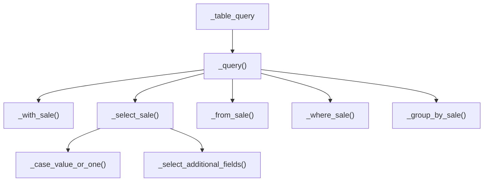

# C4 Code Level: addons/sale/report

<!--
  Auto-generated by the c4-code agent. One file per source directory.
  Refreshed on /bmb:c4 reruns whenever the directory's content hash changes.
  Do NOT hand-edit; edits will be overwritten on next refresh.
-->

## Generated By

- **Agent**: c4-code (Haiku)
- **Run ID**: c4-20261101-s4l3
- **Generated**: 2026-11-01T11:22:58Z
- **Source Directory**: [`addons/sale/report`](../../../addons/sale/report)
- **Content Hash**: git-tree 07f381479d604b68

## Overview

- **Name**: Sale reporting and quotation/order documents (`sale.report`)
- **Description**: Sales Analysis SQL-view model, an invoice-analysis extension adding a sales team, QWeb quotation/order/pro-forma report templates and report actions, and list/pivot/graph/search views for sales analysis.
- **Location**: [`addons/sale/report`](../../../addons/sale/report) — 7 files, ~788 lines
- **Language**: Python 3 (Odoo 18.0 ORM), XML (Odoo views, actions, QWeb templates)
- **Purpose**: Provides the read-only sales analysis data model and its UI (`sale.report`), extends the accounting invoice analysis with a sales team, and defines the printable Quotation / Order and PRO-FORMA Invoice documents.

## Code Elements

### Functions / Methods

- `_select(self) → SQL`
  - **Description**: Extends the `account.invoice.report` SELECT by appending `move.team_id AS team_id`.
  - **Location**: [`account_invoice_report.py:13`](../../../addons/sale/report/account_invoice_report.py#L13)
  - **Visibility**: internal (override)
  - **Dependencies**: `odoo.tools.SQL`, `super()._select()`

- `_get_done_states(self) → list[str]`
  - **Description**: Returns the order states treated as "done" for reporting; currently `['sale']`. Decorated `@api.model`.
  - **Location**: [`sale_report.py:16`](../../../addons/sale/report/sale_report.py#L16)
  - **Visibility**: internal
  - **Dependencies**: `odoo.api`

- `_compute_currency_id(self) → None`
  - **Description**: Sets `currency_id` from the current company's currency. Decorated `@api.depends_context('allowed_company_ids')`.
  - **Location**: [`sale_report.py:92`](../../../addons/sale/report/sale_report.py#L92)
  - **Visibility**: internal
  - **Dependencies**: `self.env.company`

- `_with_sale(self) → str`
  - **Description**: Hook for an optional `WITH` CTE prefix to the report query; returns an empty string.
  - **Location**: [`sale_report.py:95`](../../../addons/sale/report/sale_report.py#L95)
  - **Visibility**: internal (extension hook)
  - **Dependencies**: none

- `_select_sale(self) → str`
  - **Description**: Builds the SELECT column list (quantities, currency-converted amounts, discounts, weights, volumes, dimensions) and appends additional-field hook output.
  - **Location**: [`sale_report.py:98`](../../../addons/sale/report/sale_report.py#L98)
  - **Visibility**: internal
  - **Dependencies**: `_case_value_or_one`, `_select_additional_fields`

- `_case_value_or_one(self, value: str) → str`
  - **Description**: Returns a SQL `CASE` expression yielding `1.0` when the given value is NULL or 0, so currency rates can be divided safely.
  - **Location**: [`sale_report.py:172`](../../../addons/sale/report/sale_report.py#L172)
  - **Visibility**: internal
  - **Dependencies**: none

- `_select_additional_fields(self) → dict`
  - **Description**: Extension hook mapping field name to SQL expression for extra SELECT columns; default `{}`.
  - **Location**: [`sale_report.py:175`](../../../addons/sale/report/sale_report.py#L175)
  - **Visibility**: internal (extension hook)
  - **Dependencies**: none

- `_from_sale(self) → str`
  - **Description**: Builds the FROM/JOIN clause over `sale_order_line` joined to orders, partners, products, templates, UoM and a simple currency-rate table.
  - **Location**: [`sale_report.py:183`](../../../addons/sale/report/sale_report.py#L183)
  - **Visibility**: internal
  - **Dependencies**: `res.currency._get_simple_currency_table`, `self.env.cr.mogrify`

- `_where_sale(self) → str`
  - **Description**: Restricts report rows to non-display lines (`l.display_type IS NULL`).
  - **Location**: [`sale_report.py:197`](../../../addons/sale/report/sale_report.py#L197)
  - **Visibility**: internal
  - **Dependencies**: none

- `_group_by_sale(self) → str`
  - **Description**: Returns the GROUP BY column list matching the non-aggregated SELECT columns.
  - **Location**: [`sale_report.py:201`](../../../addons/sale/report/sale_report.py#L201)
  - **Visibility**: internal
  - **Dependencies**: none

- `_query(self) → str`
  - **Description**: Assembles the full report query from the `_with_sale`, `_select_sale`, `_from_sale`, `_where_sale` and `_group_by_sale` parts.
  - **Location**: [`sale_report.py:232`](../../../addons/sale/report/sale_report.py#L232)
  - **Visibility**: internal
  - **Dependencies**: `_with_sale`, `_select_sale`, `_from_sale`, `_where_sale`, `_group_by_sale`

- `_table_query(self) → str` (property)
  - **Description**: Odoo hook consumed to create the `sale_report` database view; returns `_query()`.
  - **Location**: [`sale_report.py:243`](../../../addons/sale/report/sale_report.py#L243)
  - **Visibility**: internal
  - **Dependencies**: `_query`

- `action_open_order(self) → dict`
  - **Description**: Returns an act_window action opening the sale order referenced by `order_reference`.
  - **Location**: [`sale_report.py:247`](../../../addons/sale/report/sale_report.py#L247)
  - **Visibility**: public (called from the list view button, `sale_report_views.xml`)
  - **Dependencies**: `order_reference`

Private helpers: none beyond the methods above. `__init__.py` only imports the two model modules.

### Classes / Modules

- **`AccountInvoiceReport`** — extends `account.invoice.report` with a sales team, no new table
  - **Location**: [`account_invoice_report.py:8`](../../../addons/sale/report/account_invoice_report.py#L8)
  - **Methods**: `_select(...)`
  - **Implements / Extends**: `_inherit = 'account.invoice.report'` (Odoo model extension)
  - **Dependencies**: `odoo.fields`, `odoo.models`, `odoo.tools.SQL`; field `team_id` (Many2one `crm.team`) at [`account_invoice_report.py:11`](../../../addons/sale/report/account_invoice_report.py#L11)

- **`SaleReport`** — Sales Analysis report model (`_name = "sale.report"`, `_auto = False`), a read-only SQL view over sale order lines
  - **Location**: [`sale_report.py:8`](../../../addons/sale/report/sale_report.py#L8)
  - **Methods**: `_get_done_states()`, `_compute_currency_id()`, `_with_sale()`, `_select_sale()`, `_case_value_or_one(value)`, `_select_additional_fields()`, `_from_sale()`, `_where_sale()`, `_group_by_sale()`, `_query()`, `_table_query`, `action_open_order()`
  - **Implements / Extends**: `models.Model`; `_rec_name = 'date'`, `_order = 'date desc'`
  - **Dependencies**: `odoo.api`, `odoo.fields`, `odoo.models`; `SALE_ORDER_STATE` from [`sale/models`](../../../addons/sale/models) (see Constants)

### Constants / Configuration

- `SALE_ORDER_STATE` — selection values for the `state` field, imported from the sale models ([`sale_report.py:5`](../../../addons/sale/report/sale_report.py#L5))
- Invoice-status selection values `upselling`, `invoiced`, `to invoice`, `no` — order-level `invoice_status` ([`sale_report.py:28`](../../../addons/sale/report/sale_report.py#L28)) and line-level `line_invoice_status` ([`sale_report.py:73`](../../../addons/sale/report/sale_report.py#L73))
- Report-visible scope: only lines with `display_type IS NULL` are counted ([`sale_report.py:197`](../../../addons/sale/report/sale_report.py#L197)); the `Sales` filter excludes `draft`, `cancel`, `sent` ([`sale_report_views.xml:84`](../../../addons/sale/report/sale_report_views.xml#L84))
- Action domains: `action_order_report_all` excludes cancelled orders ([`sale_report_views.xml:131`](../../../addons/sale/report/sale_report_views.xml#L131)); quotation analysis restricts to `draft` ([`sale_report_views.xml:176`](../../../addons/sale/report/sale_report_views.xml#L176))
- Report print name and gating: quotation/order title switches on `state` ([`ir_actions_report.xml:10`](../../../addons/sale/report/ir_actions_report.xml#L10)); PRO-FORMA report restricted to group `sale.group_proforma_sales` ([`ir_actions_report.xml:24`](../../../addons/sale/report/ir_actions_report.xml#L24))

## Entities

### `SaleReport` — Sale Report

- **Description**: Sales Analysis Report (model `_description`); read-only analytic view over sale order lines, not a writable entity.
- **Source**: [`sale_report.py:8`](../../../addons/sale/report/sale_report.py#L8)
- **Persistence**: view `sale_report` (generated from `_table_query`, [`sale_report.py:243`](../../../addons/sale/report/sale_report.py#L243); `_auto = False`)
- **Container hint**: (filled by aggregator)
- **Aggregate root**: no
- **Lifecycle traits**: none

| Attribute | Type | Nullable | Default | Role | FK Target | Constraints | Validations | Classifications |
|-----------|------|----------|---------|------|-----------|-------------|-------------|-----------------|
| `name` | Char | n/a (view) | — | regular | — | — | — | — |
| `date` | Datetime | n/a (view) | — | regular | — | — | — | — |
| `partner_id` | Many2one(res.partner) | n/a (view) | — | fk | `res.partner.id` | — | — | — |
| `company_id` | Many2one(res.company) | n/a (view) | — | fk | `res.company.id` | — | — | — |
| `pricelist_id` | Many2one(product.pricelist) | n/a (view) | — | fk | `product.pricelist.id` | — | — | — |
| `team_id` | Many2one(crm.team) | n/a (view) | — | fk | `crm.team.id` | — | — | — |
| `user_id` | Many2one(res.users) | n/a (view) | — | fk | `res.users.id` | — | — | — |
| `state` | Selection(SALE_ORDER_STATE) | n/a (view) | — | regular | — | — | — | — |
| `invoice_status` | Selection(upselling, invoiced, to invoice, no) | n/a (view) | — | regular | — | — | — | — |
| `campaign_id` | Many2one(utm.campaign) | n/a (view) | — | fk | `utm.campaign.id` | — | — | — |
| `medium_id` | Many2one(utm.medium) | n/a (view) | — | fk | `utm.medium.id` | — | — | — |
| `source_id` | Many2one(utm.source) | n/a (view) | — | fk | `utm.source.id` | — | — | — |
| `commercial_partner_id` | Many2one(res.partner) | n/a (view) | — | fk | `res.partner.id` | — | — | — |
| `country_id` | Many2one(res.country) | n/a (view) | — | fk | `res.country.id` | — | — | — |
| `industry_id` | Many2one(res.partner.industry) | n/a (view) | — | fk | `res.partner.industry.id` | — | — | — |
| `partner_zip` | Char | n/a (view) | — | regular | — | — | — | `pii:address` |
| `state_id` | Many2one(res.country.state) | n/a (view) | — | fk | `res.country.state.id` | — | — | `pii:address` |
| `order_reference` | Reference(sale.order) | n/a (view) | — | regular | — | — | — | — |
| `categ_id` | Many2one(product.category) | n/a (view) | — | fk | `product.category.id` | — | — | — |
| `product_id` | Many2one(product.product) | n/a (view) | — | fk | `product.product.id` | — | — | — |
| `product_tmpl_id` | Many2one(product.template) | n/a (view) | — | fk | `product.template.id` | — | — | — |
| `product_uom` | Many2one(uom.uom) | n/a (view) | — | fk | `uom.uom.id` | — | — | — |
| `product_uom_qty` | Float | n/a (view) | — | regular | — | — | — | — |
| `qty_to_deliver` | Float | n/a (view) | — | regular | — | — | — | — |
| `qty_delivered` | Float | n/a (view) | — | regular | — | — | — | — |
| `qty_to_invoice` | Float | n/a (view) | — | regular | — | — | — | — |
| `qty_invoiced` | Float | n/a (view) | — | regular | — | — | — | — |
| `price_subtotal` | Monetary | n/a (view) | — | regular | — | — | — | — |
| `price_total` | Monetary | n/a (view) | — | regular | — | — | — | — |
| `untaxed_amount_to_invoice` | Monetary | n/a (view) | — | regular | — | — | — | — |
| `untaxed_amount_invoiced` | Monetary | n/a (view) | — | regular | — | — | — | — |
| `line_invoice_status` | Selection(upselling, invoiced, to invoice, no) | n/a (view) | — | regular | — | — | — | — |
| `weight` | Float | n/a (view) | — | regular | — | — | — | — |
| `volume` | Float | n/a (view) | — | regular | — | — | — | — |
| `price_unit` | Float | n/a (view) | — | regular | — | — | — | — |
| `discount` | Float | n/a (view) | — | regular | — | — | — | — |
| `discount_amount` | Monetary | n/a (view) | — | regular | — | — | — | — |
| `nbr` | Integer | n/a (view) | — | regular | — | — | — | — |
| `currency_id` | Many2one(res.currency) | n/a (view) | — | computed | — | — | — | — |

Notes on the table:
- Storage types are not declared (SQL view, no DB constraints); `Nullable` is not applicable.
- `state_id` is classified `pii:address` because its name contains `state` and the entity also has `partner_zip`. The bare `state` (order status) on the same entity is NOT classified: it describes the order, not an address.
- `partner_zip` is classified `pii:address` by the `zip` substring rule.

**Relationships**:
- belongs_to `res.partner` via `partner_id` (N:1)
- belongs_to `res.partner` via `commercial_partner_id` (N:1)
- belongs_to `res.company` via `company_id` (N:1)
- belongs_to `product.pricelist` via `pricelist_id` (N:1)
- belongs_to `crm.team` via `team_id` (N:1)
- belongs_to `res.users` via `user_id` (N:1)
- belongs_to `utm.campaign` via `campaign_id` (N:1)
- belongs_to `utm.medium` via `medium_id` (N:1)
- belongs_to `utm.source` via `source_id` (N:1)
- belongs_to `res.country` via `country_id` (N:1)
- belongs_to `res.partner.industry` via `industry_id` (N:1)
- belongs_to `res.country.state` via `state_id` (N:1)
- belongs_to `product.category` via `categ_id` (N:1)
- belongs_to `product.product` via `product_id` (N:1)
- belongs_to `product.template` via `product_tmpl_id` (N:1)
- belongs_to `uom.uom` via `product_uom` (N:1)
- belongs_to `res.currency` via `currency_id` (N:1, computed)

**Indexes**:
- none declared (`_auto = False` SQL view)

<!-- USER-MANAGED: data-classification-overrides -->
(none)
<!-- /USER-MANAGED: data-classification-overrides -->

## Terms

### Entities

| Term | Normalized | Singular | Stems | Frequency | First seen |
|---|---|---|---|---:|---|
| `SaleReport` | salereport | salereport | sale, report | 1 | [`sale_report.py:8`](../../../addons/sale/report/sale_report.py#L8) |
| `AccountInvoiceReport` | accountinvoicereport | accountinvoicereport | account, invoice, report | 1 | [`account_invoice_report.py:8`](../../../addons/sale/report/account_invoice_report.py#L8) |

### Actions

| Term | Normalized | Stems | Frequency | First seen |
|---|---|---|---:|---|
| `_select` | select | select | 2 | [`account_invoice_report.py:13`](../../../addons/sale/report/account_invoice_report.py#L13) |
| `_get_done_states` | getdonestates | get, done, state | 1 | [`sale_report.py:16`](../../../addons/sale/report/sale_report.py#L16) |
| `_compute_currency_id` | computecurrencyid | compute, currency, id | 2 | [`sale_report.py:89`](../../../addons/sale/report/sale_report.py#L89) |
| `_with_sale` | withsale | with, sale | 2 | [`sale_report.py:95`](../../../addons/sale/report/sale_report.py#L95) |
| `_select_sale` | selectsale | select, sale | 2 | [`sale_report.py:98`](../../../addons/sale/report/sale_report.py#L98) |
| `_case_value_or_one` | casevalueorone | case, value, or, one | 13 | [`sale_report.py:110`](../../../addons/sale/report/sale_report.py#L110) |
| `_select_additional_fields` | selectadditionalfields | select, additional, field | 2 | [`sale_report.py:164`](../../../addons/sale/report/sale_report.py#L164) |
| `_from_sale` | fromsale | from, sale | 2 | [`sale_report.py:183`](../../../addons/sale/report/sale_report.py#L183) |
| `_where_sale` | wheresale | where, sale | 2 | [`sale_report.py:197`](../../../addons/sale/report/sale_report.py#L197) |
| `_group_by_sale` | groupbysale | group, by, sale | 2 | [`sale_report.py:201`](../../../addons/sale/report/sale_report.py#L201) |
| `_query` | query | query | 2 | [`sale_report.py:232`](../../../addons/sale/report/sale_report.py#L232) |
| `_table_query` | tablequery | table, query | 1 | [`sale_report.py:244`](../../../addons/sale/report/sale_report.py#L244) |
| `action_open_order` | actionopenorder | action, open, order | 1 | [`sale_report.py:247`](../../../addons/sale/report/sale_report.py#L247) |

### Qualifiers

| Term | Normalized | Frequency | First seen |
|---|---|---:|---|
| `upselling` | upselling | 2 | [`sale_report.py:30`](../../../addons/sale/report/sale_report.py#L30) |
| `invoiced` | invoiced | 2 | [`sale_report.py:31`](../../../addons/sale/report/sale_report.py#L31) |
| `to invoice` | toinvoice | 2 | [`sale_report.py:32`](../../../addons/sale/report/sale_report.py#L32) |
| `is_downpayment` | isdownpayment | 3 | [`sale_report.py:124`](../../../addons/sale/report/sale_report.py#L124) |

<!--
  USER-MANAGED term exclusions for this c4-code doc.
  Format (one per line):
    <term> → exclude (reason)
-->

<!-- USER-MANAGED: term-exclusions -->
(none)
<!-- /USER-MANAGED: term-exclusions -->

## Source Files

- [`__init__.py`](../../../addons/sale/report/__init__.py)
- [`account_invoice_report.py`](../../../addons/sale/report/account_invoice_report.py)
- [`account_invoice_report_views.xml`](../../../addons/sale/report/account_invoice_report_views.xml)
- [`ir_actions_report.xml`](../../../addons/sale/report/ir_actions_report.xml)
- [`ir_actions_report_templates.xml`](../../../addons/sale/report/ir_actions_report_templates.xml)
- [`sale_report.py`](../../../addons/sale/report/sale_report.py)
- [`sale_report_views.xml`](../../../addons/sale/report/sale_report_views.xml)

Non-Python files (XML) contribute the following records, which are not enumerated as code elements above:
- `account_invoice_report_views.xml`: search filter and group-by "Sales Team" on `account.invoice.report`, `team_id` column (optional hidden), and `action_account_invoice_report_salesteam` ([`account_invoice_report_views.xml:29`](../../../addons/sale/report/account_invoice_report_views.xml#L29)).
- `sale_report_views.xml`: pivot, graph (line/pie/bar), list (with `action="action_open_order"`, [`sale_report_views.xml:56`](../../../addons/sale/report/sale_report_views.xml#L56)), and search views for `sale.report`, plus the Sales Analysis actions ([`sale_report_views.xml:125`](../../../addons/sale/report/sale_report_views.xml#L125)).
- `ir_actions_report.xml`: `action_report_saleorder` ([`ir_actions_report.xml:4`](../../../addons/sale/report/ir_actions_report.xml#L4)) and `action_report_pro_forma_invoice` ([`ir_actions_report.xml:15`](../../../addons/sale/report/ir_actions_report.xml#L15)).
- `ir_actions_report_templates.xml`: QWeb templates `report_saleorder_document` ([`ir_actions_report_templates.xml:3`](../../../addons/sale/report/ir_actions_report_templates.xml#L3)), `report_saleorder_raw` ([`ir_actions_report_templates.xml:221`](../../../addons/sale/report/ir_actions_report_templates.xml#L221)), `report_saleorder` ([`ir_actions_report_templates.xml:229`](../../../addons/sale/report/ir_actions_report_templates.xml#L229)), `report_saleorder_pro_forma` ([`ir_actions_report_templates.xml:233`](../../../addons/sale/report/ir_actions_report_templates.xml#L233)), `document_tax_totals` extending `account.document_tax_totals_template` ([`ir_actions_report_templates.xml:244`](../../../addons/sale/report/ir_actions_report_templates.xml#L244)), and `quote_document_layout_preview` ([`ir_actions_report_templates.xml:246`](../../../addons/sale/report/ir_actions_report_templates.xml#L246)).

No CSV files are present in this directory.

## Dependencies

### Internal

- [`addons/sale/models`](../../../addons/sale/models) — `SALE_ORDER_STATE` import (`sale_report.py:5`) used for the `state` selection
- [`addons/account`](../../../addons/account) — extends `account.invoice.report` (`account_invoice_report.py:9`) and inherits `account.view_account_invoice_report_search`, `account.account_invoice_report_view_tree`, `account.document_tax_totals_template` in XML
- [`addons/web`](../../../addons/web) — `web.external_layout` and `web.html_container` QWeb layouts used by the report templates
- [`addons/crm`](../../../addons/crm) — `crm.team` (sales team) referenced by `team_id` on both models
- [`addons/product`](../../../addons/product) — `product.product`, `product.template`, `product.category`, `product.pricelist` relations and the `product_variant` group filter
- [`addons/uom`](../../../addons/uom) — `uom.uom` relation and factor joins in `_select_sale` / `_from_sale`
- [`addons/base`](../../../addons/base) — `res.partner`, `res.company`, `res.country`, `res.country.state`, `res.currency`, `res.users` relations and `base.group_multi_company`
- [`addons/utm`](../../../addons/utm) — `utm.campaign`, `utm.medium`, `utm.source` relations
- Circular imports: none detected.

### External

- `odoo@18.0` — framework (`odoo.api`, `odoo.fields`, `odoo.models`, `odoo.tools.SQL`); version from [`odoo/release.py:15`](../../../odoo/release.py#L15) (`version_info = (18, 0, 0, ...)`). Provides ORM, SQL view generation, and QWeb rendering.

## Relationships

Query assembly pipeline inside `SaleReport`:

## Notes for Higher-Level Synthesis

- Belongs with the sales analytics / reporting component: `SaleReport` (`sale.report`) and its views are the sales analysis read model. `AccountInvoiceReport` extends the accounting invoice analysis with the same `crm.team` dimension and should be grouped with the sales reporting component rather than accounting.
- Boundary code: the XML views and actions (`sale_report_views.xml`, `account_invoice_report_views.xml`, `ir_actions_report.xml`) are the user-facing UI and PDF boundary for sales reporting.
- Domain-bearing, not a pure utility. The QWeb templates in `ir_actions_report_templates.xml` belong with the quotation/order document component, not the analytics component.
- `SaleReport` is a read-only SQL view. It has no state mutation sites in this directory, so no lifecycle transitions are recorded here.

## Parent Component

<!--
  AUTO-MANAGED by the c4-backlink agent. Do not hand-edit between markers.
  Source of truth: c4-manifest.md § Component-Level Entries
    (component-entries.constituent_code_docs).
-->

<!-- AUTO-MANAGED: parent-component -->

- **Component**: [`sale`](../components/c4-component-sale.md)
- **Container**: [`Odoo Application Server`](../containers/c4-container-odoo-application-server.md) — Compute
- **Context**: [`c4-context.md`](../c4-context.md)

<!-- /AUTO-MANAGED: parent-component -->
