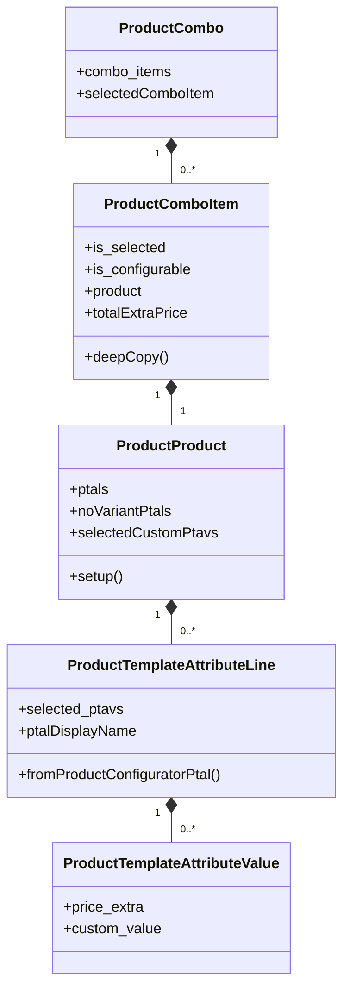

# C4 Code Level: addons/sale/static/src/js/models

<!--
  Auto-generated by the c4-code agent. One file per source directory.
  Refreshed on /bmb:c4 reruns whenever the directory's content hash changes.
  Do NOT hand-edit; edits will be overwritten on next refresh.

  Linking conventions (MAINTAIN ON EVERY REWRITE):
  - This doc lives at memory-bank/c4/code/c4-code-<sanitized>.md (3 dirs below
    repo root). Use `../../../` to reach repo root for source-file links.
  - File:line references MUST be rendered as clickable markdown links of the
    form: [`<file>:<line>`](../../../<dir>/<file>#L<line>).
  - Directory paths under Overview → Location MUST be rendered as a markdown
    link to the directory itself: [`path/to/dir/`](../../../path/to/dir).
  - Internal-dependency directory names SHOULD be linked to their c4-code
    sibling doc when one exists in `memory-bank/c4/code/`, otherwise to the
    directory in the source tree.
  - The "Parent Component" up-link section near the bottom is filled by the
    c4-backlink agent; the AUTO-MANAGED markers below MUST be preserved
    verbatim so the back-link pass can find and populate them.
-->

## Generated By

- **Agent**: c4-code (Haiku)
- **Run ID**: c4-20261101-s4l3
- **Generated**: 2026-11-01T11:22:58Z
- **Source Directory**: [`addons/sale/static/src/js/models`](../../../addons/sale/static/src/js/models)
- **Content Hash**: git-tree b52af28105bfed26

## Overview

- **Name**: Sale configurator client-side product model classes
- **Description**: ES module classes that model combos, combo items, products, and product template attribute lines/values for the sale product configurators in the browser.
- **Location**: [`addons/sale/static/src/js/models/`](../../../addons/sale/static/src/js/models) — 5 files, ~225 lines
- **Language**: JavaScript (ES modules, Odoo 18.0 web client)
- **Purpose**: In-memory client-side data model for product and combo configuration (selected attribute values, custom values, extra-price totals). No I/O, no persistence.

## Code Elements

### Functions / Methods

No module-level functions. All callables are class members; see the Classes / Modules section for their owners.

**`ProductCombo`**

- `get selectedComboItem() → ProductComboItem | undefined`
  - **Description**: Returns the first combo item whose `is_selected` flag is true.
  - **Location**: [`product_combo.js:20`](../../../addons/sale/static/src/js/models/product_combo.js#L20)
  - **Visibility**: public (getter)
  - **Dependencies**: none beyond `ProductComboItem` instances held in `combo_items`

**`ProductComboItem`**

- `get totalExtraPrice() → Number`
  - **Description**: Sum of the combo item's `extra_price` and the extra price of its selected `no_variant` PTAVs.
  - **Location**: [`product_combo_item.js:28`](../../../addons/sale/static/src/js/models/product_combo_item.js#L28)
  - **Visibility**: public (getter)
  - **Dependencies**: `ProductProduct.selectedNoVariantPtavsPriceExtra`

- `deepCopy() → ProductComboItem`
  - **Description**: Returns a new `ProductComboItem` built from a JSON round-trip of this instance.
  - **Location**: [`product_combo_item.js:37`](../../../addons/sale/static/src/js/models/product_combo_item.js#L37)
  - **Visibility**: public
  - **Dependencies**: global `JSON`; the `ProductComboItem` constructor

**`ProductProduct`**

- `setup({id, product_tmpl_id, display_name, ptals, image_src}) → void`
  - **Description**: Real initializer, invoked from the constructor so it can be patched (constructors cannot be patched). Wraps each `ptals` entry in `ProductTemplateAttributeLine`.
  - **Location**: [`product_product.js:18`](../../../addons/sale/static/src/js/models/product_product.js#L18)
  - **Visibility**: public
  - **Dependencies**: `ProductTemplateAttributeLine`

- `get noVariantPtals() → ProductTemplateAttributeLine[]`
  - **Description**: PTALs whose `create_variant` is `'no_variant'`.
  - **Location**: [`product_product.js:31`](../../../addons/sale/static/src/js/models/product_product.js#L31)
  - **Visibility**: public (getter)
  - **Dependencies**: none

- `get selectedNoVariantPtavsPriceExtra() → Number`
  - **Description**: Sum of `selectedPtavsPriceExtra` over the `no_variant` PTALs.
  - **Location**: [`product_product.js:40`](../../../addons/sale/static/src/js/models/product_product.js#L40)
  - **Visibility**: public (getter)
  - **Dependencies**: `noVariantPtals`, `ProductTemplateAttributeLine.selectedPtavsPriceExtra`

- `get selectedPtavIds() → Number[]`
  - **Description**: Ids of every selected PTAV across all PTALs.
  - **Location**: [`product_product.js:49`](../../../addons/sale/static/src/js/models/product_product.js#L49)
  - **Visibility**: public (getter)
  - **Dependencies**: none

- `get selectedNoVariantPtavIds() → Number[]`
  - **Description**: Ids of selected PTAVs restricted to `no_variant` PTALs.
  - **Location**: [`product_product.js:58`](../../../addons/sale/static/src/js/models/product_product.js#L58)
  - **Visibility**: public (getter)
  - **Dependencies**: `noVariantPtals`

- `get selectedCustomPtavs() → {id: Number, value: String}[]`
  - **Description**: Selected PTAVs (from PTALs that carry a custom value) mapped to `{id, value}` where `value` is the custom value.
  - **Location**: [`product_product.js:67`](../../../addons/sale/static/src/js/models/product_product.js#L67)
  - **Visibility**: public (getter)
  - **Dependencies**: `ProductTemplateAttributeLine.hasSelectedCustomPtav`

**`ProductTemplateAttributeLine`**

- `static fromProductConfiguratorPtal(productConfiguratorPtal) → ProductTemplateAttributeLine`
  - **Description**: Builds a PTAL from a "product configurator"-shaped PTAL object (its `selected_attribute_value_ids`, `attribute_values`, `attribute.name`, `create_variant`, `customValue`). Every selected value receives the PTAL's `customValue` as its custom value.
  - **Location**: [`product_template_attribute_line.js:24`](../../../addons/sale/static/src/js/models/product_template_attribute_line.js#L24)
  - **Visibility**: public (static)
  - **Dependencies**: `ProductTemplateAttributeValue`

- `get selectedPtavsPriceExtra() → Number`
  - **Description**: Sum of `price_extra` over the selected PTAVs.
  - **Location**: [`product_template_attribute_line.js:47`](../../../addons/sale/static/src/js/models/product_template_attribute_line.js#L47)
  - **Visibility**: public (getter)
  - **Dependencies**: none

- `get hasSelectedCustomPtav() → Boolean`
  - **Description**: True when any selected PTAV carries a truthy `custom_value`.
  - **Location**: [`product_template_attribute_line.js:56`](../../../addons/sale/static/src/js/models/product_template_attribute_line.js#L56)
  - **Visibility**: public (getter)
  - **Dependencies**: none

- `get ptalDisplayName() → String`
  - **Description**: Display label `"<name>: <selected value names>"`, with `" (<custom value>)"` appended when a custom value is selected.
  - **Location**: [`product_template_attribute_line.js:65`](../../../addons/sale/static/src/js/models/product_template_attribute_line.js#L65)
  - **Visibility**: public (getter)
  - **Dependencies**: `hasSelectedCustomPtav`

### Classes / Modules

- **`ProductCombo`** — a product combo and its combo items
  - **Location**: [`product_combo.js:3`](../../../addons/sale/static/src/js/models/product_combo.js#L3) (constructor at [`product_combo.js:9`](../../../addons/sale/static/src/js/models/product_combo.js#L9))
  - **Methods**: `get selectedComboItem()`
  - **Implements / Extends**: none
  - **Dependencies**: `ProductComboItem` (import from `./product_combo_item`)

- **`ProductComboItem`** — one selectable item of a combo, wrapping a product
  - **Location**: [`product_combo_item.js:3`](../../../addons/sale/static/src/js/models/product_combo_item.js#L3) (constructor at [`product_combo_item.js:11`](../../../addons/sale/static/src/js/models/product_combo_item.js#L11))
  - **Methods**: `get totalExtraPrice()`, `deepCopy()`
  - **Implements / Extends**: none
  - **Dependencies**: `ProductProduct` (import from `./product_product`)

- **`ProductProduct`** — a product variant as seen by the configurator, holding its PTALs
  - **Location**: [`product_product.js:3`](../../../addons/sale/static/src/js/models/product_product.js#L3) (constructor at [`product_product.js:7`](../../../addons/sale/static/src/js/models/product_product.js#L7))
  - **Methods**: `setup(...)`, `get noVariantPtals()`, `get selectedNoVariantPtavsPriceExtra()`, `get selectedPtavIds()`, `get selectedNoVariantPtavIds()`, `get selectedCustomPtavs()`
  - **Implements / Extends**: none
  - **Dependencies**: `ProductTemplateAttributeLine` (import from `./product_template_attribute_line`)

- **`ProductTemplateAttributeLine`** — a template attribute line (PTAL) and its selected values
  - **Location**: [`product_template_attribute_line.js:3`](../../../addons/sale/static/src/js/models/product_template_attribute_line.js#L3) (constructor at [`product_template_attribute_line.js:10`](../../../addons/sale/static/src/js/models/product_template_attribute_line.js#L10))
  - **Methods**: `static fromProductConfiguratorPtal(...)`, `get selectedPtavsPriceExtra()`, `get hasSelectedCustomPtav()`, `get ptalDisplayName()`
  - **Implements / Extends**: none
  - **Dependencies**: `ProductTemplateAttributeValue` (import from `./product_template_attribute_value`)

- **`ProductTemplateAttributeValue`** — a selected template attribute value (PTAV); plain data holder
  - **Location**: [`product_template_attribute_value.js:1`](../../../addons/sale/static/src/js/models/product_template_attribute_value.js#L1) (constructor at [`product_template_attribute_value.js:8`](../../../addons/sale/static/src/js/models/product_template_attribute_value.js#L8))
  - **Methods**: none
  - **Implements / Extends**: none
  - **Dependencies**: none

### Constants / Configuration

None. The directory defines no module-level constants.

## Terms

### Entities

| Term | Normalized | Singular | Stems | Frequency | First seen |
|---|---|---|---|---:|---|
| `ProductCombo` | productcombo | productcombo | product, combo | 1 | [`product_combo.js:3`](../../../addons/sale/static/src/js/models/product_combo.js#L3) |
| `ProductComboItem` | productcomboitem | productcomboitem | product, combo, item | 7 | [`product_combo.js:1`](../../../addons/sale/static/src/js/models/product_combo.js#L1) |
| `ProductProduct` | productproduct | productproduct | product, product | 4 | [`product_product.js:3`](../../../addons/sale/static/src/js/models/product_product.js#L3) |
| `ProductTemplateAttributeLine` | producttemplateattributeline | producttemplateattributeline | product, template, attribute, line | 9 | [`product_product.js:1`](../../../addons/sale/static/src/js/models/product_product.js#L1) |
| `ProductTemplateAttributeValue` | producttemplateattributevalue | producttemplateattributevalue | product, template, attribute, value | 5 | [`product_template_attribute_value.js:1`](../../../addons/sale/static/src/js/models/product_template_attribute_value.js#L1) |

### Actions

| Term | Normalized | Stems | Frequency | First seen |
|---|---|---|---:|---|
| `selectedComboItem` | selectedcomboitem | select, combo, item | 1 | [`product_combo.js:20`](../../../addons/sale/static/src/js/models/product_combo.js#L20) |
| `totalExtraPrice` | totalextraprice | total, extra, price | 1 | [`product_combo_item.js:28`](../../../addons/sale/static/src/js/models/product_combo_item.js#L28) |
| `deepCopy` | deepcopy | deep, copy | 1 | [`product_combo_item.js:37`](../../../addons/sale/static/src/js/models/product_combo_item.js#L37) |
| `setup` | setup | setup | 3 | [`product_product.js:5`](../../../addons/sale/static/src/js/models/product_product.js#L5) |
| `noVariantPtals` | novariantptals | no, variant, ptal | 3 | [`product_product.js:31`](../../../addons/sale/static/src/js/models/product_product.js#L31) |
| `selectedNoVariantPtavsPriceExtra` | selectednovariantptavspriceextra | select, no, variant, ptav, price, extra | 2 | [`product_product.js:40`](../../../addons/sale/static/src/js/models/product_product.js#L40) |
| `selectedPtavIds` | selectedptavids | select, ptav, id | 3 | [`product_product.js:49`](../../../addons/sale/static/src/js/models/product_product.js#L49) |
| `selectedNoVariantPtavIds` | selectednovariantptavids | select, no, variant, ptav, id | 1 | [`product_product.js:58`](../../../addons/sale/static/src/js/models/product_product.js#L58) |
| `selectedCustomPtavs` | selectedcustomptavs | select, custom, ptav | 1 | [`product_product.js:67`](../../../addons/sale/static/src/js/models/product_product.js#L67) |
| `fromProductConfiguratorPtal` | fromproductconfiguratorptal | product, configurator, ptal | 1 | [`product_template_attribute_line.js:24`](../../../addons/sale/static/src/js/models/product_template_attribute_line.js#L24) |
| `selectedPtavsPriceExtra` | selectedptavspriceextra | select, ptav, price, extra | 2 | [`product_template_attribute_line.js:47`](../../../addons/sale/static/src/js/models/product_template_attribute_line.js#L47) |
| `ptalDisplayName` | ptaldisplayname | ptal, display, name | 4 | [`product_template_attribute_line.js:65`](../../../addons/sale/static/src/js/models/product_template_attribute_line.js#L65) |

### Qualifiers

| Term | Normalized | Frequency | First seen |
|---|---|---:|---|
| `is_selected` | isselected | 5 | [`product_combo.js:21`](../../../addons/sale/static/src/js/models/product_combo.js#L21) |
| `is_configurable` | isconfigurable | 4 | [`product_combo_item.js:8`](../../../addons/sale/static/src/js/models/product_combo_item.js#L8) |
| `hasSelectedCustomPtav` | hasselectedcustomptav | 3 | [`product_template_attribute_line.js:56`](../../../addons/sale/static/src/js/models/product_template_attribute_line.js#L56) |

<!--
  USER-MANAGED term exclusions for this c4-code doc.

  Format (one per line):
    <term> → exclude (reason)

  Excluded terms are filtered out by the c4-component agent and
  c4-glossary-aggregator. Useful when a class/function name is purely
  technical (e.g., a local Cache helper) and should NOT be merged into
  the domain glossary.

  Markers MUST be preserved verbatim across rewrites.
-->

<!-- USER-MANAGED: term-exclusions -->
(none)
<!-- /USER-MANAGED: term-exclusions -->

## Source Files

- [`product_combo.js`](../../../addons/sale/static/src/js/models/product_combo.js)
- [`product_combo_item.js`](../../../addons/sale/static/src/js/models/product_combo_item.js)
- [`product_product.js`](../../../addons/sale/static/src/js/models/product_product.js)
- [`product_template_attribute_line.js`](../../../addons/sale/static/src/js/models/product_template_attribute_line.js)
- [`product_template_attribute_value.js`](../../../addons/sale/static/src/js/models/product_template_attribute_value.js)

## Dependencies

### Internal

All internal dependencies are sibling modules in this same directory (no cross-directory imports):

- [`product_combo_item.js`](../../../addons/sale/static/src/js/models/product_combo_item.js) — `ProductCombo` wraps each combo entry in `ProductComboItem`
- [`product_product.js`](../../../addons/sale/static/src/js/models/product_product.js) — `ProductComboItem` wraps its `product` in `ProductProduct`
- [`product_template_attribute_line.js`](../../../addons/sale/static/src/js/models/product_template_attribute_line.js) — `ProductProduct` wraps each `ptals` entry in `ProductTemplateAttributeLine`
- [`product_template_attribute_value.js`](../../../addons/sale/static/src/js/models/product_template_attribute_value.js) — `ProductTemplateAttributeLine` wraps each `selected_ptavs` entry in `ProductTemplateAttributeValue`

Import chain is linear (`product_combo` → `product_combo_item` → `product_product` → `product_template_attribute_line` → `product_template_attribute_value`). No circular imports.

### External

None. The directory has no third-party imports; it relies only on the global `JSON` object.

## Relationships

## Notes for Higher-Level Synthesis

- Pure domain model: no network calls, no persistence, no DOM access. Not a boundary component. It is the in-memory client-side model layer for the sale product and combo configurators.
- The five classes form a single composition tree rooted at `ProductCombo`. Constructors eagerly wrap nested plain objects, so the whole tree is one aggregate.
- `ProductProduct.setup` is the patch point (the constructor delegates to it, per the file comment). Treat it as an extension hook when mapping overrides from other modules.
- `ProductComboItem.deepCopy` relies on a JSON round-trip of the instance; it only preserves JSON-serializable state and re-runs the constructors.
- Heuristic only, not verified in this run: likely belongs with the other sale configurator frontend code under `addons/sale/static/src/js`. Sibling directories were not read here.

## Parent Component

<!-- AUTO-MANAGED: parent-component -->

- **Component**: [`sale`](../components/c4-component-sale.md)
- **Container**: [`Odoo Application Server`](../containers/c4-container-odoo-application-server.md) — Compute
- **Context**: [`c4-context.md`](../c4-context.md)

<!-- /AUTO-MANAGED: parent-component -->
