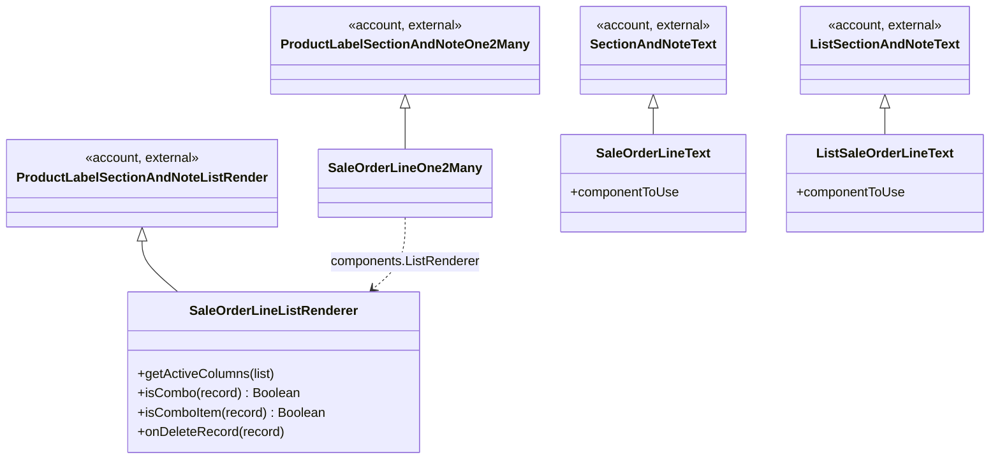

# C4 Code Level: sale_order_line_field

<!--
  Auto-generated by the c4-code agent. One file per source directory.
  Refreshed on /bmb:c4 reruns whenever the directory's content hash changes.
  Do NOT hand-edit; edits will be overwritten on next refresh.

  Linking conventions (MAINTAIN ON EVERY REWRITE):
  - This doc lives at memory-bank/c4/code/c4-code-<sanitized>.md (3 dirs below
    repo root). Use `../../../` to reach repo root for source-file links.
  - File:line references MUST be rendered as clickable markdown links of the
    form: [`<file>:<line>`](../../../<dir>/<file>#L<line>).
  - Directory paths under Overview → Location MUST be rendered as a markdown
    link to the directory itself: [`path/to/dir/`](../../../path/to/dir).
  - Internal-dependency directory names SHOULD be linked to their c4-code
    sibling doc when one exists in `memory-bank/c4/code/`, otherwise to the
    directory in the source tree.
  - The "Parent Component" up-link section near the bottom is filled by the
    c4-backlink agent; the AUTO-MANAGED markers below MUST be preserved
    verbatim so the back-link pass can find and populate them.
-->

## Generated By

- **Agent**: c4-code (Haiku)
- **Run ID**: c4-20261101-s4l3
- **Generated**: 2026-11-01T11:22:58Z
- **Source Directory**: [`addons/sale/static/src/js/sale_order_line_field`](../../../addons/sale/static/src/js/sale_order_line_field)
- **Content Hash**: git-tree 98436806af1ae711
- **Plugin**: bmb 2.2.1

## Overview

- **Name**: Sale order line field widget (`sol_o2m`, `sol_text`, `list.sol_text`)
- **Description**: OWL field widgets and a list renderer for the sale order lines one2many, adding combo-aware behaviour for combo lines and combo item lines.
- **Location**: [`addons/sale/static/src/js/sale_order_line_field`](../../../addons/sale/static/src/js/sale_order_line_field) — 2 files, 151 lines
- **Language**: JavaScript (Odoo 18.0 OWL, `/** @odoo-module **/`), QWeb XML
- **Purpose**: Customises how the sale order lines list is rendered and edited in the sale order form. It extends the account product-label/section-and-note field components, registers the field types with the Odoo field registry, and hides drag handles and delete buttons for combo item rows. The QWeb template `sale.ListRenderer.RecordRow` inherits the core list row template.

## Code Elements

### Functions / Methods

<!-- Class methods; this directory has no top-level functions. -->

- `getCellTitle(column, record) → string | undefined`
  - **Description**: Suppresses the cell tooltip for the `product_id` and `product_template_id` columns; otherwise defers to the parent implementation.
  - **Location**: [`sale_order_line_field.js:24`](../../../addons/sale/static/src/js/sale_order_line_field/sale_order_line_field.js#L24)
  - **Visibility**: public (override of list renderer hook)
  - **Dependencies**: `super.getCellTitle` (account `ProductLabelSectionAndNoteListRender`)

- `getActiveColumns(list) → Column[]`
  - **Description**: Removes the `product_template_id` column when the `product_id` column is also active, so only the variant column is shown.
  - **Location**: [`sale_order_line_field.js:33`](../../../addons/sale/static/src/js/sale_order_line_field/sale_order_line_field.js#L33)
  - **Visibility**: public (override of list renderer hook)
  - **Dependencies**: `super.getActiveColumns`

- `isSectionOrNote(record=null) → Boolean`
  - **Description**: Extends the parent check so that combo lines also count as section or note rows.
  - **Location**: [`sale_order_line_field.js:59`](../../../addons/sale/static/src/js/sale_order_line_field/sale_order_line_field.js#L59)
  - **Visibility**: public (override)
  - **Dependencies**: `super.isSectionOrNote`, `isCombo`

- `getRowClass(record) → string`
  - **Description**: Removes the `o_row_draggable` class for combo and combo item rows and adds `o_is_line_section` for combo rows.
  - **Location**: [`sale_order_line_field.js:63`](../../../addons/sale/static/src/js/sale_order_line_field/sale_order_line_field.js#L63)
  - **Visibility**: public (override)
  - **Dependencies**: `super.getRowClass`, `isCombo`, `isComboItem`

- `isCellReadonly(column, record) → Boolean`
  - **Description**: Makes every cell of a combo item row read-only except `name`, `tax_id` and `qty_delivered`.
  - **Location**: [`sale_order_line_field.js:71`](../../../addons/sale/static/src/js/sale_order_line_field/sale_order_line_field.js#L71)
  - **Visibility**: public (override)
  - **Dependencies**: `super.isCellReadonly`, `isComboItem`

- `async onDeleteRecord(record) → Promise<void>`
  - **Description**: For a combo row, clears `selected_combo_items` (set to an empty JSON list) before the parent delete runs.
  - **Location**: [`sale_order_line_field.js:78`](../../../addons/sale/static/src/js/sale_order_line_field/sale_order_line_field.js#L78)
  - **Visibility**: public (override)
  - **Dependencies**: `super.onDeleteRecord`, `isCombo`, record `update()`

- `isCombo(record) → Boolean`
  - **Description**: True when the record's `product_type` is `combo`.
  - **Location**: [`sale_order_line_field.js:85`](../../../addons/sale/static/src/js/sale_order_line_field/sale_order_line_field.js#L85)
  - **Visibility**: public
  - **Dependencies**: record `data.product_type`

- `isComboItem(record) → Boolean`
  - **Description**: True when the record has a `combo_item_id` set.
  - **Location**: [`sale_order_line_field.js:89`](../../../addons/sale/static/src/js/sale_order_line_field/sale_order_line_field.js#L89)
  - **Visibility**: public
  - **Dependencies**: record `data.combo_item_id`

- `componentToUse → Component` (getter, `SaleOrderLineText`)
  - **Description**: Uses `CharField` for combo lines; otherwise uses the parent section-and-note component.
  - **Location**: [`sale_order_line_field.js:109`](../../../addons/sale/static/src/js/sale_order_line_field/sale_order_line_field.js#L109)
  - **Visibility**: public (getter override)
  - **Dependencies**: `CharField`, `super.componentToUse`

- `componentToUse → Component` (getter, `ListSaleOrderLineText`)
  - **Description**: Same rule as above for the list variant: `CharField` for combo lines, otherwise the parent component.
  - **Location**: [`sale_order_line_field.js:115`](../../../addons/sale/static/src/js/sale_order_line_field/sale_order_line_field.js#L115)
  - **Visibility**: public (getter override)
  - **Dependencies**: `CharField`, `super.componentToUse`

### Classes / Modules

- **`SaleOrderLineListRenderer`** — list renderer for sale order lines; combo-aware row, cell and delete behaviour
  - **Location**: [`sale_order_line_field.js:18`](../../../addons/sale/static/src/js/sale_order_line_field/sale_order_line_field.js#L18)
  - **Methods**: `getCellTitle(...)`, `getActiveColumns(...)`, `isSectionOrNote(...)`, `getRowClass(...)`, `isCellReadonly(...)`, `onDeleteRecord(...)`, `isCombo(...)`, `isComboItem(...)`
  - **Implements / Extends**: extends `ProductLabelSectionAndNoteListRender` (account)
  - **Dependencies**: `ProductLabelSectionAndNoteListRender`, `sale.ListRenderer.RecordRow` template (static `recordRowTemplate`)

- **`SaleOrderLineOne2Many`** — one2many field component that swaps in `SaleOrderLineListRenderer` as `ListRenderer`
  - **Location**: [`sale_order_line_field.js:94`](../../../addons/sale/static/src/js/sale_order_line_field/sale_order_line_field.js#L94)
  - **Methods**: none (static `components` only)
  - **Implements / Extends**: extends `ProductLabelSectionAndNoteOne2Many` (account)
  - **Dependencies**: `SaleOrderLineListRenderer`, `ProductLabelSectionAndNoteOne2Many.components`

- **`SaleOrderLineText`** — section/note text field for sale order lines; uses `CharField` for combo rows
  - **Location**: [`sale_order_line_field.js:108`](../../../addons/sale/static/src/js/sale_order_line_field/sale_order_line_field.js#L108)
  - **Methods**: `componentToUse` (getter)
  - **Implements / Extends**: extends `SectionAndNoteText` (account)
  - **Dependencies**: `CharField` (web views)

- **`ListSaleOrderLineText`** — list-view variant of `SaleOrderLineText`
  - **Location**: [`sale_order_line_field.js:114`](../../../addons/sale/static/src/js/sale_order_line_field/sale_order_line_field.js#L114)
  - **Methods**: `componentToUse` (getter)
  - **Implements / Extends**: extends `ListSectionAndNoteText` (account)
  - **Dependencies**: `CharField` (web views)

### Constants / Configuration

- `SaleOrderLineListRenderer.recordRowTemplate = 'sale.ListRenderer.RecordRow'` — QWeb template name used for list rows ([`sale_order_line_field.js:19`](../../../addons/sale/static/src/js/sale_order_line_field/sale_order_line_field.js#L19))
- `saleOrderLineOne2Many` — field descriptor spreading the account one2many descriptor, with `SaleOrderLineOne2Many` as component ([`sale_order_line_field.js:100`](../../../addons/sale/static/src/js/sale_order_line_field/sale_order_line_field.js#L100))
- `saleOrderLineText` — field descriptor spreading the account section-and-note text descriptor, with `SaleOrderLineText` as component ([`sale_order_line_field.js:120`](../../../addons/sale/static/src/js/sale_order_line_field/sale_order_line_field.js#L120))
- `listSaleOrderLineText` — list-view field descriptor, with `ListSaleOrderLineText` as component ([`sale_order_line_field.js:125`](../../../addons/sale/static/src/js/sale_order_line_field/sale_order_line_field.js#L125))
- Field registry key `sol_o2m` — registers `saleOrderLineOne2Many` ([`sale_order_line_field.js:106`](../../../addons/sale/static/src/js/sale_order_line_field/sale_order_line_field.js#L106))
- Field registry key `sol_text` — registers `saleOrderLineText` ([`sale_order_line_field.js:130`](../../../addons/sale/static/src/js/sale_order_line_field/sale_order_line_field.js#L130))
- Field registry key `list.sol_text` — registers `listSaleOrderLineText` ([`sale_order_line_field.js:131`](../../../addons/sale/static/src/js/sale_order_line_field/sale_order_line_field.js#L131))
- Combo product type literal `'combo'` — the business rule that drives all combo behaviour in this directory ([`sale_order_line_field.js:86`](../../../addons/sale/static/src/js/sale_order_line_field/sale_order_line_field.js#L86), [`sale_order_line_field.js:110`](../../../addons/sale/static/src/js/sale_order_line_field/sale_order_line_field.js#L110), [`sale_order_line_field.js:116`](../../../addons/sale/static/src/js/sale_order_line_field/sale_order_line_field.js#L116))

### QWeb template: `sale.ListRenderer.RecordRow`

Declared in [`sale_order_line_field.xml:4`](../../../addons/sale/static/src/js/sale_order_line_field/sale_order_line_field.xml#L4). It inherits `web.ListRenderer.RecordRow` in primary mode and makes two changes:

- Drag handle `Field` is hidden for combo and combo item rows (`t-if`) ([`sale_order_line_field.xml:9`](../../../addons/sale/static/src/js/sale_order_line_field/sale_order_line_field.xml#L9))
- The remove-button cell `td.o_list_record_remove` gets `d-none` for combo item rows ([`sale_order_line_field.xml:15`](../../../addons/sale/static/src/js/sale_order_line_field/sale_order_line_field.xml#L15))

## Terms

<!--
  Auto-generated by the c4-code agent (Step 3.6). Raw term observations for
  this directory — no clustering, no canonicalization.
-->

### Entities

| Term | Normalized | Singular | Stems | Frequency | First seen |
|---|---|---|---|---:|---|
| `SaleOrderLineListRenderer` | saleorderlinelistrenderer | SaleOrderLineListRenderer | sale, order, line, list, render | 2 | [`sale_order_line_field.js:18`](../../../addons/sale/static/src/js/sale_order_line_field/sale_order_line_field.js#L18) |
| `SaleOrderLineOne2Many` | saleorderlineone2many | SaleOrderLineOne2Many | sale, order, line, one2many | 2 | [`sale_order_line_field.js:94`](../../../addons/sale/static/src/js/sale_order_line_field/sale_order_line_field.js#L94) |
| `SaleOrderLineText` | saleorderlinetext | SaleOrderLineText | sale, order, line, text | 2 | [`sale_order_line_field.js:108`](../../../addons/sale/static/src/js/sale_order_line_field/sale_order_line_field.js#L108) |
| `ListSaleOrderLineText` | listsaleorderlinetext | ListSaleOrderLineText | list, sale, order, line, text | 2 | [`sale_order_line_field.js:114`](../../../addons/sale/static/src/js/sale_order_line_field/sale_order_line_field.js#L114) |

### Actions

| Term | Normalized | Stems | Frequency | First seen |
|---|---|---|---:|---|
| `getCellTitle` | getcelltitle | get, cell, title | 2 | [`sale_order_line_field.js:24`](../../../addons/sale/static/src/js/sale_order_line_field/sale_order_line_field.js#L24) |
| `getActiveColumns` | getactivecolumns | get, active, column | 2 | [`sale_order_line_field.js:33`](../../../addons/sale/static/src/js/sale_order_line_field/sale_order_line_field.js#L33) |
| `isSectionOrNote` | issectionornote | is, section, or, note | 2 | [`sale_order_line_field.js:59`](../../../addons/sale/static/src/js/sale_order_line_field/sale_order_line_field.js#L59) |
| `getRowClass` | getrowclass | get, row, class | 2 | [`sale_order_line_field.js:63`](../../../addons/sale/static/src/js/sale_order_line_field/sale_order_line_field.js#L63) |
| `isCellReadonly` | iscellreadonly | is, cell, readonly | 2 | [`sale_order_line_field.js:71`](../../../addons/sale/static/src/js/sale_order_line_field/sale_order_line_field.js#L71) |
| `onDeleteRecord` | ondeleterecord | on, delete, record | 2 | [`sale_order_line_field.js:78`](../../../addons/sale/static/src/js/sale_order_line_field/sale_order_line_field.js#L78) |
| `isCombo` | iscombo | is, combo | 6 | [`sale_order_line_field.js:60`](../../../addons/sale/static/src/js/sale_order_line_field/sale_order_line_field.js#L60) |
| `isComboItem` | iscomboitem | is, combo, item | 5 | [`sale_order_line_field.js:65`](../../../addons/sale/static/src/js/sale_order_line_field/sale_order_line_field.js#L65) |
| `componentToUse` | componenttouse | component, to, use | 4 | [`sale_order_line_field.js:109`](../../../addons/sale/static/src/js/sale_order_line_field/sale_order_line_field.js#L109) |

<!--
  USER-MANAGED term exclusions for this c4-code doc.

  Format (one per line):
    <term> → exclude (reason)

  Markers MUST be preserved verbatim across rewrites.
-->

<!-- USER-MANAGED: term-exclusions -->
(none)
<!-- /USER-MANAGED: term-exclusions -->

## Source Files

- [`sale_order_line_field.js`](../../../addons/sale/static/src/js/sale_order_line_field/sale_order_line_field.js)
- [`sale_order_line_field.xml`](../../../addons/sale/static/src/js/sale_order_line_field/sale_order_line_field.xml)

## Dependencies

### Internal

- [`addons/web/static/src/core`](../../../addons/web/static/src/core) — `@web/core/registry` (field registration via `registry.category('fields')`)
- [`addons/web/static/src/views/fields/char`](../../../addons/web/static/src/views/fields/char) — `@web/views/fields/char/char_field` (`CharField`, used for combo text rows)
- [`addons/account/static/src/components/product_label_section_and_note_field`](../../../addons/account/static/src/components/product_label_section_and_note_field) — `@account/...` base list renderer and one2many component that this directory extends
- [`addons/account/static/src/components/section_and_note_fields_backend`](../../../addons/account/static/src/components/section_and_note_fields_backend) — `@account/...` base section/note text fields and descriptors that this directory extends
- [`addons/web/static/src/views/list`](../../../addons/web/static/src/views/list) — `web.ListRenderer.RecordRow` QWeb template inherited by `sale.ListRenderer.RecordRow`
- [`addons/sale/static/src/js/combo_configurator_dialog`](../c4-code-addons-sale-static-src-js-combo_configurator_dialog.md) — sibling sale combo UI; shares the `product_type === 'combo'` / `combo_item_id` concept (no direct import in this directory)

### External

- `Odoo 18.0 framework (OWL, QWeb)` — provides the `@odoo-module` runtime, field registry and list renderer base classes; version pinned by the Odoo 18.0 code base, not in this directory

## Relationships

## Notes for Higher-Level Synthesis

- Belongs with the sale order UI combo logic (`addons/sale/static/src/js`), alongside the combo configurator components. Combo rules (`product_type === 'combo'`, `combo_item_id`) are shared concepts, so group with [`combo_configurator_dialog`](../c4-code-addons-sale-static-src-js-combo_configurator_dialog.md).
- Boundary code: this directory is the frontend registration point for the `sol_o2m`, `sol_text` and `list.sol_text` field types used in sale views. It translates view configuration into list and field presentation.
- Not a pure utility. It is domain-bearing (combo line behaviour) but holds no persistence, state or server calls of its own.

## Parent Component

<!-- AUTO-MANAGED: parent-component -->

- **Component**: [`sale`](../components/c4-component-sale.md)
- **Container**: [`Odoo Application Server`](../containers/c4-container-odoo-application-server.md) — Compute
- **Context**: [`c4-context.md`](../c4-context.md)

<!-- /AUTO-MANAGED: parent-component -->
