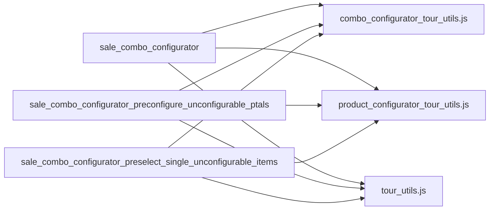

# C4 Code Level: Sale Web Tour Tests

<!--
  Auto-generated by the c4-code agent. One file per source directory.
  Refreshed on /bmb:c4 reruns whenever the directory's content hash changes.
  Do NOT hand-edit; edits will be overwritten on next refresh.

  Linking conventions (MAINTAIN ON EVERY REWRITE):
  - This doc lives at memory-bank/c4/code/c4-code-<sanitized>.md (3 dirs below
    repo root). Use `../../../` to reach repo root for source-file links.
  - File:line references MUST be rendered as clickable markdown links of the
    form: [`<file>:<line>`](../../../<dir>/<file>#L<line>).
  - Directory paths under Overview → Location MUST be rendered as a markdown
    link to the directory itself: [`path/to/dir/`](../../../path/to/dir).
  - Internal-dependency directory names SHOULD be linked to their c4-code
    sibling doc when one exists in `memory-bank/c4/code/`, otherwise to the
    directory in the source tree.
  - The "Parent Component" up-link section near the bottom is filled by the
    c4-backlink agent; the AUTO-MANAGED markers below MUST be preserved
    verbatim so the back-link pass can find and populate them.
-->

## Generated By

- **Agent**: c4-code (Haiku)
- **Run ID**: c4-20261101-s4l3
- **Generated**: 2026-11-01T11:22:58Z
- **Source Directory**: [`addons/sale/static/tests/tours`](../../../addons/sale/static/tests/tours)
- **Content Hash**: git-tree af45800f074ba3c3

## Overview

- **Name**: Sale web_tour E2E test tours
- **Description**: Browser-driven web_tour scripts that walk Sales user journeys (quotation emailing, product attribute value deletion, catalog ordering, combo product configuration, portal quote signing).
- **Location**: [`addons/sale/static/tests/tours`](../../../addons/sale/static/tests/tours) — 7 files, 446 lines (8 registered tours)
- **Language**: JavaScript (Odoo 18.0 ES modules; one file carries the `/** @odoo-module **/` header)
- **Purpose**: End-to-end regression coverage for the Sale app. Each tour is registered in the `web_tour.tours` registry and executed by a Python HttpCase test outside this directory. Two tours depend on fixture data created by those Python tests. Test-only code: no production behaviour lives here.

## Code Elements

### Functions / Methods

Both helpers are module-local step builders in one file. They are not exported.

- `openProductAttribute(product_attribute)` → step array (JS, untyped)
  - **Description**: Builds steps that go to the Sales app, open the Configuration menu, open the Product Attributes list, and click the attribute named by the argument.
  - **Location**: [`product_attribute_value_tour.js:4`](../../../addons/sale/static/tests/tours/product_attribute_value_tour.js#L4)
  - **Visibility**: internal (module-local `const`)
  - **Dependencies**: `stepUtils.goToAppSteps` from `@web_tour/tour_service/tour_utils` (import at [`product_attribute_value_tour.js:2`](../../../addons/sale/static/tests/tours/product_attribute_value_tour.js#L2))

- `deletePAV(product_attribute_value, message)` → step array (JS, untyped)
  - **Description**: Builds steps that click the remove button on the given attribute value's row, check the confirmation modal (default title `Bye-bye, record!` when `message` is omitted), and click the modal close button.
  - **Location**: [`product_attribute_value_tour.js:22`](../../../addons/sale/static/tests/tours/product_attribute_value_tour.js#L22)
  - **Visibility**: internal (module-local `const`)
  - **Dependencies**: none external (pure step builder)

### Classes / Modules

No classes. Each entry below is one `web_tour.tours` registration (module-style unit). The `steps` builder is inline in each registration.

- **`mail_attachment_removal_tour`** — quotation send-by-email with attachment removal
  - **Location**: [`mail_attachment_removal_test_tour.js:3`](../../../addons/sale/static/tests/tours/mail_attachment_removal_test_tour.js#L3)
  - **Methods**: `steps()` (inline array)
  - **Implements / Extends**: registers into `web_tour.tours`
  - **Dependencies**: `registry` from `@web/core/registry`
  - **User journey**: Click "send by email" on the quotation status bar → save a new document layout in the technical modal → delete an attachment from the attachments field → click send in the mail composer → confirm the quotation. No `url` set, so it runs from the current page.

- **`delete_product_attribute_value_tour`** — deleting product attribute values with usage guards
  - **Location**: [`product_attribute_value_tour.js:41`](../../../addons/sale/static/tests/tours/product_attribute_value_tour.js#L41)
  - **Methods**: `steps()` (uses `openProductAttribute` and `deletePAV`)
  - **Implements / Extends**: registers into `web_tour.tours`
  - **Dependencies**: `registry` from `@web/core/registry`; `stepUtils` from `@web_tour/tour_service/tour_utils`
  - **User journey**: Starts at `/odoo`, navigates Sales → Configuration → Product Attributes → "PA". Then: attempt to delete `pa_value_1` (used on a product), expect the error text naming `pa_value_1` in the modal; delete `pa_value_2` (used only on an archived product), expect the default confirmation; delete `pa_value_3` (removed from a product), expect the default confirmation; finally assert the "Attributes" link is present. Fixture data comes from the Python test (comment at [`product_attribute_value_tour.js:40`](../../../addons/sale/static/tests/tours/product_attribute_value_tour.js#L40)).

- **`sale_catalog`** — ordering through the product catalog
  - **Location**: [`sale_catalog.js:3`](../../../addons/sale/static/tests/tours/sale_catalog.js#L3)
  - **Methods**: `steps()` (inline array)
  - **Implements / Extends**: registers into `web_tour.tours`
  - **Dependencies**: `registry` from `@web/core/registry`
  - **User journey**: Create a new sales order from the list → pick the first customer in the dropdown → open the product catalog → search "Restricted" → wait until "Restricted Product" shows and "AAA Product" is filtered out → add it → set the quantity to 6 → increase it by one → close the catalog. No `url` set.

- **`sale_combo_configurator`** — full combo product configuration lifecycle
  - **Location**: [`sale_combo_configurator.js:9`](../../../addons/sale/static/tests/tours/sale_combo_configurator.js#L9)
  - **Methods**: `steps()` (inline array; uses `comboConfiguratorTourUtils`, `productConfiguratorTourUtils`, `tourUtils`, `stepUtils`)
  - **Implements / Extends**: registers into `web_tour.tours`
  - **Dependencies**: `registry`; `stepUtils`; the three sale tour helper modules (see Dependencies → Internal)
  - **User journey**: At `/odoo`, open Sales → create an order for "Test Partner" → add "Combo product". Checks: 2 combos with 2 items each; price follows quantity (1 → 25.00, 2 → 50.00, 1 → 25.00, 3 → 75.00). Confirm stays disabled until one item per combo is chosen. Choose "Product A1", which has a configurable no-variant attribute, set value "A", save (price 90.00). Re-open it, set a custom no-variant value "B" with free text, save (price 93.00). Verify the order lines (quantities 3.00, unit prices 18.50 and 12.50, subtotal 93.00). Edit the line, reopen with the previous selection, set quantity to 2, confirm "Product A1" and "Product B2" are still selected, change the first item to "Product A2", save, and verify the updated lines and 50.00 total. Ends with saving the form.

- **`sale_combo_configurator_preconfigure_unconfigurable_ptals`** — preconfigured combo items
  - **Location**: [`sale_combo_configurator_preconfigure_unconfigurable_ptals.js:9`](../../../addons/sale/static/tests/tours/sale_combo_configurator_preconfigure_unconfigurable_ptals.js#L9)
  - **Methods**: `steps()` (inline array)
  - **Implements / Extends**: registers into `web_tour.tours`
  - **Dependencies**: `registry`; `stepUtils`; sale combo, product configurator and tour helper modules
  - **User journey**: At `/odoo`, create an order for "Test Partner" and add "Combo product". Verify that "Test product" is already showing "Attribute A: A" (unconfigurable, so preselected) and not "Attribute B: B" (configurable). Select the item, set Attribute B to "B" in multi-select, save the configurator, verify "Attribute B: B" now shows, save the combo configurator, save the form.

- **`sale_combo_configurator_preselect_single_unconfigurable_items`** — preselection of single unconfigurable items
  - **Location**: [`sale_combo_configurator_preselect_single_unconfigurable_items.js:9`](../../../addons/sale/static/tests/tours/sale_combo_configurator_preselect_single_unconfigurable_items.js#L9)
  - **Methods**: `steps()` (inline array)
  - **Implements / Extends**: registers into `web_tour.tours`
  - **Dependencies**: `registry`; `stepUtils`; sale combo, product configurator and tour helper modules
  - **User journey**: At `/odoo`, create an order for "Test Partner" and add "Combo product". Verify exactly two items are preselected ("Product A" and "Product C"), and confirm stays disabled. Configure "Product B" (Attribute B = "B"), configure "Product D" (custom Attribute D value "Test D"), select "Product E1", confirm enables, save the combo configurator, save the form.

- **`sale_signature`** — customer signs a quotation in the portal
  - **Location**: [`sale_signature.js:8`](../../../addons/sale/static/tests/tours/sale_signature.js#L8)
  - **Methods**: `steps()` (inline array; includes an inline `run(helpers)` that polls the canvas)
  - **Implements / Extends**: registers into `web_tour.tours`
  - **Dependencies**: `waitUntil` from `@odoo/hoot-dom` ([`sale_signature.js:3`](../../../addons/sale/static/tests/tours/sale_signature.js#L3)); `redirect` from `@web/core/utils/urls` ([`sale_signature.js:5`](../../../addons/sale/static/tests/tours/sale_signature.js#L5))
  - **User journey**: At `/my/quotes`, open the test SO → click Sign → clear the name (submit must be disabled) → enter "Joel Willis" (submit enabled) → wait until the signature canvas has drawn pixels → open the auto-select style dropdown and pick the fourth style → submit → confirm the "Thank You" message → redirect to `/odoo` and wait for the navigation bar. Fixture SO comes from the Python test (comment at [`sale_signature.js:7`](../../../addons/sale/static/tests/tours/sale_signature.js#L7)).

- **`sale_signature_without_name`** — signature validation when no signature is drawn
  - **Location**: [`sale_signature.js:87`](../../../addons/sale/static/tests/tours/sale_signature.js#L87)
  - **Methods**: `steps()` (inline array)
  - **Implements / Extends**: registers into `web_tour.tours`
  - **Dependencies**: `registry` (import in the same file)
  - **User journey**: Click "Sign & Pay" in the portal sidebar (supports iframe-hosted portal), click submit without a signature, expect the error "Signature is missing.". No `url` set.

### Constants / Configuration

None. No constants encode business rules in this directory. Step-level strings such as `Bye-bye, record!` and `Joel Willis` are UI text and fixture names, not configuration.

## Entities

No ORM models, schema definitions, or persistence-bearing classes in this directory. Section omitted.

## Terms

### Actions

| Term | Normalized | Stems | Frequency | First seen |
|---|---|---|---:|---|
| `openProductAttribute` | openproductattribute | open, product, attribute | 2 | [`product_attribute_value_tour.js:4`](../../../addons/sale/static/tests/tours/product_attribute_value_tour.js#L4) |
| `deletePAV` | deletepav | delete, pav | 4 | [`product_attribute_value_tour.js:22`](../../../addons/sale/static/tests/tours/product_attribute_value_tour.js#L22) |

<!--
  USER-MANAGED term exclusions for this c4-code doc.

  Format (one per line):
    <term> → exclude (reason)

  Excluded terms are filtered out by the c4-component agent and
  c4-glossary-aggregator. Useful when a class/function name is purely
  technical (e.g., a local Cache helper) and should NOT be merged into
  the domain glossary.

  Markers MUST be preserved verbatim across rewrites.
-->

<!-- USER-MANAGED: term-exclusions -->
(none)
<!-- /USER-MANAGED: term-exclusions -->

## Source Files

- [`mail_attachment_removal_test_tour.js`](../../../addons/sale/static/tests/tours/mail_attachment_removal_test_tour.js)
- [`product_attribute_value_tour.js`](../../../addons/sale/static/tests/tours/product_attribute_value_tour.js)
- [`sale_catalog.js`](../../../addons/sale/static/tests/tours/sale_catalog.js)
- [`sale_combo_configurator.js`](../../../addons/sale/static/tests/tours/sale_combo_configurator.js)
- [`sale_combo_configurator_preconfigure_unconfigurable_ptals.js`](../../../addons/sale/static/tests/tours/sale_combo_configurator_preconfigure_unconfigurable_ptals.js)
- [`sale_combo_configurator_preselect_single_unconfigurable_items.js`](../../../addons/sale/static/tests/tours/sale_combo_configurator_preselect_single_unconfigurable_items.js)
- [`sale_signature.js`](../../../addons/sale/static/tests/tours/sale_signature.js)

## Dependencies

### Internal

- [`addons/sale/static/src/js/tours`](../../../addons/sale/static/src/js/tours) — shared sale tour helpers, aliased as `@sale/js/tours/*`. Used by the three combo tours: [`combo_configurator_tour_utils.js`](../../../addons/sale/static/src/js/tours/combo_configurator_tour_utils.js) (combo assertions and actions), [`product_configurator_tour_utils.js`](../../../addons/sale/static/src/js/tours/product_configurator_tour_utils.js) (attribute selection in the configurator), [`tour_utils.js`](../../../addons/sale/static/src/js/tours/tour_utils.js) (order creation, customer and product selection, SOL checks).
- Odoo framework modules (outside this repo walk, not repo paths): `@web/core/registry`, `@web_tour/tour_service/tour_utils` (`stepUtils`), `@web/core/utils/urls` (`redirect`). Used by all tours for registration and step helpers.

### External

- `@odoo/hoot-dom` — `waitUntil` polling for the drawn signature in `sale_signature`. Version: provided by Odoo 18.0 core; no pin in this directory.
- Odoo 18.0 `web_tour` framework — tour registry (`web_tour.tours`) and step utilities. Version: Odoo 18.0 core; no pin in this directory.

## Relationships

Only the three combo tours depend on the shared sale tour helpers. The other tours use only the framework.

## Notes for Higher-Level Synthesis

- Test-only E2E browser code for the Sale app. It does not belong to a production component. Group it with the sale module's test component, alongside the Python HttpCase tests that drive these tours (those tests are outside this walk).
- The combo tours share helpers in `addons/sale/static/src/js/tours`. Treat those helpers as the combo-configurator component's test support.
- Two tours (`delete_product_attribute_value_tour`, `sale_signature`) rely on fixture data created in Python tests. A higher-level synthesis should record that dependency rather than treat the tours as self-contained.

## Parent Component

<!--
  AUTO-MANAGED by the c4-backlink agent. Do not hand-edit between markers —
  edits will be overwritten on the next /bmb:c4 run. This section provides
  the upward link to the component that owns this code directory, completing
  the two-way navigation across C4 layers.

  Source of truth: c4-manifest.md § Component-Level Entries
    (component-entries.constituent_code_docs).
-->

<!-- AUTO-MANAGED: parent-component -->

- **Component**: [`sale`](../components/c4-component-sale.md)
- **Container**: [`Odoo Application Server`](../containers/c4-container-odoo-application-server.md) — Compute
- **Context**: [`c4-context.md`](../c4-context.md)

<!-- /AUTO-MANAGED: parent-component -->
