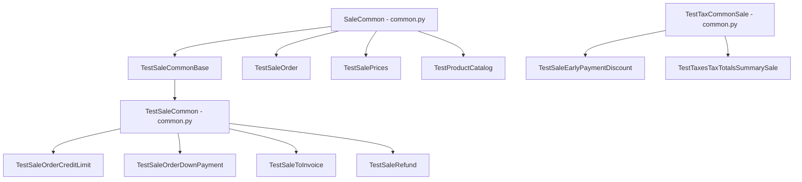

# C4 Code Level: addons/sale/tests

<!--
  Auto-generated by the c4-code agent. One file per source directory.
  Refreshed on /bmb:c4 reruns whenever the directory's content hash changes.
  Do NOT hand-edit; edits will be overwritten on next refresh.

  Linking conventions (MAINTAIN ON EVERY REWRITE):
  - This doc lives at memory-bank/c4/code/c4-code-<sanitized>.md (3 dirs below
    repo root). Use `../../../` to reach repo root for source-file links.
  - File:line references MUST be rendered as clickable markdown links of the
    form: [`<file>:<line>`](../../../<dir>/<file>#L<line>).
  - Directory paths under Overview → Location MUST be rendered as a markdown
    link to the directory itself: [`path/to/dir/`](../../../path/to/dir).
  - Internal-dependency directory names SHOULD be linked to their c4-code
    sibling doc when one exists in `memory-bank/c4/code/`, otherwise to the
    directory in the source tree.
  - The "Parent Component" up-link section near the bottom is filled by the
    c4-backlink agent; the AUTO-MANAGED markers below MUST be preserved
    verbatim so the back-link pass can find and populate them.
-->

## Generated By

- **Agent**: c4-code (Haiku)
- **Run ID**: c4-20261101-s4l3
- **Generated**: 2026-11-01T11:22:58Z
- **Source Directory**: [`addons/sale/tests`](../../../addons/sale/tests)
- **Content Hash**: 890ba7843757feab (git-tree)

## Overview

- **Name**: Sale module test suite
- **Description**: Odoo 18.0 test package for the `sale` addon: shared fixtures in `common.py`, plus 25 test modules covering sale orders, pricing, discounts, down payments, invoicing, credit limits, access rights, controllers, payments, product configurator/combo, catalog and tax totals.
- **Location**: [`addons/sale/tests`](../../../addons/sale/tests) — 28 files (25 test modules, 2 fixture modules, 1 package `__init__.py`); line count not measured
- **Language**: Python 3 (Odoo 18.0 test framework)
- **Purpose**: Automated regression tests for the sale addon. Test classes subclass Odoo's `TransactionCase` / `HttpCase` or a shared fixture class; they run at install or post-install (`@tagged`) and exercise ORM behaviour, business rules, HTTP controllers and browser tours.

## Code Elements

### Functions / Methods

Fixture and helper methods only. Test methods (`test_*`) are not enumerated; see the per-module summary below.

- `SaleCommon.setUpClass(cls)` — builds a company US country, a sale order with an empty order and a two-line order, and clears taxes on the product fixtures
  - **Description**: Base fixture setup shared by most sale test classes
  - **Location**: [`common.py:17`](../../../addons/sale/tests/common.py#L17)
  - **Visibility**: public (classmethod)
  - **Dependencies**: `odoo.fields.Command`, `ProductCommon` and `SalesTeamCommon` fixtures (inherited)
- `SaleCommon._enable_pricelists(cls)` — adds the pricelist group to the current user
  - **Description**: Test helper toggling the product pricelist feature
  - **Location**: [`common.py:47`](../../../addons/sale/tests/common.py#L47)
  - **Visibility**: internal (classmethod)
  - **Dependencies**: `product.group_product_pricelist` XML id
- `SaleCommon._enable_discounts(cls)` — adds the discount-per-SO-line group to the current user
  - **Description**: Test helper toggling the discount feature
  - **Location**: [`common.py:51`](../../../addons/sale/tests/common.py#L51)
  - **Visibility**: internal (classmethod)
  - **Dependencies**: `cls.group_discount_per_so_line`
- `TestSaleCommonBase.setup_sale_configuration_for_company(cls, company)` — creates a sales team, salesman/portal/employee users, a pricelist, a product category and nine products (service, consumable with expense policies) for a given company
  - **Description**: Reusable sale configuration data, company-scoped; returns a dict of created records
  - **Location**: [`common.py:59`](../../../addons/sale/tests/common.py#L59)
  - **Visibility**: public (classmethod)
  - **Dependencies**: `crm.team`, `res.users`, `product.pricelist`, `product.category`, `product.product`, `uom` XML ids
- `TestSaleCommon.collect_company_accounting_data(cls, company)` — extends the accounting fixture with sale configuration and links the product category to revenue/expense accounts
  - **Description**: Hook used by `AccountTestInvoicingCommon` to add sale data post-accounting setup
  - **Location**: [`common.py:246`](../../../addons/sale/tests/common.py#L246)
  - **Visibility**: public (classmethod)
  - **Dependencies**: `AccountTestInvoicingCommon.collect_company_accounting_data`
- `TestTaxCommonSale.setUpClass(cls)` — creates a foreign-currency pricelist for tax tests
  - **Description**: Tax fixture setup for sale-level tax tests
  - **Location**: [`common.py:262`](../../../addons/sale/tests/common.py#L262)
  - **Visibility**: public (classmethod)
  - **Dependencies**: `TestTaxCommon` fixtures
- `TestTaxCommonSale.convert_document_to_sale_order(self, document)` — converts a generic tax-test document into a `sale.order` with lines, currency and rate
  - **Description**: Bridges the account tax-test document format into sale orders
  - **Location**: [`common.py:269`](../../../addons/sale/tests/common.py#L269)
  - **Visibility**: public
  - **Dependencies**: `setup_other_currency`, `sale.order`
- `TestTaxCommonSale.assert_sale_order_tax_totals_summary(self, sale_order, expected_values, soft_checking=False)` — asserts tax totals and sale order amounts (untaxed, tax, total) including cash-rounding adjustment
  - **Description**: Assertion helper for sale-order tax totals
  - **Location**: [`common.py:292`](../../../addons/sale/tests/common.py#L292)
  - **Visibility**: public
  - **Dependencies**: `_assert_tax_totals_summary`, `assertRecordValues`
- `TestProductConfiguratorCommon.setUpClass(cls)` — prepares product configurator fixtures (loads image data via `file_open`, base64-encoded)
  - **Description**: Fixture for configurator data tests
  - **Location**: [`product_configurator_common.py:10`](../../../addons/sale/tests/product_configurator_common.py#L10)
  - **Visibility**: public (classmethod)
  - **Dependencies**: `base64`, `odoo.tools.misc.file_open`
- `TestProductCatalog.setUp(self)` — per-test setup for the catalog tests
  - **Description**: Per-test setup for catalog scenarios
  - **Location**: [`test_product_catalog.py:21`](../../../addons/sale/tests/test_product_catalog.py#L21)
  - **Visibility**: internal
  - **Dependencies**: `SaleCommon`
- `TestProductCatalog._get_default_catalog_data(self, product)` — builds default catalog payload for a product
  - **Description**: Helper producing catalog request data
  - **Location**: [`test_product_catalog.py:55`](../../../addons/sale/tests/test_product_catalog.py#L55)
  - **Visibility**: internal
  - **Dependencies**: none beyond ORM
- `TestProductCatalog._create_pricelist_discount_rules(self)` — creates pricelist discount rules for catalog tests
  - **Description**: Helper creating pricelist rules
  - **Location**: [`test_product_catalog.py:79`](../../../addons/sale/tests/test_product_catalog.py#L79)
  - **Visibility**: internal
  - **Dependencies**: `product.pricelist.item`
- `TestSaleComboConfigurator._create_combo_from_attribute(self, attribute, product_name, combo_name)` — builds a combo product from a product attribute
  - **Description**: Helper for combo configurator scenarios
  - **Location**: [`test_sale_combo_configurator.py:159`](../../../addons/sale/tests/test_sale_combo_configurator.py#L159)
  - **Visibility**: internal
  - **Dependencies**: `product.template`, `product.combo`
- `TestSaleOrder._create_sale_order(self)` — creates a standard sale order fixture
  - **Description**: Helper used across `TestSaleOrder` cases
  - **Location**: [`test_sale_order.py:333`](../../../addons/sale/tests/test_sale_order.py#L333)
  - **Visibility**: internal
  - **Dependencies**: `sale.order`
- `TestSalePrices._create_discount_pricelist_rule(self, **additional_values)` — creates a pricelist discount rule with overridable values
  - **Description**: Helper for price and discount tests
  - **Location**: [`test_sale_prices.py:35`](../../../addons/sale/tests/test_sale_prices.py#L35)
  - **Visibility**: internal
  - **Dependencies**: `product.pricelist.item`
- `TestSaleOrderDownPayment._assert_invoice_lines_values(self, lines, expected)` — asserts invoice line values for down-payment invoices
  - **Description**: Assertion helper
  - **Location**: [`test_sale_order_down_payment.py:106`](../../../addons/sale/tests/test_sale_order_down_payment.py#L106)
  - **Visibility**: internal
  - **Dependencies**: `assertRecordValues`
- `TestSaleToInvoice._check_order_search(self, orders, domain, expected_result)` — asserts a sale order search domain returns the expected records
  - **Description**: Assertion helper for to-invoice search filters
  - **Location**: [`test_sale_to_invoice.py:67`](../../../addons/sale/tests/test_sale_to_invoice.py#L67)
  - **Visibility**: internal
  - **Dependencies**: `sale.order` search
- `TestSaleProductAttributeValueCommon._setup_currency(cls, currency_ratio=2)` — creates a foreign currency with a rate for attribute-value price tests
  - **Description**: Currency fixture helper
  - **Location**: [`test_sale_product_attribute_value_config.py:23`](../../../addons/sale/tests/test_sale_product_attribute_value_config.py#L23)
  - **Visibility**: internal (classmethod)
  - **Dependencies**: `res.currency`, `res.currency.rate`
- `TestSaleProductAttributeValueCommon._set_or_create_rate_today(cls, currency, rate)` — sets or creates today's rate for a currency
  - **Description**: Rate fixture helper
  - **Location**: [`test_sale_product_attribute_value_config.py:36`](../../../addons/sale/tests/test_sale_product_attribute_value_config.py#L36)
  - **Visibility**: internal (classmethod)
  - **Dependencies**: `res.currency.rate`
- `TestSaleProductAttributeValueCommon._get_or_create_currency(cls, name, symbol)` — returns or creates a currency
  - **Description**: Currency lookup helper
  - **Location**: [`test_sale_product_attribute_value_config.py:62`](../../../addons/sale/tests/test_sale_product_attribute_value_config.py#L62)
  - **Visibility**: internal (classmethod)
  - **Dependencies**: `res.currency`

### Classes / Modules

Fixture classes (shared by test modules):

- **`SaleCommon`** — base fixture: products, company, two-line sale order, salesteam
  - **Location**: [`common.py:11`](../../../addons/sale/tests/common.py#L11)
  - **Methods**: `setUpClass(...)`, `_enable_pricelists(...)`, `_enable_discounts(...)`
  - **Implements / Extends**: `ProductCommon`, `SalesTeamCommon`
  - **Dependencies**: `odoo.addons.product.tests.common`, `odoo.addons.sales_team.tests.common`
- **`TestSaleCommonBase`** — `TransactionCase` providing per-company sale configuration without accounting setup
  - **Location**: [`common.py:55`](../../../addons/sale/tests/common.py#L55)
  - **Methods**: `setup_sale_configuration_for_company(...)`
  - **Implements / Extends**: `TransactionCase`
  - **Dependencies**: `odoo.tests`
- **`TestSaleCommon`** — post-install fixture combining accounting (`AccountTestInvoicingCommon`) with sale configuration. Note: name is shared with `test_common.TestSaleCommon` (see below)
  - **Location**: [`common.py:242`](../../../addons/sale/tests/common.py#L242)
  - **Methods**: `collect_company_accounting_data(...)`
  - **Implements / Extends**: `AccountTestInvoicingCommon`, `TestSaleCommonBase`
  - **Dependencies**: `odoo.addons.account.tests.common`
- **`TestTaxCommonSale`** — tax-test fixture with foreign-currency pricelist and document conversion
  - **Location**: [`common.py:259`](../../../addons/sale/tests/common.py#L259)
  - **Methods**: `setUpClass(...)`, `convert_document_to_sale_order(...)`, `assert_sale_order_tax_totals_summary(...)`
  - **Implements / Extends**: `TestTaxCommon`
  - **Dependencies**: `odoo.addons.account.tests.common`
- **`TestProductConfiguratorCommon`** — `TransactionCase` fixture for product configurator data
  - **Location**: [`product_configurator_common.py:7`](../../../addons/sale/tests/product_configurator_common.py#L7)
  - **Methods**: `setUpClass(...)`
  - **Implements / Extends**: `TransactionCase`
  - **Dependencies**: `base64`, `odoo.tools.misc`

Test classes (grouped by module; method counts from `def test_*` occurrences):

- **`TestAccessRights`** — access-rights tests (4 tests)
  - **Location**: [`test_access_rights.py:15`](../../../addons/sale/tests/test_access_rights.py#L15)
  - **Methods**: `setUpClass(...)`
  - **Implements / Extends**: `BaseUsersCommon`, `SaleCommon`, `MailCommon`
- **`TestAccruedSaleOrders`** — accrued sale order / accounting tests (4 tests)
  - **Location**: [`test_accrued_sale_orders.py:9`](../../../addons/sale/tests/test_accrued_sale_orders.py#L9)
  - **Methods**: `setUpClass(...)`
  - **Implements / Extends**: `AccountTestInvoicingCommon`
- **`TestSaleCommon`** (module-level; shadows the `common.py` name) — smoke/base test wrapper (1 test)
  - **Location**: [`test_common.py:10`](../../../addons/sale/tests/test_common.py#L10)
  - **Implements / Extends**: `SaleCommon`
- **`TestAccessRightsControllers`** — HTTP access-rights checks on sale controllers (part of 3 controller tests)
  - **Location**: [`test_controllers.py:11`](../../../addons/sale/tests/test_controllers.py#L11)
  - **Implements / Extends**: `BaseUsersCommon`, `HttpCase`, `SaleCommon`
- **`TestSalesControllers`** — sale controller behaviour over HTTP
  - **Location**: [`test_controllers.py:69`](../../../addons/sale/tests/test_controllers.py#L69)
  - **Implements / Extends**: `BaseUsersCommon`, `HttpCase`, `SaleCommon`
- **`TestSaleSignature`** — online signature flow for portal users
  - **Location**: [`test_controllers.py:86`](../../../addons/sale/tests/test_controllers.py#L86)
  - **Implements / Extends**: `HttpCaseWithUserPortal`
- **`TestSaleOrderCreditLimit`** — credit-limit warnings and checks on sale orders, including multi-company (7 tests; `@tagged('post_install', '-at_install')`)
  - **Location**: [`test_credit_limit.py:10`](../../../addons/sale/tests/test_credit_limit.py#L10)
  - **Methods**: `setUpClass(...)`, `test_credit_limit_multi_company` (at [`:46`](../../../addons/sale/tests/test_credit_limit.py#L46))
  - **Implements / Extends**: `TestSaleCommon` (`common.py`)
- **`TestSaleOnchanges`** — onchange behaviour on sale records (2 tests)
  - **Location**: [`test_onchange.py:8`](../../../addons/sale/tests/test_onchange.py#L8)
  - **Implements / Extends**: `TransactionCase`
- **`TestSalePayment`** — payment flow for sale orders: portal payment, transactions, payment-related mail (23 tests)
  - **Location**: [`test_payment_flow.py:18`](../../../addons/sale/tests/test_payment_flow.py#L18)
  - **Methods**: `setUpClass(...)`
  - **Implements / Extends**: `AccountPaymentCommon`, `SaleCommon`, `PaymentHttpCommon`, `MailCase`
- **`TestProductAttributeValue`** — product attribute value handling in sale (1 test, HTTP)
  - **Location**: [`test_product_attribute_value.py:10`](../../../addons/sale/tests/test_product_attribute_value.py#L10)
  - **Implements / Extends**: `HttpCase`, `SaleCommon`
- **`TestProductCatalog`** — sale catalog (product grid / order lines) over HTTP (9 tests)
  - **Location**: [`test_product_catalog.py:10`](../../../addons/sale/tests/test_product_catalog.py#L10)
  - **Methods**: `setUpClass(...)`, `setUp(...)`, `_get_default_catalog_data(...)`, `_create_pricelist_discount_rules(...)`
  - **Implements / Extends**: `HttpCase`, `SaleCommon`
- **`TestProductConfiguratorData`** — product configurator data tests (8 tests across two classes in the module)
  - **Location**: [`test_product_configurator_data.py:12`](../../../addons/sale/tests/test_product_configurator_data.py#L12)
  - **Implements / Extends**: `HttpCaseWithUserDemo`, `ProductVariantsCommon`, `SaleCommon`
- **`TestSaleProductVariants`** — sale product variant handling
  - **Location**: [`test_product_configurator_data.py:381`](../../../addons/sale/tests/test_product_configurator_data.py#L381)
  - **Methods**: `setUpClass(...)`
  - **Implements / Extends**: `ProductAttributesCommon`, `SaleCommon`
- **`TestSaleComboConfigurator`** — combo configurator flows over HTTP (3 tests)
  - **Location**: [`test_sale_combo_configurator.py:10`](../../../addons/sale/tests/test_sale_combo_configurator.py#L10)
  - **Implements / Extends**: `HttpCase`, `SaleCommon`
- **`TestSaleEarlyPaymentDiscount`** — early payment discount on sale orders (4 tests)
  - **Location**: [`test_sale_early_payment_discount.py:10`](../../../addons/sale/tests/test_sale_early_payment_discount.py#L10)
  - **Implements / Extends**: `TestTaxCommonSale`
- **`TestSaleFlow`** — end-to-end quotation-to-order flow (1 test)
  - **Location**: [`test_sale_flow.py:5`](../../../addons/sale/tests/test_sale_flow.py#L5)
  - **Methods**: `setUpClass(...)`
  - **Implements / Extends**: `TestSaleCommonBase`
- **`TestSaleOrder`** — core sale order behaviour: confirmation, lines, pricing, state transitions, mail (41 tests)
  - **Location**: [`test_sale_order.py:19`](../../../addons/sale/tests/test_sale_order.py#L19)
  - **Methods**: `setUpClass(...)` ([`:24`](../../../addons/sale/tests/test_sale_order.py#L24)), `_create_sale_order(...)` ([`:333`](../../../addons/sale/tests/test_sale_order.py#L333))
  - **Implements / Extends**: `SaleCommon`
- **`TestSaleOrderInvoicing`** — invoicing from sale orders (module-level class, same file)
  - **Location**: [`test_sale_order.py:857`](../../../addons/sale/tests/test_sale_order.py#L857)
  - **Implements / Extends**: `AccountTestInvoicingCommon`, `SaleCommon`
- **`TestSalesTeam`** — sales team assignment and related behaviour
  - **Location**: [`test_sale_order.py:874`](../../../addons/sale/tests/test_sale_order.py#L874)
  - **Methods**: `setUpClass(...)` ([`:877`](../../../addons/sale/tests/test_sale_order.py#L877))
  - **Implements / Extends**: `SaleCommon`
- **`TestSaleMailComposerUI`** — mail composer UI tests from a sale order (browser-driven)
  - **Location**: [`test_sale_order.py:1170`](../../../addons/sale/tests/test_sale_order.py#L1170)
  - **Methods**: `setUpClass(...)` ([`:1171`](../../../addons/sale/tests/test_sale_order.py#L1171))
  - **Implements / Extends**: `MailCommon`, `HttpCase`
- **`TestSaleOrderCancel`** — cancelling sale orders with sales-team users (2 tests)
  - **Location**: [`test_sale_order_cancel.py:9`](../../../addons/sale/tests/test_sale_order_cancel.py#L9)
  - **Methods**: `setUpClass(...)`
  - **Implements / Extends**: `SaleCommon`, `TestSalesCommon`
- **`TestSaleOrderDiscount`** — discounts on sale order lines (10 tests)
  - **Location**: [`test_sale_order_discount.py:11`](../../../addons/sale/tests/test_sale_order_discount.py#L11)
  - **Implements / Extends**: `SaleCommon`
- **`TestSaleOrderDownPayment`** — down-payment invoices and lines (21 tests)
  - **Location**: [`test_sale_order_down_payment.py:9`](../../../addons/sale/tests/test_sale_order_down_payment.py#L9)
  - **Methods**: `setUpClass(...)` ([`:12`](../../../addons/sale/tests/test_sale_order_down_payment.py#L12)), two `@classmethod` helpers ([`:70`](../../../addons/sale/tests/test_sale_order_down_payment.py#L70), [`:88`](../../../addons/sale/tests/test_sale_order_down_payment.py#L88)), `_assert_invoice_lines_values(...)` ([`:106`](../../../addons/sale/tests/test_sale_order_down_payment.py#L106))
  - **Implements / Extends**: `TestSaleCommon` (`common.py`)
- **`TestSaleOrderProductCatalog`** — catalog on sale orders over HTTP (1 test)
  - **Location**: [`test_sale_order_product_catalog.py:7`](../../../addons/sale/tests/test_sale_order_product_catalog.py#L7)
  - **Implements / Extends**: `HttpCase`
- **`TestSalePrices`** — pricelist, price computation and discount rules (23 tests; uses `freezegun`)
  - **Location**: [`test_sale_prices.py:16`](../../../addons/sale/tests/test_sale_prices.py#L16)
  - **Methods**: `setUpClass(...)` ([`:19`](../../../addons/sale/tests/test_sale_prices.py#L19)), `_create_discount_pricelist_rule(...)` ([`:35`](../../../addons/sale/tests/test_sale_prices.py#L35))
  - **Implements / Extends**: `SaleCommon`
- **`TestSaleProductAttributeValueCommon`** — fixture for attribute-value pricing with currency rates
  - **Location**: [`test_sale_product_attribute_value_config.py:12`](../../../addons/sale/tests/test_sale_product_attribute_value_config.py#L12)
  - **Methods**: `setUpClass(...)` ([`:15`](../../../addons/sale/tests/test_sale_product_attribute_value_config.py#L15)), `_setup_currency`, `_set_or_create_rate_today`, `_get_or_create_currency`
  - **Implements / Extends**: `AccountTestInvoicingCommon`, `TestProductAttributeValueCommon` (product module)
- **`TestSaleProductAttributeValueConfig`** — attribute value config on sale (1 test)
  - **Location**: [`test_sale_product_attribute_value_config.py:73`](../../../addons/sale/tests/test_sale_product_attribute_value_config.py#L73)
  - **Implements / Extends**: `TestProductAttributeValueCommon`
- **`TestSaleProductTemplate`** — sale-side product template behaviour (2 tests)
  - **Location**: [`test_sale_product_template.py:11`](../../../addons/sale/tests/test_sale_product_template.py#L11)
  - **Implements / Extends**: `SaleCommon`
- **`TestSaleRefund`** — refunds of sale orders via credit notes (3 tests)
  - **Location**: [`test_sale_refund.py:11`](../../../addons/sale/tests/test_sale_refund.py#L11)
  - **Methods**: `setUpClass(...)` ([`:14`](../../../addons/sale/tests/test_sale_refund.py#L14))
  - **Implements / Extends**: `TestSaleCommon` (`common.py`)
- **`TestSaleReportCurrencyRate`** — sale report currency conversion (2 tests)
  - **Location**: [`test_sale_report.py:13`](../../../addons/sale/tests/test_sale_report.py#L13)
  - **Methods**: `setUpClass(...)` ([`:16`](../../../addons/sale/tests/test_sale_report.py#L16))
  - **Implements / Extends**: `SaleCommon`
- **`TestSaleToInvoice`** — "to invoice" quantities and search filters (32 tests)
  - **Location**: [`test_sale_to_invoice.py:15`](../../../addons/sale/tests/test_sale_to_invoice.py#L15)
  - **Methods**: `setUpClass(...)` ([`:18`](../../../addons/sale/tests/test_sale_to_invoice.py#L18)), `_check_order_search(...)` ([`:67`](../../../addons/sale/tests/test_sale_to_invoice.py#L67))
  - **Implements / Extends**: `TestSaleCommon` (`common.py`)
- **`TestTaxesTaxTotalsSummarySale`** — tax totals summary on sale orders, reusing the account suite (13 tests)
  - **Location**: [`test_taxes_tax_totals_summary.py:7`](../../../addons/sale/tests/test_taxes_tax_totals_summary.py#L7)
  - **Implements / Extends**: `TestTaxCommonSale`, `TestTaxesTaxTotalsSummary` (account module)

### Constants / Configuration

- `group_discount_per_so_line` — resolved from XML id `sale.group_discount_per_so_line` in fixture setup ([`common.py:23`](../../../addons/sale/tests/common.py#L23))
- `order_date = '2020-01-01'` — fixed order date used for currency conversion in tax fixtures ([`common.py:270`](../../../addons/sale/tests/common.py#L270))

## Entities

Not emitted. The test package defines no ORM models; it only creates records of existing `sale.*`, `product.*`, `account.*` and `res.*` models.

## Terms

Not extracted for this directory in this run (test-only code; vocabulary is inherited from the production `addons/sale` walk).

## Source Files

- [`__init__.py`](../../../addons/sale/tests/__init__.py)
- [`common.py`](../../../addons/sale/tests/common.py)
- [`product_configurator_common.py`](../../../addons/sale/tests/product_configurator_common.py)
- [`test_access_rights.py`](../../../addons/sale/tests/test_access_rights.py)
- [`test_accrued_sale_orders.py`](../../../addons/sale/tests/test_accrued_sale_orders.py)
- [`test_common.py`](../../../addons/sale/tests/test_common.py)
- [`test_controllers.py`](../../../addons/sale/tests/test_controllers.py)
- [`test_credit_limit.py`](../../../addons/sale/tests/test_credit_limit.py)
- [`test_onchange.py`](../../../addons/sale/tests/test_onchange.py)
- [`test_payment_flow.py`](../../../addons/sale/tests/test_payment_flow.py)
- [`test_product_attribute_value.py`](../../../addons/sale/tests/test_product_attribute_value.py)
- [`test_product_catalog.py`](../../../addons/sale/tests/test_product_catalog.py)
- [`test_product_configurator_data.py`](../../../addons/sale/tests/test_product_configurator_data.py)
- [`test_sale_combo_configurator.py`](../../../addons/sale/tests/test_sale_combo_configurator.py)
- [`test_sale_early_payment_discount.py`](../../../addons/sale/tests/test_sale_early_payment_discount.py)
- [`test_sale_flow.py`](../../../addons/sale/tests/test_sale_flow.py)
- [`test_sale_order.py`](../../../addons/sale/tests/test_sale_order.py)
- [`test_sale_order_cancel.py`](../../../addons/sale/tests/test_sale_order_cancel.py)
- [`test_sale_order_discount.py`](../../../addons/sale/tests/test_sale_order_discount.py)
- [`test_sale_order_down_payment.py`](../../../addons/sale/tests/test_sale_order_down_payment.py)
- [`test_sale_order_product_catalog.py`](../../../addons/sale/tests/test_sale_order_product_catalog.py)
- [`test_sale_prices.py`](../../../addons/sale/tests/test_sale_prices.py)
- [`test_sale_product_attribute_value_config.py`](../../../addons/sale/tests/test_sale_product_attribute_value_config.py)
- [`test_sale_product_template.py`](../../../addons/sale/tests/test_sale_product_template.py)
- [`test_sale_refund.py`](../../../addons/sale/tests/test_sale_refund.py)
- [`test_sale_report.py`](../../../addons/sale/tests/test_sale_report.py)
- [`test_sale_to_invoice.py`](../../../addons/sale/tests/test_sale_to_invoice.py)
- [`test_taxes_tax_totals_summary.py`](../../../addons/sale/tests/test_taxes_tax_totals_summary.py)

## Test Coverage Summary

Behaviour summaries are inferred from module names, class names and fixture setup. Test bodies were not read in full, so treat these as orientation, not a specification.

- **Fixtures** (`common.py`, `product_configurator_common.py`): shared company, product, user, pricelist and tax setup reused by almost every module below.
- **Core sale orders** (`test_sale_order.py`, 41 tests): order creation, confirmation and invoicing, sales-team assignment, and the mail composer UI (browser test).
- **Pricing and discounts** (`test_sale_prices.py`, `test_sale_order_discount.py`, `test_sale_early_payment_discount.py`, `test_sale_product_attribute_value_config.py`, `test_product_attribute_value.py`): pricelist rules, discount-per-line, early-payment discounts and attribute-value pricing with currency rates.
- **Invoicing and down payments** (`test_sale_order_down_payment.py`, `test_sale_to_invoice.py`, `test_sale_refund.py`, `test_accrued_sale_orders.py`): down-payment invoices, to-invoice quantities and search filters, refunds, and accrued revenue.
- **Tax totals** (`test_taxes_tax_totals_summary.py`, `test_sale_early_payment_discount.py`): sale-order tax totals, reusing the account tax-totals suite.
- **Credit limit** (`test_credit_limit.py`, 7 tests): sale-order credit-limit checks, including a multi-company case. Post-install only.
- **Access rights and controllers** (`test_access_rights.py`, `test_controllers.py`): group-based access and HTTP controller behaviour, including portal signature.
- **Payments** (`test_payment_flow.py`, 23 tests): portal payment flow for sale orders and related mail.
- **Product and configurator** (`test_product_configurator_data.py`, `test_sale_combo_configurator.py`, `test_product_catalog.py`, `test_sale_order_product_catalog.py`, `test_sale_product_template.py`): variant and combo configurator data, product catalog over HTTP.
- **Cancel, onchange, report, flow** (`test_sale_order_cancel.py`, `test_onchange.py`, `test_sale_report.py`, `test_sale_flow.py`, `test_common.py`): cancellation, onchange logic, currency-rate reporting, end-to-end quotation flow, base smoke test.

## Dependencies

### Internal

- [`addons/sale`](../c4-code-addons-sale.md) — tested module (production code); tests exercise its models and controllers
- [`addons/sale/controllers`](../c4-code-addons-sale-controllers.md) — imported by `test_payment_flow.py` (`PaymentPortal`)
- [`addons/account/tests`](../../../addons/account/tests) — `AccountTestInvoicingCommon`, `TestTaxCommon`, and the tax-totals suite
- [`addons/product/tests`](../../../addons/product/tests) — `ProductCommon`, `ProductAttributesCommon`, `ProductVariantsCommon`, `TestProductAttributeValueCommon`
- [`addons/sales_team/tests`](../../../addons/sales_team/tests) — `SalesTeamCommon`, `TestSalesCommon`
- [`addons/base/tests`](../../../addons/base/tests) — `BaseUsersCommon`, `HttpCaseWithUserPortal`, `HttpCaseWithUserDemo`
- [`addons/mail/tests`](../../../addons/mail/tests) — `MailCommon`, `MailCase`
- [`addons/account_payment/tests`](../../../addons/account_payment/tests) — `AccountPaymentCommon`
- [`addons/payment/tests`](../../../addons/payment/tests) — `PaymentHttpCommon`
- [`addons/portal/controllers`](../../../addons/portal/controllers) — `CustomerPortal` (imported by `test_payment_flow.py`)

### External

- `odoo@18.0` — test framework (`TransactionCase`, `HttpCase`, `Form`, `tagged`, `users`, `mute_logger`)
- `freezegun` — version not read from the manifest in this run; used by `test_sale_order.py` and `test_sale_prices.py` for time freezing
- Python standard library — `unittest.mock`, `datetime`, `uuid`, `base64` (test-only helpers)

## Relationships

## Notes for Higher-Level Synthesis

- Test-only directory. Belongs with the `addons/sale` production component, not as a separate business component.
- `common.py` is the hub: almost every module in this directory inherits from `SaleCommon`, `TestSaleCommon` or `TestTaxCommonSale`. Treat it as the single fixture source for the sale component.
- Name collision: `TestSaleCommon` is defined both in `common.py` and `test_common.py`. Downstream glossary tooling should not merge them.
- Not domain-bearing for the runtime system. It documents expected sale behaviour and is not a boundary.

## Parent Component

<!-- AUTO-MANAGED: parent-component -->

- **Component**: [`sale`](../components/c4-component-sale.md)
- **Container**: [`Odoo Application Server`](../containers/c4-container-odoo-application-server.md) — Compute
- **Context**: [`c4-context.md`](../c4-context.md)

<!-- /AUTO-MANAGED: parent-component -->
