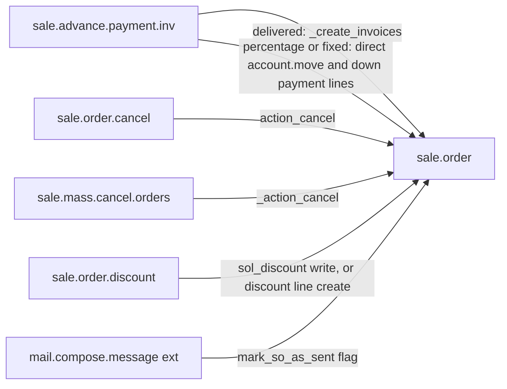

# C4 Code Level: addons/sale/wizard

<!--
  Auto-generated by the c4-code agent. One file per source directory.
  Refreshed on /bmb:c4 reruns whenever the directory's content hash changes.
  Do NOT hand-edit; edits will be overwritten on next refresh.

  Linking conventions (MAINTAIN ON EVERY REWRITE):
  - This doc lives at memory-bank/c4/code/c4-code-<sanitized>.md (3 dirs below
    repo root). Use `../../../` to reach repo root for source-file links.
  - File:line references MUST be rendered as clickable markdown links of the
    form: [`<file>:<line>`](../../../<dir>/<file>#L<line>).
  - Directory paths under Overview → Location MUST be rendered as a markdown
    link to the directory itself: [`path/to/dir/`](../../../path/to/dir).
  - Internal-dependency directory names SHOULD be linked to their c4-code
    sibling doc when one exists in `memory-bank/c4/code/`, otherwise to the
    directory in the source tree.
  - The "Parent Component" up-link section near the bottom is filled by the
    c4-backlink agent; the AUTO-MANAGED markers below MUST be preserved
    verbatim so the back-link pass can find and populate them.
-->

## Generated By

- **Agent**: c4-code (Haiku)
- **Run ID**: c4-20261101-s4l3
- **Generated**: 2026-11-01T11:22:58Z
- **Source Directory**: [`addons/sale/wizard`](../../../addons/sale/wizard)
- **Content Hash**: b317ea138901ab00

## Overview

- **Name**: Sale wizards (TransientModel dialogs and sale-related extensions)
- **Description**: Transient Odoo wizard models and their form/action XML that let users invoice, cancel, discount, and payment-link sale orders, plus small extensions of mail, payment, base layout and settings models for the sale app.
- **Location**: [`addons/sale/wizard`](../../../addons/sale/wizard) — 17 files, 1352 lines (10 Python, 7 XML)
- **Language**: Python 3.12 (Odoo 18.0 ORM), XML (Odoo views and actions)
- **Purpose**: Provides the user-facing dialogs that drive sale.order state changes and invoice creation without a dedicated controller. Transient models are not persistent domain entities; they hold dialog input and are auto-vacuumed by the framework. Persistent state changes happen by calling sale.order and sale.order.line methods (see Wizard Effects on sale.order below).

## Code Elements

### Functions / Methods

Public and action methods are listed. Private compute/onchange/prepare helpers are grouped at the end of each class block.

**`SaleAdvancePaymentInv`** (`sale.advance.payment.inv`)

- `create_invoices(self) → action` — validates down payment amount, creates invoices, returns the sale.order invoice action
  - **Description**: Entry point of the "Create invoice(s)" dialog.
  - **Location**: [`sale_make_invoice_advance.py:134`](../../../addons/sale/wizard/sale_make_invoice_advance.py#L134)
  - **Visibility**: public (button `create_invoices` in [`sale_make_invoice_advance_views.xml:56`](../../../addons/sale/wizard/sale_make_invoice_advance_views.xml#L56))
  - **Dependencies**: `_check_amount_is_positive`, `_create_invoices`, `sale.order.action_view_invoice`

- `view_draft_invoices(self) → action` — opens draft `account.move` records linked to the selected orders
  - **Description**: Window action on draft invoices (link in the warning alert).
  - **Location**: [`sale_make_invoice_advance.py:139`](../../../addons/sale/wizard/sale_make_invoice_advance.py#L139)
  - **Visibility**: public (object button in [`sale_make_invoice_advance_views.xml:12`](../../../addons/sale/wizard/sale_make_invoice_advance_views.xml#L12))
  - **Dependencies**: `account.move` (domain on `line_ids.sale_line_ids.order_id`, `state = draft`)

- `_create_invoices(self, sale_orders) → account.move | sale.order._create_invoices result` — branches on `advance_payment_method`
  - **Description**: `delivered` delegates to `sale.order._create_invoices`; `percentage` and `fixed` build down payment lines and a draft invoice directly.
  - **Location**: [`sale_make_invoice_advance.py:151`](../../../addons/sale/wizard/sale_make_invoice_advance.py#L151)
  - **Visibility**: internal (`_` prefix)
  - **Dependencies**: `sale.order._create_invoices` (line [154](../../../addons/sale/wizard/sale_make_invoice_advance.py#L154)), `account.move` sudo create (line [170](../../../addons/sale/wizard/sale_make_invoice_advance.py#L170)), `mail.message_origin_link`, `Command`, `formatLang`

- `_check_amount_is_positive(self) → None` — raises `UserError` when the down payment value is not positive
  - **Location**: [`sale_make_invoice_advance.py:125`](../../../addons/sale/wizard/sale_make_invoice_advance.py#L125)
  - **Visibility**: internal

- `_prepare_down_payment_section_values(self, order) → dict` — values for a `line_section` down payment header
  - **Location**: [`sale_make_invoice_advance.py:224`](../../../addons/sale/wizard/sale_make_invoice_advance.py#L224)
  - **Visibility**: internal

- `_prepare_down_payment_lines_values(self, order) → (list, list)` — one down payment line per tax and account grouping, price rounded by ratio
  - **Location**: [`sale_make_invoice_advance.py:233`](../../../addons/sale/wizard/sale_make_invoice_advance.py#L233)
  - **Visibility**: internal
  - **Dependencies**: `account.tax._add_tax_details_in_base_line`, `product.template.get_product_accounts`, `Command`, `frozendict`

- `_prepare_base_downpayment_line_values(self, order) → dict` — base values for down payment `sale.order.line`
  - **Location**: [`sale_make_invoice_advance.py:306`](../../../addons/sale/wizard/sale_make_invoice_advance.py#L306)
  - **Visibility**: internal

- `_prepare_invoice_values(self, order, so_lines, accounts) → dict` — merges `order._prepare_invoice()` with down payment invoice lines
  - **Location**: [`sale_make_invoice_advance.py:316`](../../../addons/sale/wizard/sale_make_invoice_advance.py#L316)
  - **Visibility**: internal

- `_get_down_payment_description(self, order) → str` — "Down payment of N%" or "Down Payment" (translated)
  - **Location**: [`sale_make_invoice_advance.py:329`](../../../addons/sale/wizard/sale_make_invoice_advance.py#L329)
  - **Visibility**: internal

- `_compute_count`, `_compute_has_down_payments`, `_compute_currency_id`, `_compute_company_id`, `_compute_display_invoice_amount_warning`, `_compute_display_draft_invoice_warning`, `_compute_invoice_amounts` — display and default helpers
  - **Location**: [`sale_make_invoice_advance.py:67`](../../../addons/sale/wizard/sale_make_invoice_advance.py#L67) to [`:113`](../../../addons/sale/wizard/sale_make_invoice_advance.py#L113)
  - **Visibility**: internal (computed fields)

- `_onchange_advance_payment_method(self) → dict` — fills default `amount` when method is `percentage`
  - **Location**: [`sale_make_invoice_advance.py:118`](../../../addons/sale/wizard/sale_make_invoice_advance.py#L118)
  - **Visibility**: internal (onchange)

**`SaleOrderCancel`** (`sale.order.cancel`)

- `action_send_mail_and_cancel(self) → action` — posts the composed email on the order, then cancels
  - **Location**: [`sale_order_cancel.py:74`](../../../addons/sale/wizard/sale_order_cancel.py#L74)
  - **Visibility**: public (button in [`sale_order_cancel_views.xml:39`](../../../addons/sale/wizard/sale_order_cancel_views.xml#L39))
  - **Dependencies**: `sale.order.message_post`, `action_cancel`

- `action_cancel(self) → action` — cancels the order with `disable_cancel_warning=True` context
  - **Location**: [`sale_order_cancel.py:86`](../../../addons/sale/wizard/sale_order_cancel.py#L86)
  - **Visibility**: public (button in [`sale_order_cancel_views.xml:43`](../../../addons/sale/wizard/sale_order_cancel_views.xml#L43))
  - **Dependencies**: `sale.order.action_cancel`

- `_compute_recipient_ids`, `_compute_display_invoice_alert`, `_compute_subject`, `_compute_body` — recipient defaults, draft-invoice alert flag, template rendering
  - **Location**: [`sale_order_cancel.py:40`](../../../addons/sale/wizard/sale_order_cancel.py#L40) to [`:72`](../../../addons/sale/wizard/sale_order_cancel.py#L72)
  - **Visibility**: internal (computed fields)
  - **Dependencies**: `mail.composer.mixin`, `template_id._render_field`

- `_default_author_id(self) → res.partner` — current user partner
  - **Location**: [`sale_order_cancel.py:13`](../../../addons/sale/wizard/sale_order_cancel.py#L13)
  - **Visibility**: internal (default)

**`MassCancelOrders`** (`sale.mass.cancel.orders`)

- `action_mass_cancel(self) → None` — cancels every selected order through the private `_action_cancel`
  - **Location**: [`mass_cancel_orders.py:31`](../../../addons/sale/wizard/mass_cancel_orders.py#L31)
  - **Visibility**: public (button in [`mass_cancel_orders_views.xml:27`](../../../addons/sale/wizard/mass_cancel_orders_views.xml#L27))
  - **Dependencies**: `sale.order._action_cancel`

- `_compute_sale_orders_count`, `_compute_has_confirmed_order` — counts and confirmed-order warning flag
  - **Location**: [`mass_cancel_orders.py:19`](../../../addons/sale/wizard/mass_cancel_orders.py#L19) to [`:29`](../../../addons/sale/wizard/mass_cancel_orders.py#L29)
  - **Visibility**: internal (computed fields)

**`SaleOrderDiscount`** (`sale.order.discount`)

- `action_apply_discount(self) → None` — per-line discount write or discount line creation
  - **Location**: [`sale_order_discount.py:169`](../../../addons/sale/wizard/sale_order_discount.py#L169)
  - **Visibility**: public (button in [`sale_order_discount_views.xml:33`](../../../addons/sale/wizard/sale_order_discount_views.xml#L33))
  - **Dependencies**: `sale.order.line.write`, `_create_discount_lines`

- `_create_discount_lines(self) → sale.order.line recordset | None` — builds one or more discount lines grouped by tax set
  - **Location**: [`sale_order_discount.py:97`](../../../addons/sale/wizard/sale_order_discount.py#L97)
  - **Visibility**: internal
  - **Dependencies**: `sale.order.line.create` (line [167](../../../addons/sale/wizard/sale_order_discount.py#L167)), `decimal.precision`, `float_repr`, `defaultdict`

- `_get_discount_product(self) → product.product` — returns company discount product, creating it when the user has rights
  - **Location**: [`sale_order_discount.py:74`](../../../addons/sale/wizard/sale_order_discount.py#L74)
  - **Visibility**: internal
  - **Dependencies**: `res.company.sale_discount_product_id` write (line [85](../../../addons/sale/wizard/sale_order_discount.py#L85))

- `_prepare_discount_product_values(self) → dict`, `_prepare_discount_line_values(self, product, amount, taxes, description=None) → dict` — value builders (discount line `sequence` 999, `price_unit` negative)
  - **Location**: [`sale_order_discount.py:46`](../../../addons/sale/wizard/sale_order_discount.py#L46) and [`:57`](../../../addons/sale/wizard/sale_order_discount.py#L57)
  - **Visibility**: internal

- `_check_discount_amount(self) → None` — raises `ValidationError` when a percentage type exceeds 1.0
  - **Location**: [`sale_order_discount.py:37`](../../../addons/sale/wizard/sale_order_discount.py#L37)
  - **Visibility**: internal (constraint)

**`PaymentLinkWizard`** (extends `payment.link.wizard`)

- `_compute_confirmation_message(self) → None` — text saying whether the payment confirms the quotation
  - **Location**: [`payment_link_wizard.py:17`](../../../addons/sale/wizard/payment_link_wizard.py#L17)
  - **Visibility**: internal (computed field)
  - **Dependencies**: `sale.order` (sudo browse), `_get_prepayment_required_amount`, `amount_paid`

- `_compute_warning_message(self) → None` — adds "sale order has expired" warning
  - **Location**: [`payment_link_wizard.py:32`](../../../addons/sale/wizard/payment_link_wizard.py#L32)
  - **Visibility**: internal (override)

- `_prepare_query_params(self, *args) → dict` — adds `sale_order_id` to payment query for sale orders
  - **Location**: [`payment_link_wizard.py:39`](../../../addons/sale/wizard/payment_link_wizard.py#L39)
  - **Visibility**: internal (override)

**`MailComposer`** (extends `mail.compose.message`)

- `action_schedule_message(self, scheduled_date=False) → action` — forwards the `mark_so_as_sent` context into the scheduled send
  - **Location**: [`mail_compose_message.py:9`](../../../addons/sale/wizard/mail_compose_message.py#L9)
  - **Visibility**: public (override)

- `_prepare_mail_values_rendered(self, res_ids) → dict` — sets `mark_so_as_sent=True` on values for `sale.order` records
  - **Location**: [`mail_compose_message.py:15`](../../../addons/sale/wizard/mail_compose_message.py#L15)
  - **Visibility**: internal (override)

**`PaymentWizard`** (extends `payment.provider.onboarding.wizard`, `_name` `sale.payment.provider.onboarding.wizard`)

- `add_payment_methods(self) → action` — stores the chosen method on the company and enables portal confirmation flags
  - **Location**: [`payment_provider_onboarding_wizard.py:24`](../../../addons/sale/wizard/payment_provider_onboarding_wizard.py#L24)
  - **Visibility**: public (override)

- `_start_stripe_onboarding(self) → action` — sets the Sales menu as the start menu for the Stripe step
  - **Location**: [`payment_provider_onboarding_wizard.py:33`](../../../addons/sale/wizard/payment_provider_onboarding_wizard.py#L33)
  - **Visibility**: internal (override)

- `_get_default_payment_method(self) → str` — company default or `digital_signature`
  - **Location**: [`payment_provider_onboarding_wizard.py:14`](../../../addons/sale/wizard/payment_provider_onboarding_wizard.py#L14)
  - **Visibility**: internal

**`ResConfigSettings`** (extends `res.config.settings`)

- `set_values(self) → None` — disables `sale.automatic_invoice` when the default invoice policy is not `order`
  - **Location**: [`res_config_settings.py:119`](../../../addons/sale/wizard/res_config_settings.py#L119)
  - **Visibility**: public (override)

- `_onchange_quotation_validity_days`, `_onchange_prepayment_percent`, `_onchange_portal_confirmation_pay`, `_onchange_group_product_variant`, `_onchange_group_discount_per_so_line` — form-level value guards
  - **Location**: [`res_config_settings.py:83`](../../../addons/sale/wizard/res_config_settings.py#L83) to [`:115`](../../../addons/sale/wizard/res_config_settings.py#L115)
  - **Visibility**: internal (onchange)

**`BaseDocumentLayout`** (extends `base.document.layout`)

- `_get_preview_template(self) → str` — uses the sale quote layout preview when opened from a sale order
  - **Location**: [`base_document_layout.py:9`](../../../addons/sale/wizard/base_document_layout.py#L9)
  - **Visibility**: internal (override)

- `_get_render_information(self, styles) → dict` — injects the sale order as `doc` in the preview context
  - **Location**: [`base_document_layout.py:17`](../../../addons/sale/wizard/base_document_layout.py#L17)
  - **Visibility**: internal (override)

Private helpers not enumerated further: none beyond the lists above. The `__init__.py` file only imports modules.

### Classes / Modules

- **`SaleAdvancePaymentInv`** (`sale.advance.payment.inv`) — "Create invoice(s)" dialog for regular, percentage, or fixed down payment invoices
  - **Location**: [`sale_make_invoice_advance.py:9`](../../../addons/sale/wizard/sale_make_invoice_advance.py#L9)
  - **Methods**: `create_invoices(...)`, `view_draft_invoices(...)`, `_create_invoices(...)`, `_prepare_down_payment_lines_values(...)`, `_prepare_invoice_values(...)`, `_get_down_payment_description(...)`
  - **Implements / Extends**: `models.TransientModel`
  - **Dependencies**: `odoo.exceptions.UserError`, `odoo.fields.Command`, `odoo.tools.formatLang`, `odoo.tools.frozendict`, `sale.order`, `sale.order.line`, `account.move`

- **`SaleOrderCancel`** (`sale.order.cancel`) — cancel dialog with optional customer email
  - **Location**: [`sale_order_cancel.py:8`](../../../addons/sale/wizard/sale_order_cancel.py#L8)
  - **Methods**: `action_send_mail_and_cancel(...)`, `action_cancel(...)`
  - **Implements / Extends**: `models.TransientModel`, `mail.composer.mixin`
  - **Dependencies**: `sale.order`, `res.partner`, `mail` template rendering

- **`MassCancelOrders`** (`sale.mass.cancel.orders`) — list-view bulk cancel of quotations
  - **Location**: [`mass_cancel_orders.py:6`](../../../addons/sale/wizard/mass_cancel_orders.py#L6)
  - **Methods**: `action_mass_cancel(...)`
  - **Implements / Extends**: `models.TransientModel`
  - **Dependencies**: `sale.order`

- **`SaleOrderDiscount`** (`sale.order.discount`) — apply per-line or order-level discount
  - **Location**: [`sale_order_discount.py:10`](../../../addons/sale/wizard/sale_order_discount.py#L10)
  - **Methods**: `action_apply_discount(...)`, `_create_discount_lines(...)`, `_get_discount_product(...)`
  - **Implements / Extends**: `models.TransientModel`
  - **Dependencies**: `sale.order`, `sale.order.line`, `res.company`, `product.product`, `account.tax`, `decimal.precision`

- **`PaymentLinkWizard`** (`payment.link.wizard` extension) — payment link dialog for sale orders
  - **Location**: [`payment_link_wizard.py:10`](../../../addons/sale/wizard/payment_link_wizard.py#L10)
  - **Methods**: `_compute_confirmation_message(...)`, `_compute_warning_message(...)`, `_prepare_query_params(...)`
  - **Implements / Extends**: `payment.link.wizard`
  - **Dependencies**: `sale.order`, `werkzeug.urls` (imported at [line 4](../../../addons/sale/wizard/payment_link_wizard.py#L4)), `format_amount`

- **`MailComposer`** (`mail.compose.message` extension) — scheduled-send support for `mark_so_as_sent`
  - **Location**: [`mail_compose_message.py:6`](../../../addons/sale/wizard/mail_compose_message.py#L6)
  - **Methods**: `action_schedule_message(...)`, `_prepare_mail_values_rendered(...)`
  - **Implements / Extends**: `mail.compose.message`

- **`PaymentWizard`** (`sale.payment.provider.onboarding.wizard`, extends `payment.provider.onboarding.wizard`) — sale quotation onboarding for payment providers
  - **Location**: [`payment_provider_onboarding_wizard.py:7`](../../../addons/sale/wizard/payment_provider_onboarding_wizard.py#L7)
  - **Methods**: `add_payment_methods(...)`, `_start_stripe_onboarding(...)`, `_get_default_payment_method(...)`
  - **Implements / Extends**: `payment.provider.onboarding.wizard`
  - **Dependencies**: `res.company` (sale onboarding fields)

- **`ResConfigSettings`** (`res.config.settings` extension) — Sales settings page fields and guards
  - **Location**: [`res_config_settings.py:6`](../../../addons/sale/wizard/res_config_settings.py#L6)
  - **Methods**: `set_values(...)`, plus the `_onchange_*` guards listed above
  - **Implements / Extends**: `res.config.settings`
  - **Dependencies**: `res.company` related fields, `ir.config_parameter`

- **`BaseDocumentLayout`** (`base.document.layout` extension) — sale order preview in the document layout wizard
  - **Location**: [`base_document_layout.py:6`](../../../addons/sale/wizard/base_document_layout.py#L6)
  - **Methods**: `_get_preview_template(...)`, `_get_render_information(...)`
  - **Implements / Extends**: `base.document.layout`

### Constants / Configuration

- `(none)` — no module-level constants or business-rule configuration values. The only literal business thresholds are inline: discount percentage upper bound `1.0` ([`sale_order_discount.py:42`](../../../addons/sale/wizard/sale_order_discount.py#L42)), discount line `sequence` `999` ([`sale_order_discount.py:63`](../../../addons/sale/wizard/sale_order_discount.py#L63)), and the confirmed order states `('sale', 'done')` ([`mass_cancel_orders.py:28`](../../../addons/sale/wizard/mass_cancel_orders.py#L28)).

## Wizard Effects on sale.order

Each row states what a wizard does to sale.order state and invoices. "Outside this dir" means the callee is defined elsewhere; this directory only calls it.

| Wizard (model) | Trigger (UI) | Method(s) called | Effect on sale.order | Invoice creation | Evidence |
|---|---|---|---|---|---|
| `sale.advance.payment.inv` | "Create invoice(s)" list action, `create_invoices` button | `sale.order._create_invoices` (outside this dir) when `advance_payment_method = delivered` | No state write in this dir. Invoice creation is delegated. Result is opened via `action_view_invoice` (outside this dir). | Yes: regular invoice(s), grouped unless `consolidated_billing` | [`:134`](../../../addons/sale/wizard/sale_make_invoice_advance.py#L134), [`:154`](../../../addons/sale/wizard/sale_make_invoice_advance.py#L154) |
| `sale.advance.payment.inv` (down payment) | same dialog, `percentage` or `fixed` | Creates `line_section` and down payment `sale.order.line` records directly; creates `account.move` with sudo | No state write in this dir. Adds down payment lines to the order and posts chatter notes on the order and invoice. | Yes: draft down payment invoice built directly, bypassing `sale.order._create_invoices` | [`:156-222`](../../../addons/sale/wizard/sale_make_invoice_advance.py#L156) |
| `sale.advance.payment.inv` (draft check) | Warning alert and `view_draft_invoices` link | Read-only `account.move` search | None | None | [`:103-107`](../../../addons/sale/wizard/sale_make_invoice_advance.py#L103), [`:139`](../../../addons/sale/wizard/sale_make_invoice_advance.py#L139) |
| `sale.order.cancel` | "Send and cancel" / "Cancel" buttons | `sale.order.message_post` then `sale.order.action_cancel` (outside this dir) with `disable_cancel_warning=True` | Transitions order to cancel through the public `action_cancel`. Posts an email on the order first when sending. | Draft invoices are cancelled by `action_cancel` (outside this dir). The alert text states this. | [`:74-87`](../../../addons/sale/wizard/sale_order_cancel.py#L74), [`:47-52`](../../../addons/sale/wizard/sale_order_cancel.py#L47) |
| `sale.mass.cancel.orders` | Bulk "Cancel" from list view, `action_mass_cancel` | `sale.order._action_cancel` (outside this dir) on all selected orders | Transitions every selected order to cancel, including `sale` and `done` orders. Warning only; does not block. No `disable_cancel_warning` context is passed. | Not directly. Cancellation side effects are in `_action_cancel` (outside this dir). | [`:31-32`](../../../addons/sale/wizard/mass_cancel_orders.py#L31), [`:24-29`](../../../addons/sale/wizard/mass_cancel_orders.py#L24) |
| `sale.order.discount` | "Apply" button, `action_apply_discount` | `sale.order.line.write` (`sol_discount`) or `sale.order.line.create` (`so_discount`, `amount`) | No state write. `sol_discount` sets `discount` on existing lines. Other types add one or more negative-price discount lines. May create the company discount product. | None | [`:169-175`](../../../addons/sale/wizard/sale_order_discount.py#L169), [`:85`](../../../addons/sale/wizard/sale_order_discount.py#L85) |
| `payment.link.wizard` (sale ext.) | Binding action on sale.order form, "Generate a Payment Link" | Reads order state and prepayment amount (sudo) | None in this dir. Message says the payment will confirm a draft or sent quote when the threshold is met. Confirmation happens in the payment flow (outside this dir). | None | [`payment_link_wizard.py:17-30`](../../../addons/sale/wizard/payment_link_wizard.py#L17), [`payment_link_wizard_views.xml:4-12`](../../../addons/sale/wizard/payment_link_wizard_views.xml#L4) |
| `mail.compose.message` (sale ext.) | Scheduled send with `mark_so_as_sent` context | Sets `mark_so_as_sent` in scheduled mail values for `sale.order` | No state write here. The flag is consumed outside this dir when the scheduled mail is sent, to mark the quote as sent. | None | [`mail_compose_message.py:9-20`](../../../addons/sale/wizard/mail_compose_message.py#L9) |
| `sale.payment.provider.onboarding.wizard` | Payment onboarding panel | Writes `res.company` onboarding and portal confirmation flags | No direct sale.order write. Changes default confirmation mode (sign or pay) for later orders (outside this dir). | None | [`payment_provider_onboarding_wizard.py:24-31`](../../../addons/sale/wizard/payment_provider_onboarding_wizard.py#L24) |
| `res.config.settings` (sale ext.) | Sales settings save | `set_values` writes `sale.automatic_invoice = False` when policy is not `order` | No sale.order write. Affects future automatic invoicing (outside this dir). | None directly | [`res_config_settings.py:119-122`](../../../addons/sale/wizard/res_config_settings.py#L119) |
| `account.accrued.orders.wizard` (XML only) | Binding action on sale.order, restricted to `account.group_account_user` | Model is not defined in this dir | Unknown from this dir | Unknown from this dir | [`account_accrued_orders_wizard_views.xml:4-11`](../../../addons/sale/wizard/account_accrued_orders_wizard_views.xml#L4) |
| `base.document.layout` (sale ext.) | Document layout preview | Preview template and render context only | None | None | [`base_document_layout.py:9-24`](../../../addons/sale/wizard/base_document_layout.py#L9) |

The `sale.order.cancel` and `sale.order.discount` form views have no action record in this directory; their launch actions are defined outside it. The `sale.mass.cancel.orders` action is defined here ([`mass_cancel_orders_views.xml:36`](../../../addons/sale/wizard/mass_cancel_orders_views.xml#L36)).

## Entities

Not emitted. The directory's models are `TransientModel` dialogs (auto-vacuumed transient tables) and model extensions. None is a persistent domain entity, and none carries its own state field. Sale order state is owned by `addons/sale/models` (see Dependencies).

## Terms

<!--
  Auto-generated by the c4-code agent (Step 3.6). Raw term observations for
  this directory — no clustering, no canonicalization. The c4-component agent
  and c4-glossary-aggregator do the synthesis.

  Render only categories with at least one observation. Skip the whole
  `## Terms` section entirely when no terms are detected.

  The USER-MANAGED `term-exclusions` block at the END of this section
  captures directory-local terminology exclusions — terms that should NOT
  be merged with similar terms elsewhere (e.g., a local utility class with
  the same name as a domain entity).

  Markers MUST be preserved verbatim across rewrites.
-->

### Entities

| Term | Normalized | Singular | Stems | Frequency | First seen |
|---|---|---|---|---:|---|
| `SaleAdvancePaymentInv` | saleadvancepaymentinv | saleadvancepaymentinv | sale, advance, payment, inv | 1 | [`sale_make_invoice_advance.py:9`](../../../addons/sale/wizard/sale_make_invoice_advance.py#L9) |
| `SaleOrderCancel` | saleordercancel | saleordercancel | sale, order, cancel | 1 | [`sale_order_cancel.py:8`](../../../addons/sale/wizard/sale_order_cancel.py#L8) |
| `SaleOrderDiscount` | saleorderdiscount | saleorderdiscount | sale, order, discount | 1 | [`sale_order_discount.py:10`](../../../addons/sale/wizard/sale_order_discount.py#L10) |
| `MassCancelOrders` | masscancelorders | masscancelorder | mass, cancel, order | 1 | [`mass_cancel_orders.py:6`](../../../addons/sale/wizard/mass_cancel_orders.py#L6) |
| `PaymentLinkWizard` | paymentlinkwizard | paymentlinkwizard | payment, link | 1 | [`payment_link_wizard.py:10`](../../../addons/sale/wizard/payment_link_wizard.py#L10) |
| `MailComposer` | mailcomposer | mailcomposer | mail, compos | 1 | [`mail_compose_message.py:6`](../../../addons/sale/wizard/mail_compose_message.py#L6) |
| `PaymentWizard` | paymentwizard | paymentwizard | payment | 1 | [`payment_provider_onboarding_wizard.py:7`](../../../addons/sale/wizard/payment_provider_onboarding_wizard.py#L7) |
| `ResConfigSettings` | resconfigsettings | resconfigsetting | res, config, setting | 1 | [`res_config_settings.py:6`](../../../addons/sale/wizard/res_config_settings.py#L6) |
| `BaseDocumentLayout` | basedocumentlayout | basedocumentlayout | base, document, layout | 1 | [`base_document_layout.py:6`](../../../addons/sale/wizard/base_document_layout.py#L6) |

### Actions

| Term | Normalized | Stems | Frequency | First seen |
|---|---|---|---:|---|
| `create_invoices` | createinvoices | create, invoice | 2 | [`sale_make_invoice_advance.py:134`](../../../addons/sale/wizard/sale_make_invoice_advance.py#L134) |
| `_create_invoices` | createinvoices | create, invoice | 3 | [`sale_make_invoice_advance.py:151`](../../../addons/sale/wizard/sale_make_invoice_advance.py#L151) |
| `view_draft_invoices` | viewdraftinvoices | view, draft, invoice | 2 | [`sale_make_invoice_advance.py:139`](../../../addons/sale/wizard/sale_make_invoice_advance.py#L139) |
| `action_send_mail_and_cancel` | actionsendmailandcancel | action, send, mail, cancel | 2 | [`sale_order_cancel.py:74`](../../../addons/sale/wizard/sale_order_cancel.py#L74) |
| `action_cancel` | actioncancel | action, cancel | 4 | [`sale_order_cancel.py:86`](../../../addons/sale/wizard/sale_order_cancel.py#L86) |
| `action_mass_cancel` | actionmasscancel | action, mass, cancel | 2 | [`mass_cancel_orders.py:31`](../../../addons/sale/wizard/mass_cancel_orders.py#L31) |
| `action_apply_discount` | actionapplydiscount | action, apply, discount | 2 | [`sale_order_discount.py:169`](../../../addons/sale/wizard/sale_order_discount.py#L169) |
| `_create_discount_lines` | creatediscountlines | create, discount, line | 2 | [`sale_order_discount.py:97`](../../../addons/sale/wizard/sale_order_discount.py#L97) |
| `_get_discount_product` | getdiscountproduct | get, discount, product | 2 | [`sale_order_discount.py:74`](../../../addons/sale/wizard/sale_order_discount.py#L74) |
| `_prepare_discount_line_values` | preparediscountlinevalues | prepare, discount, line, value | 3 | [`sale_order_discount.py:57`](../../../addons/sale/wizard/sale_order_discount.py#L57) |
| `_prepare_down_payment_lines_values` | preparedownpaymentlinesvalues | prepare, down, payment, line, value | 2 | [`sale_make_invoice_advance.py:233`](../../../addons/sale/wizard/sale_make_invoice_advance.py#L233) |
| `_prepare_down_payment_section_values` | preparedownpaymentsectionvalues | prepare, down, payment, section, value | 2 | [`sale_make_invoice_advance.py:224`](../../../addons/sale/wizard/sale_make_invoice_advance.py#L224) |
| `_prepare_base_downpayment_line_values` | preparebasedownpaymentlinevalues | prepare, base, down, payment, line, value | 2 | [`sale_make_invoice_advance.py:306`](../../../addons/sale/wizard/sale_make_invoice_advance.py#L306) |
| `_prepare_invoice_values` | prepareinvoicevalues | prepare, invoice, value | 2 | [`sale_make_invoice_advance.py:316`](../../../addons/sale/wizard/sale_make_invoice_advance.py#L316) |
| `_get_down_payment_description` | getdownpaymentdescription | get, down, payment, description | 2 | [`sale_make_invoice_advance.py:329`](../../../addons/sale/wizard/sale_make_invoice_advance.py#L329) |
| `_check_amount_is_positive` | checkamountispositive | check, amount, positive | 2 | [`sale_make_invoice_advance.py:125`](../../../addons/sale/wizard/sale_make_invoice_advance.py#L125) |
| `add_payment_methods` | addpaymentmethods | add, payment, method | 2 | [`payment_provider_onboarding_wizard.py:24`](../../../addons/sale/wizard/payment_provider_onboarding_wizard.py#L24) |
| `action_schedule_message` | actionschedulemessage | action, schedule, message | 2 | [`mail_compose_message.py:9`](../../../addons/sale/wizard/mail_compose_message.py#L9) |
| `_prepare_mail_values_rendered` | preparemailvaluesrendered | prepare, mail, value, rendered | 2 | [`mail_compose_message.py:15`](../../../addons/sale/wizard/mail_compose_message.py#L15) |
| `_prepare_query_params` | preparequeryparams | prepare, query, param | 2 | [`payment_link_wizard.py:39`](../../../addons/sale/wizard/payment_link_wizard.py#L39) |

Computed-field and onchange hooks (`_compute_*`, `_onchange_*`, `_default_*`, `_get_default_payment_method`, `_get_render_information`, `_get_preview_template`, `_start_stripe_onboarding`, `set_values`, `_check_discount_amount`) are also present in the directory. Their names are ORM scaffolding; they are listed under Code Elements.

### Qualifiers

| Term | Normalized | Frequency | First seen |
|---|---|---:|---|
| `amount` (discount type) | amount | 9 | [`sale_order_discount.py:24`](../../../addons/sale/wizard/sale_order_discount.py#L24) |
| `fixed` (down payment method) | fixed | 8 | [`sale_make_invoice_advance.py:17`](../../../addons/sale/wizard/sale_make_invoice_advance.py#L17) |
| `percentage` (down payment method) | percentage | 6 | [`sale_make_invoice_advance.py:16`](../../../addons/sale/wizard/sale_make_invoice_advance.py#L16) |
| `delivered` (invoice method) | delivered | 3 | [`sale_make_invoice_advance.py:15`](../../../addons/sale/wizard/sale_make_invoice_advance.py#L15) |
| `sol_discount` | soldiscount | 4 | [`sale_order_discount.py:22`](../../../addons/sale/wizard/sale_order_discount.py#L22) |
| `so_discount` | sodiscount | 2 | [`sale_order_discount.py:23`](../../../addons/sale/wizard/sale_order_discount.py#L23) |
| `draft` (invoice state) | draft | 4 | [`sale_make_invoice_advance.py:107`](../../../addons/sale/wizard/sale_make_invoice_advance.py#L107) |
| `sale` (sale.order state) | sale | 2 | [`mass_cancel_orders.py:28`](../../../addons/sale/wizard/mass_cancel_orders.py#L28) |
| `done` (sale.order state) | done | 1 | [`mass_cancel_orders.py:28`](../../../addons/sale/wizard/mass_cancel_orders.py#L28) |
| `sent` (sale.order state) | sent | 1 | [`payment_link_wizard.py:22`](../../../addons/sale/wizard/payment_link_wizard.py#L22) |
| `is_downpayment` | isdownpayment | 5 | [`sale_make_invoice_advance.py:76`](../../../addons/sale/wizard/sale_make_invoice_advance.py#L76) |
| `has_down_payments` | hasdownpayments | 4 | [`sale_make_invoice_advance.py:29`](../../../addons/sale/wizard/sale_make_invoice_advance.py#L29) |
| `has_confirmed_order` | hasconfirmedorder | 4 | [`mass_cancel_orders.py:17`](../../../addons/sale/wizard/mass_cancel_orders.py#L17) |
| `consolidated_billing` | consolidatedbilling | 3 | [`sale_make_invoice_advance.py:60`](../../../addons/sale/wizard/sale_make_invoice_advance.py#L60) |
| `deduct_down_payments` | deductdownpayments | 2 | [`sale_make_invoice_advance.py:31`](../../../addons/sale/wizard/sale_make_invoice_advance.py#L31) |

Roles: none observed. Events: none observed (chatter `message_post` calls are not domain event emissions).

<!--
  USER-MANAGED term exclusions for this c4-code doc.

  Format (one per line):
    <term> → exclude (reason)

  Excluded terms are filtered out by the c4-component agent and
  c4-glossary-aggregator. Useful when a class/function name is purely
  technical (e.g., a local Cache helper) and should NOT be merged into
  the domain glossary.

  Markers MUST be preserved verbatim across rewrites.
-->

<!-- USER-MANAGED: term-exclusions -->
(none)
<!-- /USER-MANAGED: term-exclusions -->

## Source Files

- [`__init__.py`](../../../addons/sale/wizard/__init__.py)
- [`account_accrued_orders_wizard_views.xml`](../../../addons/sale/wizard/account_accrued_orders_wizard_views.xml)
- [`base_document_layout.py`](../../../addons/sale/wizard/base_document_layout.py)
- [`mail_compose_message.py`](../../../addons/sale/wizard/mail_compose_message.py)
- [`mass_cancel_orders.py`](../../../addons/sale/wizard/mass_cancel_orders.py)
- [`mass_cancel_orders_views.xml`](../../../addons/sale/wizard/mass_cancel_orders_views.xml)
- [`payment_link_wizard.py`](../../../addons/sale/wizard/payment_link_wizard.py)
- [`payment_link_wizard_views.xml`](../../../addons/sale/wizard/payment_link_wizard_views.xml)
- [`payment_provider_onboarding_wizard.py`](../../../addons/sale/wizard/payment_provider_onboarding_wizard.py)
- [`res_config_settings.py`](../../../addons/sale/wizard/res_config_settings.py)
- [`res_config_settings_views.xml`](../../../addons/sale/wizard/res_config_settings_views.xml)
- [`sale_make_invoice_advance.py`](../../../addons/sale/wizard/sale_make_invoice_advance.py)
- [`sale_make_invoice_advance_views.xml`](../../../addons/sale/wizard/sale_make_invoice_advance_views.xml)
- [`sale_order_cancel.py`](../../../addons/sale/wizard/sale_order_cancel.py)
- [`sale_order_cancel_views.xml`](../../../addons/sale/wizard/sale_order_cancel_views.xml)
- [`sale_order_discount.py`](../../../addons/sale/wizard/sale_order_discount.py)
- [`sale_order_discount_views.xml`](../../../addons/sale/wizard/sale_order_discount_views.xml)

## Dependencies

### Internal

- [`addons/sale/models`](../c4-code-addons-sale-models.md) — sale.order, sale.order.line, and res.company sale fields. Every wizard action calls members defined there (`_create_invoices`, `action_cancel`, `_action_cancel`, `action_view_invoice`, `_prepare_invoice`, `_get_prepayment_required_amount`, `amount_paid`, `is_expired`, `require_payment`, `sale_discount_product_id`). Those definitions live outside this directory; the link is unverified at this level.
- [`addons/account`](../../../addons/account) — `account.move` (created directly in the down payment path), `account.tax` (`_add_tax_details_in_base_line`), and the `account.accrued.orders.wizard` model referenced by XML only.
- [`addons/payment`](../../../addons/payment) — base models `payment.link.wizard` and `payment.provider.onboarding.wizard` that this directory extends.
- [`addons/mail`](../../../addons/mail) — `mail.compose.message` and `mail.composer.mixin` that this directory extends or inherits.
- [`addons/base`](../../../addons/base) — `base.document.layout`, `res.config.settings`, `res.company`, `res.partner`, `ir.config_parameter` used by the wizards.
- [`addons/product`](../../../addons/product) — `product.product` and `product.template` (`get_product_accounts`, `default_model`) used by the down payment and discount flows.

Circular imports: none. `__init__.py` imports only sibling modules in this directory (lines [4-12](../../../addons/sale/wizard/__init__.py#L4)).

### External

- `odoo` 18.0 — ORM, fields, API, exceptions, tools. Version from project context; not read from a manifest.
- `werkzeug` — `werkzeug.urls` import in [`payment_link_wizard.py:4`](../../../addons/sale/wizard/payment_link_wizard.py#L4). Version not read.
- Python stdlib `collections.defaultdict` — discount tax grouping in [`sale_order_discount.py:3`](../../../addons/sale/wizard/sale_order_discount.py#L3).

## Relationships

## Notes for Higher-Level Synthesis

- Belongs with the sale order lifecycle component (cancel, invoice, discount actions on sale.order). These wizards are the UI front for transitions whose logic lives in `addons/sale/models`, so they should not stand alone as a separate business component.
- Boundary code: each wizard is a user-facing dialog (form view plus action) and is the entry point for the sale order actions listed in the Wizard Effects table. Treat as UI boundary, not domain.
- Two cancel paths differ: `sale.order.cancel` calls the public `action_cancel` with `disable_cancel_warning`; `sale.mass.cancel.orders` calls the private `_action_cancel` and does not disable the warning. Synthesis should flag this as a behavioral difference.
- Extensions of `mail`, `payment`, `base` and `res.config.settings` (`base_document_layout.py`, `mail_compose_message.py`, `payment_link_wizard.py`, `payment_provider_onboarding_wizard.py`, `res_config_settings.py`) integrate sale with other platform modules. They belong with the integration or settings components, not the order wizards.
- Observations for review (not changed here): `delivered` invoices go through `sale.order._create_invoices`, but percentage and fixed down payments bypass it and create `account.move` with sudo. `res_config_settings.py:83` decorates a non-computed `_onchange_` method with `@api.depends`, so it has no effect. `sale_order_discount.py` concatenates title strings without a separator (`"Discount %(percent)s%%" "- On products..."`, [lines 155-157](../../../addons/sale/wizard/sale_order_discount.py#L155)). `sale_make_invoice_advance.py` help text joins `"invoicing,"` and `"according"` without a space ([lines 22-23](../../../addons/sale/wizard/sale_make_invoice_advance.py#L22)). `payment_link_wizard.py:35` browses `sale.order` without sudo, unlike line 21. `payment_provider_onboarding_wizard.py:28` checks `'other'`, which this directory does not add to `selection_add`.

## Parent Component

<!--
  AUTO-MANAGED by the c4-backlink agent. Do not hand-edit between markers —
  edits will be overwritten on the next /bmb:c4 run. This section provides
  the upward link to the component that owns this code directory, completing
  the two-way navigation across C4 layers.

  Source of truth: c4-manifest.md § Component-Level Entries
    (component-entries.constituent_code_docs).
-->

<!-- AUTO-MANAGED: parent-component -->

- **Component**: [`sale`](../components/c4-component-sale.md)
- **Container**: [`Odoo Application Server`](../containers/c4-container-odoo-application-server.md) — Compute
- **Context**: [`c4-context.md`](../c4-context.md)

<!-- /AUTO-MANAGED: parent-component -->
