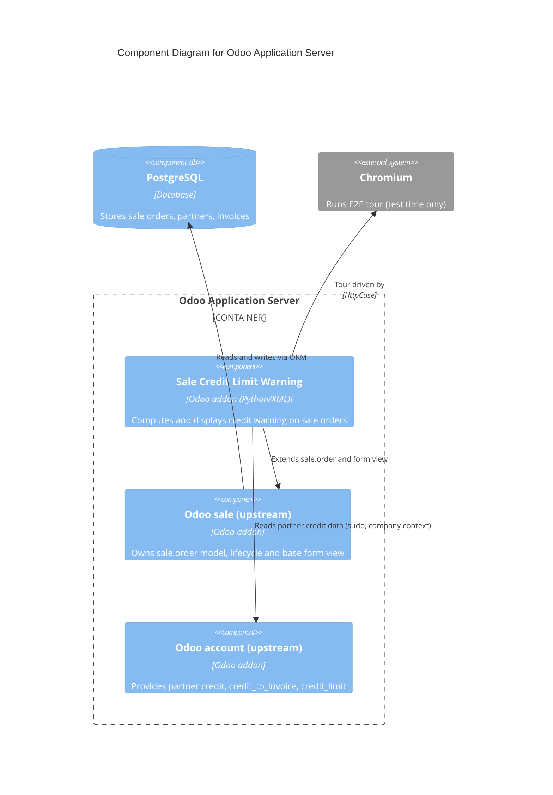

# C4 Component Level: Sale Credit Limit Warning

<!--
  Auto-generated by the c4-component agent. One file per logical component.
  Refreshed on /bmb:c4 reruns when constituent code docs change.
-->

## Generated By

- **Agent**: c4-component (Sonnet)
- **Run ID**: c4-20261031-k7m2
- **Generated**: 2026-10-31T12:00:00Z
- **Constituent Code Docs**: 5 files — see [Code Elements](#code-elements)

## Overview

- **Name**: Sale Credit Limit Warning
- **Description**: Odoo addon that warns salespeople on draft/sent sale orders when the customer's outstanding exposure approaches or exceeds its credit limit.
- **Type**: Domain Module (Odoo addon extending upstream `sale.order`)
- **Technology**: Python 3 (Odoo 18.0 ORM), Odoo XML views, JavaScript (Odoo web_tour, test-only)

## Purpose

Surfaces credit exposure at quotation time. It adds two computed, non-stored fields to `sale.order` and replaces the core single credit banner with level-specific (warning / danger) alerts in the order form. It does not own the sale order lifecycle, partner credit data, invoicing, or credit-limit configuration; those belong to upstream Odoo `sale` and `account`. It never blocks or mutates an order.

## Software Features

- **Credit warning level**: classifies a draft/sent order as `warning` (total reaches 80% of the limit, inclusive) or `danger` (total exceeds the limit).
- **Warning message**: builds a multi-line message with limit, outstanding receivables, this order and total after this order, rendered in the order's currency formatting.
- **Context-correct evaluation**: reads the limit in the order's company and company currency, and works for salespeople without accounting rights.
- **Level-specific banners**: hides the core `partner_credit_warning` banner and shows yellow or red alerts between the status bar and the form sheet, updating live on unsaved edits.
- **Silent degradation**: clears the banner when there is no partner, no limit, the setting is off, or the order is confirmed or cancelled.
- **Automated verification**: Python unit/integration tests plus a browser tour covering threshold transitions.

## Code Elements

This component is composed of the following code-level docs:

- [`../code/c4-code-custom_addons-sale_credit_limit_warning.md`](../code/c4-code-custom_addons-sale_credit_limit_warning.md) — addon package root and manifest (registration boundary; depends on `sale`, loads view, registers test-only tour assets)
- [`../code/c4-code-custom_addons-sale_credit_limit_warning-models.md`](../code/c4-code-custom_addons-sale_credit_limit_warning-models.md) — `sale.order` extension with `credit_warning_message`, `credit_warning_level` and `_compute_credit_warning`
- [`../code/c4-code-custom_addons-sale_credit_limit_warning-views.md`](../code/c4-code-custom_addons-sale_credit_limit_warning-views.md) — inherited `sale.view_order_form` with warning/danger alert blocks
- [`../code/c4-code-custom_addons-sale_credit_limit_warning-tests.md`](../code/c4-code-custom_addons-sale_credit_limit_warning-tests.md) — `TestCreditLimitWarning` (14 tests) and `TestCreditBannerE2E` (HttpCase)
- [`../code/c4-code-custom_addons-sale_credit_limit_warning-static-tests-tours.md`](../code/c4-code-custom_addons-sale_credit_limit_warning-static-tests-tours.md) — `credit_banner_happy` web tour (test-only JavaScript)

## Interfaces

### Sale Order Credit Warning Fields

- **Protocol**: In-Process Function (Odoo ORM computed fields; also reachable through Odoo's standard RPC field reads)
- **Description**: Computed, non-stored fields on `sale.order`, recomputed on dependency change including unsaved (`new`) records.
- **Operations**:
  - `credit_warning_level` (`fields.Selection`: `warning` | `danger`) → level, falsy when no warning
  - `credit_warning_message` (`fields.Text`) → multi-line explanatory text, empty when no warning
  - `_compute_credit_warning() → None` — internal compute method (not a public entry point)
- **Contract**: in-process; see [`sale_order.py`](../../../custom_addons/sale_credit_limit_warning/models/sale_order.py). Threshold constant `CREDIT_WARNING_THRESHOLD = 0.8`.

### Sale Order Form Banner

- **Protocol**: In-Process Function (Odoo view inheritance, rendered by the web client)
- **Description**: UI surface of the feature: view `view_order_form_credit_limit_warning` inherits `sale.view_order_form`.
- **Operations**:
  - warning alert shown when `credit_warning_level == 'warning'`
  - danger alert shown when `credit_warning_level == 'danger'`
- **Contract**: [`sale_order_views.xml`](../../../custom_addons/sale_credit_limit_warning/views/sale_order_views.xml)

### Addon Manifest

- **Protocol**: In-Process Function (Odoo module loader)
- **Description**: Registers the addon: `depends: ['sale']`, `data: views/sale_order_views.xml`, `web.assets_tests` tour glob, `auto_install: False`.
- **Operations**: none (declarative)
- **Contract**: [`__manifest__.py`](../../../custom_addons/sale_credit_limit_warning/__manifest__.py)

## Dependencies

### Components Used (in-process or in-system)

- No other custom_addons components were identified in the constituent code docs. Cross-component refs verified by master-index pass.

### External Systems

- **Odoo `sale` addon (upstream platform, `addons/sale`)** — extended via `_inherit = 'sale.order'`; form view `sale.view_order_form` inherited; reads `state` (draft/sent) without mutating it; test base `TestSaleCommon`.
- **Odoo accounting data (upstream, via `res.partner`)** — reads `credit`, `credit_to_invoice`, `credit_limit` with `sudo()` and company context, plus the company credit-limit setting (`account_use_credit_limit`) and `res.currency.compare_amounts`.
- **Odoo framework (`odoo` 18.0)** — ORM (`api.depends`, `depends_context`), `formatLang`, test framework (`Form`, `tagged`, `HttpCase`), `web_tour` runner and `@web/core/registry`.
- **PostgreSQL** — indirect, via the Odoo ORM; the addon declares no stored columns or tables.
- **Chromium** — browser runtime for the E2E tour (test time only).
- **lxml** — view-arch parsing in tests.

## Component Diagram

## Notes for Higher-Level Synthesis

- **Likely deployment**: the single Odoo application server container (Dockerfile + docker-compose.yml service), backed by PostgreSQL. The addon is loaded in-process; it is not a separately deployable unit. Opt-in install (`auto_install: False`). Tests and tour assets ship in the test bundle only.
- **Cross-container traffic**: none. Database access is indirect through the ORM.
- **Platform note**: manifest `version: 18.0.1.0.0` and `odoo/release.py` agree on Odoo 18.0.
- **Upstream lifecycle**: the addon only reads `sale.order.state`; no state mutation or lifecycle signals were recorded in any constituent code doc, so no Entity Lifecycles section is emitted. Upstream Odoo `sale` owns the `sale.order` lifecycle.
- **Test coupling**: the tour's expected figures depend on fixtures created by `tests/test_credit_banner_e2e.py`.

## Glossary (Bounded Context)

### Entities

| Local canonical | Variants observed | Definition | Constituent code docs |
|---|---|---|---|
| `SaleOrder` | `SaleOrder` | [not described — derived from models doc] | [`code/c4-code-custom_addons-sale_credit_limit_warning-models`](../code/c4-code-custom_addons-sale_credit_limit_warning-models.md) |

### Actions

| Local canonical | Variants observed | Definition | Constituent code docs |
|---|---|---|---|
| `_quote` | `_quote` | [not described — derived from tests doc] | [`code/c4-code-custom_addons-sale_credit_limit_warning-tests`](../code/c4-code-custom_addons-sale_credit_limit_warning-tests.md) |
| `_post_invoice` | `_post_invoice` | [not described — derived from tests doc] | [`code/c4-code-custom_addons-sale_credit_limit_warning-tests`](../code/c4-code-custom_addons-sale_credit_limit_warning-tests.md) |
| `_lines` | `_lines`, `_line` | [not described — derived from tests doc] | [`code/c4-code-custom_addons-sale_credit_limit_warning-tests`](../code/c4-code-custom_addons-sale_credit_limit_warning-tests.md) |
| `_form_arch` | `_form_arch` | [not described — derived from tests doc] | [`code/c4-code-custom_addons-sale_credit_limit_warning-tests`](../code/c4-code-custom_addons-sale_credit_limit_warning-tests.md) |
| `_compute_credit_warning` | `_compute_credit_warning` | Compute warning level and message for draft/sent orders from partner exposure vs credit limit | [`code/c4-code-custom_addons-sale_credit_limit_warning-models`](../code/c4-code-custom_addons-sale_credit_limit_warning-models.md) |
| `assertBanner` | `assertBanner`, `assertNoBanner` | [not described — derived from static-tests-tours doc] | [`code/c4-code-custom_addons-sale_credit_limit_warning-static-tests-tours`](../code/c4-code-custom_addons-sale_credit_limit_warning-static-tests-tours.md) |
| `setQuantity` | `setQuantity` | [not described — derived from static-tests-tours doc] | [`code/c4-code-custom_addons-sale_credit_limit_warning-static-tests-tours`](../code/c4-code-custom_addons-sale_credit_limit_warning-static-tests-tours.md) |
| `visibleBanners` | `visibleBanners` | [not described — derived from static-tests-tours doc] | [`code/c4-code-custom_addons-sale_credit_limit_warning-static-tests-tours`](../code/c4-code-custom_addons-sale_credit_limit_warning-static-tests-tours.md) |
| `numbers` | `numbers` | [not described — derived from static-tests-tours doc] | [`code/c4-code-custom_addons-sale_credit_limit_warning-static-tests-tours`](../code/c4-code-custom_addons-sale_credit_limit_warning-static-tests-tours.md) |

### Qualifiers

| Local canonical | Variants observed | Frequency | Constituent code docs |
|---|---|---:|---|
| `danger` | `danger` | 15 | [`code/c4-code-custom_addons-sale_credit_limit_warning-models`](../code/c4-code-custom_addons-sale_credit_limit_warning-models.md), [`code/c4-code-custom_addons-sale_credit_limit_warning-tests`](../code/c4-code-custom_addons-sale_credit_limit_warning-tests.md) |
| `warning` | `warning` | 9 | [`code/c4-code-custom_addons-sale_credit_limit_warning-models`](../code/c4-code-custom_addons-sale_credit_limit_warning-models.md), [`code/c4-code-custom_addons-sale_credit_limit_warning-tests`](../code/c4-code-custom_addons-sale_credit_limit_warning-tests.md) |

<!--
  USER-MANAGED bounded-context exclusivity for this component.

  Format (one block per excluded term):
    <term> = <definition for this component>
      do_not_merge_with: <other-component-name(s), or "system-wide">
      reason: <why this term is intentionally distinct here>

  When set, the c4-glossary-aggregator does NOT merge this term with
  same-stem terms in other components. The term remains component-bound
  in the system-wide c4-glossary.md § Bounded Contexts section.

  Markers MUST be preserved verbatim across rewrites.
-->

<!-- USER-MANAGED: bounded-context-exclusivity -->
(none — terms in this component will be merged into the system-wide glossary)
<!-- /USER-MANAGED: bounded-context-exclusivity -->

## Parent Container

<!--
  AUTO-MANAGED by the c4-backlink agent. Do not hand-edit between markers —
  edits will be overwritten on the next /bmb:c4 run. This section provides
  the upward link to the container(s) that deploy this component, completing
  the two-way navigation across C4 layers.

  Source of truth: c4-manifest.md § Container-Level Entries
    (container-entries.Components). A component MAY be deployed in multiple
    containers (libraries, shared modules); all are listed.
-->

<!-- AUTO-MANAGED: parent-container -->

- **Container**: [`Odoo Application Server`](../containers/c4-container-odoo-application-server.md) — Compute
- **Context**: [`../c4-context.md`](../c4-context.md)
- **Component Index**: [`../c4-component.md`](../c4-component.md)

<!-- /AUTO-MANAGED: parent-container -->
