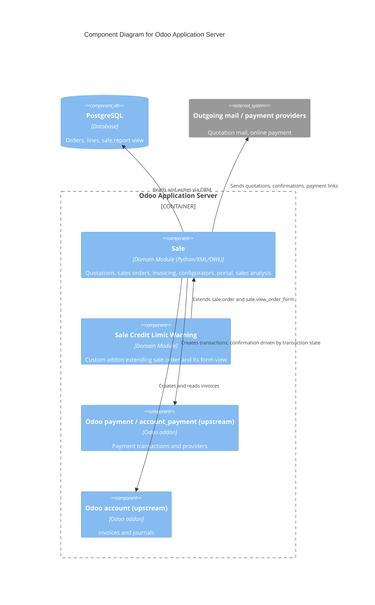

# C4 Component Level: Sale (Upstream Odoo Sales Addon)

<!--
  Auto-generated by the c4-component agent. One file per logical component.
  Refreshed on /bmb:c4 reruns when constituent code docs change.
-->

## Generated By

- **Agent**: c4-component (Sonnet)
- **Run ID**: c4-20261101-s4l3
- **Generated**: 2026-11-01T11:22:58Z
- **Constituent Code Docs**: 28 files — see [Code Elements](#code-elements)

## Overview

- **Name**: Sale (upstream Odoo 18.0 Sales addon, `addons/sale`)
- **Description**: Quotations and sales orders, order lines, invoicing from orders, product and combo configurators, customer portal (view, sign, pay), sales analysis reporting, and onboarding.
- **Type**: Domain Module
- **Technology**: Python (Odoo 18.0 ORM, HTTP/JSON controllers, TransientModel wizards, SQL-view reports); XML (views, actions, data, QWeb report and portal templates); JavaScript (OWL components, field widgets, web_tour tours and tests)

## Purpose

Owns the sales domain of the platform: the `sale.order` aggregate (draft, sent, sale, cancel) with its `sale.order.line` children, the actions that move an order through its lifecycle, and the invoicing, payment and portal flows that hang from it. It also extends models owned by other addons (account, payment, CRM, product, partner, company, UTM, mail) with sale-specific fields and behaviour. It does not own the chart of accounts, payment providers, product catalogue master data or the web client framework. The custom component `sale-credit-limit-warning` extends this component (see [`c4-component-sale-credit-limit-warning.md`](./c4-component-sale-credit-limit-warning.md)); this component has no dependency on it.

## Software Features

- **Quotation to order lifecycle**: create quotations, send them, confirm into sales orders, lock, cancel (single or mass) and reset to draft.
- **Order pricing and lines**: computed taxes, discounts, totals, section and note lines, down-payment lines, combo and optional products, order-level discount wizard.
- **Invoicing from orders**: invoice delivered or ordered quantities, percentage or fixed down payments, consolidated billing, optional automatic send-invoice cron.
- **Product and combo configurators**: server RPC plus OWL dialogs for choosing variants, no-variant attributes, optional products and combo items with live pricing.
- **Customer portal**: quotation and order lists, order page with report download, signature-based acceptance, decline, and online payment entry points (including down payment).
- **Sales analysis and documents**: `sale.report` SQL view with pivot/graph/list views, quotation/order and pro-forma QWeb reports, sales-team invoice analysis.
- **Security and onboarding**: salesman and manager access rows, record rules (own versus all orders), scheduled-message and mail templates, onboarding views and guided tour.

## Code Elements

This component is composed of the following code-level docs:

- [`../code/c4-code-addons-sale.md`](../code/c4-code-addons-sale.md) — module package root: manifest, post-init hook (cron sync, down-payment account default)
- [`../code/c4-code-addons-sale-controllers.md`](../code/c4-code-addons-sale-controllers.md) — portal, product-configurator and combo-configurator HTTP/JSON routes
- [`../code/c4-code-addons-sale-data.md`](../code/c4-code-addons-sale-data.md) — XML data: sequence, mail templates, subtypes, activity type, cron, config parameters, demo data
- [`../code/c4-code-addons-sale-models.md`](../code/c4-code-addons-sale-models.md) — `sale.order`, `sale.order.line` and `_inherit` extensions of account, payment, CRM, product, partner, company, UTM
- [`../code/c4-code-addons-sale-report.md`](../code/c4-code-addons-sale-report.md) — `sale.report` SQL view, invoice-report extension, QWeb quotation/order/pro-forma reports
- [`../code/c4-code-addons-sale-security.md`](../code/c4-code-addons-sale-security.md) — access rows, record rules, `res.groups` definitions
- [`../code/c4-code-addons-sale-static-src-js.md`](../code/c4-code-addons-sale-static-src-js.md) — top-level frontend JS: field widgets, public widgets, combo and line helpers
- [`../code/c4-code-addons-sale-static-src-js-badge_extra_price.md`](../code/c4-code-addons-sale-static-src-js-badge_extra_price.md) — extra-price badge OWL component
- [`../code/c4-code-addons-sale-static-src-js-combo_configurator_dialog.md`](../code/c4-code-addons-sale-static-src-js-combo_configurator_dialog.md) — combo configurator dialog
- [`../code/c4-code-addons-sale-static-src-js-models.md`](../code/c4-code-addons-sale-static-src-js-models.md) — client-side combo, product and PTAL/PTAV model classes
- [`../code/c4-code-addons-sale-static-src-js-product.md`](../code/c4-code-addons-sale-static-src-js-product.md) — configurator product row component
- [`../code/c4-code-addons-sale-static-src-js-product_card.md`](../code/c4-code-addons-sale-static-src-js-product_card.md) — selectable product card component
- [`../code/c4-code-addons-sale-static-src-js-product_configurator_dialog.md`](../code/c4-code-addons-sale-static-src-js-product_configurator_dialog.md) — product configurator dialog (attributes, optional products, quantities)
- [`../code/c4-code-addons-sale-static-src-js-product_list.md`](../code/c4-code-addons-sale-static-src-js-product_list.md) — product list/table component with total
- [`../code/c4-code-addons-sale-static-src-js-product_template_attribute_line.md`](../code/c4-code-addons-sale-static-src-js-product_template_attribute_line.md) — attribute-line component by display type
- [`../code/c4-code-addons-sale-static-src-js-quantity_buttons.md`](../code/c4-code-addons-sale-static-src-js-quantity_buttons.md) — quantity control widget
- [`../code/c4-code-addons-sale-static-src-js-sale_action_helper.md`](../code/c4-code-addons-sale-static-src-js-sale_action_helper.md) — no-content help panel with video preview
- [`../code/c4-code-addons-sale-static-src-js-sale_order_line_field.md`](../code/c4-code-addons-sale-static-src-js-sale_order_line_field.md) — `sol_o2m`, `sol_text`, `list.sol_text` order-line field widgets
- [`../code/c4-code-addons-sale-static-src-js-tours.md`](../code/c4-code-addons-sale-static-src-js-tours.md) — onboarding `sale_tour` and tour-step helpers
- [`../code/c4-code-addons-sale-static-src-views-sale_onboarding_kanban.md`](../code/c4-code-addons-sale-static-src-views-sale_onboarding_kanban.md) — `sale_onboarding_kanban` view registration
- [`../code/c4-code-addons-sale-static-src-views-sale_onboarding_list.md`](../code/c4-code-addons-sale-static-src-views-sale_onboarding_list.md) — `sale_onboarding_list` view registration
- [`../code/c4-code-addons-sale-static-src-xml.md`](../code/c4-code-addons-sale-static-src-xml.md) — QWeb templates for order-line product field and sales-team progress bar
- [`../code/c4-code-addons-sale-static-tests.md`](../code/c4-code-addons-sale-static-tests.md) — frontend JS unit tests
- [`../code/c4-code-addons-sale-static-tests-mock_server-mock_models.md`](../code/c4-code-addons-sale-static-tests-mock_server-mock_models.md) — mock-server model fixtures for frontend tests
- [`../code/c4-code-addons-sale-static-tests-tours.md`](../code/c4-code-addons-sale-static-tests-tours.md) — web_tour E2E scripts
- [`../code/c4-code-addons-sale-tests.md`](../code/c4-code-addons-sale-tests.md) — Python test suite (25 modules; also exports `TestSaleCommon` fixtures)
- [`../code/c4-code-addons-sale-views.md`](../code/c4-code-addons-sale-views.md) — XML views, actions, menus and portal QWeb templates
- [`../code/c4-code-addons-sale-wizard.md`](../code/c4-code-addons-sale-wizard.md) — invoice, cancel, discount, payment-link and related transient wizards

## Interfaces

### Sale Order Model API

- **Protocol**: In-Process Function (Odoo ORM)
- **Description**: Public and framework-visible methods on `sale.order` and `sale.order.line` used by wizards, controllers, payment processing, and dependent addons.
- **Operations**:
  - `action_quotation_sent() → bool` — draft to sent
  - `action_confirm() → bool` — draft/sent to sale; guarded by `_confirmation_error_message`
  - `action_cancel() → action | bool` — cancel (shows cancel wizard for non-draft); `_action_cancel()` is the private direct path
  - `action_draft()`, `action_lock()`, `action_unlock()` — reset and lock management
  - `_create_invoices(...)`, `action_view_invoice()` — invoice creation and navigation
  - `_validate_order()` — confirmation after signature or payment (called by controller and payment flow)
  - `_compute_partner_credit_warning`, `partner_credit_warning` — core credit banner (extended by the custom component)
- **Contract**: in-process; see [`sale_order.py`](../../../addons/sale/models/sale_order.py) and [`sale_order_line.py`](../../../addons/sale/models/sale_order_line.py)

### Customer Portal Routes

- **Protocol**: REST (HTTP and JSON-RPC via `odoo.http`)
- **Description**: Customer-facing quotation and order pages, acceptance, decline and payment.
- **Operations**:
  - `GET /my/quotes`, `/my/quotes/page/<n>` (auth user) — quotation list
  - `GET /my/orders`, `/my/orders/page/<n>` (auth user) — order list
  - `GET /my/orders/<id>` (auth public, access token) — order page, report download
  - `POST /my/orders/<id>/accept` (JSON, public) — signature acceptance, validates order if no payment required
  - `POST /my/orders/<id>/decline` (public) — cancels quotation with message
  - `GET /my/orders/<id>/document/<doc_id>` (public) — product document download
  - `POST /my/orders/<id>/transaction` (JSON, public) — create draft payment transaction
  - `payment_pay` override — order-aware payment route
- **Contract**: in-process route decorators in [`portal.py`](../../../addons/sale/controllers/portal.py); no OpenAPI

### Configurator RPC Routes

- **Protocol**: REST (JSON-RPC, `auth='user'`)
- **Description**: Data endpoints for the product and combo configurator dialogs.
- **Operations**:
  - `/sale/product_configurator/get_values` — main product and optional products with attributes, exclusions, prices
  - `/sale/product_configurator/create_product` — create variant for dynamic attributes
  - `/sale/product_configurator/update_combination` — price/name for a changed combination
  - `/sale/product_configurator/get_optional_products` — optional products for a parent combination
  - `/sale/combo_configurator/get_data` — combo, items and PTAL/PTAV data
  - `/sale/combo_configurator/get_price` — combo display price
- **Contract**: in-process; see [`product_configurator.py`](../../../addons/sale/controllers/product_configurator.py) and [`combo_configurator.py`](../../../addons/sale/controllers/combo_configurator.py)

### Wizard Actions

- **Protocol**: In-Process Function (TransientModel button actions, invoked from the web client)
- **Description**: User dialogs that drive order state changes and invoicing.
- **Operations**:
  - `sale.advance.payment.inv.create_invoices()` — invoice delivered, percentage or fixed down payment
  - `sale.order.cancel.action_cancel()` / `action_send_mail_and_cancel()` — cancel with optional mail
  - `sale.mass.cancel.orders.action_mass_cancel()` — cancel selected orders via `_action_cancel`
  - `sale.order.discount.action_apply_discount()` — apply discount to lines or add discount lines
  - `payment.link.wizard` — generate payment link for an order
- **Contract**: in-process; see [`wizard/`](../../../addons/sale/wizard)

### Frontend Extension Points (Assets)

- **Protocol**: In-Process Function (OWL/JS registry entries bundled by the Odoo asset pipeline)
- **Description**: Registered field widgets (`sol_o2m`, `sol_text`, `list.sol_text`), views (`sale_onboarding_kanban`, `sale_onboarding_list`), configurator dialogs and the `sale_tour` tour.
- **Operations**:
  - Product and combo configurator dialogs — open from order-line field widgets, call the configurator RPC routes
- **Contract**: asset bundles declared in [`__manifest__.py`](../../../addons/sale/__manifest__.py)

### Sales Analysis Model

- **Protocol**: In-Process Function (read-only SQL view model)
- **Description**: `sale.report` aggregates order lines for pivot, graph and list analysis; `account.invoice.report` gains a sales team dimension.
- **Operations**:
  - `sale.report.action_open_order() → action` — open the underlying order
- **Contract**: [`sale_report.py`](../../../addons/sale/report/sale_report.py)

## Dependencies

### Components Used (in-process or in-system)

- **Odoo `sales_team`, `account_payment` (pulling `account`, `payment`, `portal`), `utm`** — manifest dependencies of this addon ([`c4-code-addons-sale.md`](../code/c4-code-addons-sale.md)); these are upstream addons and are not separately documented as components here. Cross-component refs verified by master-index pass.
- **Odoo `base`** — `WARNING_MESSAGE` / `WARNING_HELP` imports and core models. Cross-component refs verified by master-index pass.
- **Odoo `account`, `payment`, `crm`, `product`, `mail`, `analytic`, `portal`** — extended through `_inherit` and invoked from controllers and wizards (invoice creation, payment transactions, portal base controller).

### External Systems

- **PostgreSQL** — persistence for orders, lines and the `sale.report` SQL view via the ORM.
- **Payment providers (via `payment` addon)** — payment transactions linked to orders; transaction state drives confirmation and invoicing.
- **Outgoing mail (SMTP, via `mail` addon)** — confirmation and quotation mail templates, scheduled messages.
- **`odoo` 18.0 framework** — ORM, HTTP layer, asset pipeline. Python deps in constituent docs: `MarkupSafe`, `python-dateutil`.

## Entity Lifecycles

### `sale.order` — Sales Order

- **Ownership**: OWNS
- **ERD row**: [`sale.order`](../c4-entities.md#sale-order)
- **State field(s)**: `state`
- **State-machine framework**: `none` (plain `write` calls inside action methods)
- **Mutation sources** (constituent c4-code docs that contribute writes):
  - [`code/c4-code-addons-sale-models.md`](../code/c4-code-addons-sale-models.md) — 5 mutation sites
  - [`code/c4-code-addons-sale-wizard.md`](../code/c4-code-addons-sale-wizard.md) — 0 mutation sites (calls `action_cancel` / `_action_cancel`; invokes transitions, defines none)
  - [`code/c4-code-addons-sale-controllers.md`](../code/c4-code-addons-sale-controllers.md) — 0 mutation sites (calls `_validate_order` / `_action_cancel` from portal accept/decline)
- **Emitted events**: none (notifications go through `message_post` and mail templates, which are not named domain events)

**Transitions (axis: `state`)**:

| Current State | Event | Next State | Guard | Actor |
|---|---|---|---|---|
| `draft` | `action_quotation_sent` | `sent` | all orders must be `draft` | `action_quotation_sent` |
| `draft` | `message_post` with `mark_so_as_sent` | `sent` | order is `draft` | `message_post` |
| `draft`, `sent` | `action_confirm` | `sale` | `_confirmation_error_message` empty (state draft/sent; lines have products) | `action_confirm` |
| `draft`, `sent`, `sale` | `action_cancel` | `cancel` | order not locked | `_action_cancel` |
| `cancel`, `sent` | `action_draft` | `draft` | filtered to `cancel`/`sent`; confirmed `sale` cannot be reset | `action_draft` |

Notes on the table: the `message_post` row is a second `draft` to `sent` path ([`sale_order.py:1728`](../../../addons/sale/models/sale_order.py#L1728)). Payment processing also triggers `sent` and `sale` through `PaymentTransaction` in the same models doc. `locked` is a boolean flag, not a state axis; `invoice_status` is derived, not a lifecycle state. Ownership note: the wizard and controller docs record no reads-only block for this entity, so the claim follows the OWNS rule.

<!-- USER-MANAGED-START: lifecycle-notes-sale-order -->

**Notes (User-Managed)** — hand-authored notes preserved across regenerations. Record caveats, deferred decisions, ops history, "why is this CONTRIBUTES" rationale, etc. The slug `<entity-slug>` is the lowercased entity name with non-word chars replaced by hyphens.

(empty by default)

<!-- USER-MANAGED-END: lifecycle-notes-sale-order -->

<!--
  AUTO-MANAGED by the c4-component master-index pass. Do not hand-edit between
  markers — edits will be overwritten on the next /bmb:c4 run. Populated
  with the list of OTHER components that also write this entity's state plus
  a severity tag.

  Severity vocabulary:
    OK        — exactly one component writes; this component is the sole writer (or only reader)
    SHARED    — multiple components write, but at least one claims OWNS (typical for entities with explicit owner)
    CONFLICT  — multiple components claim OWNS, OR writers exist but no component claims OWNS

  Source of truth: c4-component master-index pass — builds an entity → writers
  map across all per-component docs and fills this block in each per-component
  doc.
-->

<!-- AUTO-MANAGED: cross-component-lifecycle-conflicts-sale-order -->

- **Severity**: OK
- **Other writers**: (none)
- **Other readers**: (none)
- **Notes**: Sole writer; no conflict. sale-credit-limit-warning reads `sale.order.state` but records no lifecycle section, so it is not counted as a claimant.

<!-- /AUTO-MANAGED: cross-component-lifecycle-conflicts-sale-order -->

## Glossary (Bounded Context)

<!--
  Auto-generated by the c4-component agent (Step 5.7). Condensed: clusters
  below are the domain-relevant terms observed across constituent docs.
  Private compute/prepare helpers and view-registration scaffolding are not
  enumerated; see the constituent code docs. Second-pass stoplist dropped 0
  terms; table-row guards rejected header and separator rows.
-->

### Entities

| Local canonical | Variants observed | Definition | Constituent code docs |
|---|---|---|---|
| `SaleOrder` | `SaleOrder` | Quotation and confirmed sales order header, owning its lines, invoices, transactions and pricing context | [`code/c4-code-addons-sale-models`](../code/c4-code-addons-sale-models.md) |
| `SaleOrderLine` | `SaleOrderLine` | One line of a sales order: product or service, section or note, or down-payment line | [`code/c4-code-addons-sale-models`](../code/c4-code-addons-sale-models.md) |
| `SaleReport` | `SaleReport` | Sales Analysis Report; read-only analytic view over sale order lines | [`code/c4-code-addons-sale-report`](../code/c4-code-addons-sale-report.md) |
| `ProductTemplateAttributeLine` | `ProductTemplateAttributeLine` | PTAL: a group of attribute values on a product template (client model and component) | [`code/c4-code-addons-sale-static-src-js-models`](../code/c4-code-addons-sale-static-src-js-models.md), [`code/c4-code-addons-sale-static-src-js-product_template_attribute_line`](../code/c4-code-addons-sale-static-src-js-product_template_attribute_line.md) |
| `ProductComboItem` | `ProductComboItem` | One selectable item within a product combo | [`code/c4-code-addons-sale-static-src-js-models`](../code/c4-code-addons-sale-static-src-js-models.md) |
| `CustomerPortal` | `CustomerPortal` | Portal controller for quotations and orders | [`code/c4-code-addons-sale-controllers`](../code/c4-code-addons-sale-controllers.md) |
| `SaleAdvancePaymentInv` | `SaleAdvancePaymentInv` | Create-invoice dialog (delivered, percentage, fixed down payment) | [`code/c4-code-addons-sale-wizard`](../code/c4-code-addons-sale-wizard.md) |
| `MassCancelOrders` | `MassCancelOrders` | Dialog that cancels several selected orders | [`code/c4-code-addons-sale-wizard`](../code/c4-code-addons-sale-wizard.md) |

### Actions

| Local canonical | Variants observed | Definition | Constituent code docs |
|---|---|---|---|
| `action_confirm` | `action_confirm` | Confirm a quotation into a sales order | [`code/c4-code-addons-sale-models`](../code/c4-code-addons-sale-models.md) |
| `action_cancel` | `action_cancel` | Cancel an order; also wizard method that calls it | [`code/c4-code-addons-sale-models`](../code/c4-code-addons-sale-models.md), [`code/c4-code-addons-sale-wizard`](../code/c4-code-addons-sale-wizard.md) |
| `action_quotation_sent` | `action_quotation_sent` | Mark a quotation as sent | [`code/c4-code-addons-sale-models`](../code/c4-code-addons-sale-models.md) |
| `action_draft` | `action_draft` | Reset a cancelled or sent order to draft | [`code/c4-code-addons-sale-models`](../code/c4-code-addons-sale-models.md) |
| `create_invoices` | `create_invoices`, `_create_invoices` | Create invoice(s) from orders | [`code/c4-code-addons-sale-wizard`](../code/c4-code-addons-sale-wizard.md) |
| `portal_quote_accept` | `portal_quote_accept` | Accept a quotation with a signature from the portal | [`code/c4-code-addons-sale-controllers`](../code/c4-code-addons-sale-controllers.md) |
| `portal_quote_decline` | `portal_quote_decline` | Decline a quotation from the portal | [`code/c4-code-addons-sale-controllers`](../code/c4-code-addons-sale-controllers.md) |
| `action_apply_discount` | `action_apply_discount` | Apply a discount to order lines or add discount lines | [`code/c4-code-addons-sale-wizard`](../code/c4-code-addons-sale-wizard.md) |

### Qualifiers

| Local canonical | Variants observed | Frequency | Constituent code docs |
|---|---|---:|---|
| `sale` | `sale` | 196 | [`code/c4-code-addons-sale-models`](../code/c4-code-addons-sale-models.md), [`code/c4-code-addons-sale-wizard`](../code/c4-code-addons-sale-wizard.md) |
| `draft` | `draft` | 47 | [`code/c4-code-addons-sale-models`](../code/c4-code-addons-sale-models.md), [`code/c4-code-addons-sale-wizard`](../code/c4-code-addons-sale-wizard.md) |
| `sent` | `sent` | 38 | [`code/c4-code-addons-sale-models`](../code/c4-code-addons-sale-models.md), [`code/c4-code-addons-sale-wizard`](../code/c4-code-addons-sale-wizard.md) |
| `cancel` | `cancel` | 30 | [`code/c4-code-addons-sale-models`](../code/c4-code-addons-sale-models.md) |
| `invoiced` | `invoiced` | 34 | [`code/c4-code-addons-sale-models`](../code/c4-code-addons-sale-models.md), [`code/c4-code-addons-sale-report`](../code/c4-code-addons-sale-report.md) |
| `upselling` | `upselling` | 14 | [`code/c4-code-addons-sale-models`](../code/c4-code-addons-sale-models.md), [`code/c4-code-addons-sale-report`](../code/c4-code-addons-sale-report.md) |
| `is_downpayment` | `is_downpayment` | 37 | [`code/c4-code-addons-sale-models`](../code/c4-code-addons-sale-models.md), [`code/c4-code-addons-sale-wizard`](../code/c4-code-addons-sale-wizard.md), [`code/c4-code-addons-sale-report`](../code/c4-code-addons-sale-report.md) |
| `is_configurable` | `is_configurable`, `is_configurable_product` | 9 | [`code/c4-code-addons-sale-controllers`](../code/c4-code-addons-sale-controllers.md), [`code/c4-code-addons-sale-static-src-js-models`](../code/c4-code-addons-sale-static-src-js-models.md), [`code/c4-code-addons-sale-models`](../code/c4-code-addons-sale-models.md) |
| `is_expired` | `is_expired` | 5 | [`code/c4-code-addons-sale-models`](../code/c4-code-addons-sale-models.md), [`code/c4-code-addons-sale-controllers`](../code/c4-code-addons-sale-controllers.md) |

### Roles

| Local canonical | Variants observed | Canonical persona? | Frequency | Constituent code docs |
|---|---|---|---:|---|
| `group_sale_salesman` | `group_sale_salesman` | no | 45 | [`code/c4-code-addons-sale-security`](../code/c4-code-addons-sale-security.md), [`code/c4-code-addons-sale-models`](../code/c4-code-addons-sale-models.md) |
| `group_sale_manager` | `group_sale_manager` | no | 22 | [`code/c4-code-addons-sale-security`](../code/c4-code-addons-sale-security.md) |
| `group_sale_salesman_all_leads` | `group_sale_salesman_all_leads` | no | 8 | [`code/c4-code-addons-sale-security`](../code/c4-code-addons-sale-security.md) |
| `group_auto_done_setting` | `group_auto_done_setting` | no | 1 | [`code/c4-code-addons-sale-models`](../code/c4-code-addons-sale-models.md) |

<!--
  USER-MANAGED bounded-context exclusivity for this component.

  Format (one block per excluded term):
    <term> = <definition for this component>
      do_not_merge_with: <other-component-name(s), or "system-wide">
      reason: <why this term is intentionally distinct here>

  When set, the c4-glossary-aggregator does NOT merge this term with
  same-stem terms in other components. The term remains component-bound
  in the system-wide c4-glossary.md § Bounded Contexts section.

  Markers MUST be preserved verbatim across rewrites.
-->

<!-- USER-MANAGED: bounded-context-exclusivity -->
(none — terms in this component will be merged into the system-wide glossary)
<!-- /USER-MANAGED: bounded-context-exclusivity -->

## Component Diagram

## Notes for Higher-Level Synthesis

<!--
  Hints the c4-container agent picks up when mapping this component to a container.
-->

- **Likely deployment**: Odoo Application Server container (Python models, controllers and OWL assets served by the same Odoo process; data in PostgreSQL). The `static/src` and `static/tests` code is delivered through the Odoo asset bundles of that same process.
- **Cross-container traffic**: ORM access to PostgreSQL; SMTP via the mail addon; payment-provider redirects and callbacks via the payment addon. The `custom_addons/sale_credit_limit_warning` component depends on this one (inbound edge, not outbound).
- **Credit-limit anchors for relationship checks**: `partner_credit_warning` / `_compute_partner_credit_warning` on `sale.order` and `AccountMove._compute_partner_credit` / `_get_partner_credit_warning_exclude_amount` in the models doc. The `sale-credit-limit-warning` doc records that it only reads `sale.order.state`, consistent with this component's OWNS claim.
- **Internal behaviour flag**: the two cancel paths differ (`sale.order.cancel` wizard calls public `action_cancel` with `disable_cancel_warning`; `sale.mass.cancel.orders` calls private `_action_cancel`).

## Parent Container

<!--
  AUTO-MANAGED by the c4-backlink agent. Do not hand-edit between markers —
  edits will be overwritten on the next /bmb:c4 run. This section provides
  the upward link to the container(s) that deploy this component, completing
  the two-way navigation across C4 layers.

  Source of truth: c4-manifest.md § Container-Level Entries
    (container-entries.Components). A component MAY be deployed in multiple
    containers (libraries, shared modules); all are listed.
-->

<!-- AUTO-MANAGED: parent-container -->

- **Container**: [`Odoo Application Server`](../containers/c4-container-odoo-application-server.md) — Compute
- **Context**: [`../c4-context.md`](../c4-context.md)
- **Component Index**: [`../c4-component.md`](../c4-component.md)

<!-- /AUTO-MANAGED: parent-container -->
